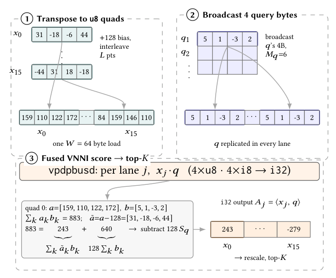

# PiPNN II：量化近邻图构建的打分与流式 top-K

> **L1 机制诊断，非性能复现。** 这里只实现已解码字节的打分与 top-K；完整 CPU/GPU 实验**成本过高，不复现（审查 DONE）**。

## 论文信息

| 字段 | 内容 |
| --- | --- |
| 论文 | [Turbocharging PiPNN for Proximity and k-NN Graph Building](https://arxiv.org/abs/2611.05690v1)；[固定 v1 正文](https://arxiv.org/html/2611.05690v1) |
| 公司 / 作者机构 | 一作 **Tobias Rubel**，University of Maryland, College Park。Guy Blelloch、Laxman Dhulipala 分别同时署名 CMU/UMD 与 Google Research；Lars Gottesbüren、Jakub Łącki、Vahab Mirrokni 署名 Google Research。Google 合作，不是一作单位。 |
| 原始发布日期 | **2026-11-03 22:20:36 UTC**，arXiv v1；见 2026-11-05 [cs.DB 公告](https://arxiv.org/list/cs.DB/recent?show=2000)。 |
| 原作者代码 | **尚未发布可核验源码。** [GINGER v1 §1](https://arxiv.org/html/2611.08306v1#S1) 将 [google/ginger](https://github.com/google/ginger) 指为 PiPNN II 官方实现；2026-11-07 核对[固定文件树](https://api.github.com/repos/google/ginger/git/trees/ce77e5faa3b0451b84908acf399e610f5349446b?recursive=1)，只有说明、许可证和贡献指南，未发布可执行 CPU 实现，也不能据此推断 GPiPNN 已公开。 |
| 本地 Adapter / key | `pipnn-ii`；`adapter: null`，仅 L1 组件，不接入 Evolve。 |
| 本地代码 | `src/auto_research/foundation_models/pipnn_ii.py` |

## 原始论文总结

### 背景与主要改动

PiPNN 先用递归分区把可能相近的点送入同一叶，再在叶内批量打分，避免逐点搜索正在构建的图。PiPNN II 用量化减少内存流量，把打分和 top-K 合并，避免先写再读完整距离矩阵。直接 k-NN 图保留叶内见到的近邻，和需要可导航边并执行剪枝的 ANNS 索引不是同一产物。论文另有 GPiPNN：平坦分段路由、分段 top-K、排序聚合及复用已见边的剪枝；这些未在本地实现。

<!-- paper-figure:start -->
### 原论文关键图

[](https://arxiv.org/pdf/2611.05690v1#page=5)

图片来自[原论文](https://arxiv.org/pdf/2611.05690v1#page=5) v1 第 5 页 Figure 2，按图边界栅格裁取、未重绘。版权归原作者所有，原文许可 CC BY 4.0。裁剪区域、尺寸与哈希见 `assets/provenance.json`。
<!-- paper-figure:end -->

### 核心公式

Section 4.1 / Algorithm 2 接收量化后解码的有符号数据库字节 $\tilde a_j$ 与有符号查询字节 $b_j$。VNNI 的数据库操作数需要无符号形式 $a_j=\tilde a_j+128$，因此同一查询的修正项可以复用：

$$
D=\sum_j a_j b_j-128\sum_j b_j=\sum_j\tilde a_j b_j,\qquad
d=-D\,\sigma_d\,\sigma_q .
$$

按缩放后的负点积 $d$ 取最小 K 个，不能先对整数点积取 K 再缩放。原图中一条 lane 的偏置点积为 883，查询字节和为 5，恢复有符号点积为 $883-640=243$。论文对 L2 还使用向量范数；本地只实现上述负点积切片。

### 论文离线与线上效果

论文 Section 6 报告 CPU 索引构建相对原 PiPNN 最多快 8 倍。直接 10-NN 图在 recall@10 至少 0.9 的条件下，CPU 与 GPU 各自相对最佳对照最多快 13 倍与 6.6 倍。这是作者的离线构建和检索评测，不是本地测量，未报告生产线上 A/B。

## 本地复现

### 数据协议与代码映射

`corrected_dot` 检查 i8 范围与维数并执行偏置修正。`fused_quantized_topk` 接收一个查询与流式 `(row, scale)` 序列，按行修正、缩放、保留 K 个最优候选；同分保留较早位置。参考实现使用 Python 整数累加和浮点缩放，未声称与硬件 i32/fp32 舍入逐位一致。没有引入量化器、索引或外部数据。

```bash
PYTHONPATH=src python -c 'from auto_research.foundation_models.pipnn_ii import diagnostic; print(diagnostic(42, "cpu"))'
PYTHONPATH=src python -m pytest tests/test_nov06_priority.py -q
```

### 结果、负控与边界

在小合成矩阵中，用直接 signed dot 加全量排序作独立参考，分别检查整数误差与排序一致；反例包含非零查询字节和、不同数据库行尺度和同分。输入只遍历一次，除当前行和查询外只保留 K 个候选。这些诊断不代表 TurboQuant 编解码、分区、Prune 或亿级构建/检索已经验证。

### 高成本完整实验

完整配置覆盖 12 个数据集，CPU 最大十亿点、GPU 最大一亿点。作者 CPU 机器为 192/288 vCPU 与 1.5/2.2 TB DRAM；GPU 构建核在单 H100 80 GB 的 Hopper SM90a 上运行。单 A100/A30 或 Mac 无法忠实重现这套性能和规模矩阵。**成本过高，不复现（审查 DONE）**；未下载向量集、运行 GPU 或外推耗时。这个 CPU 参考不需要 GPU 验收。
