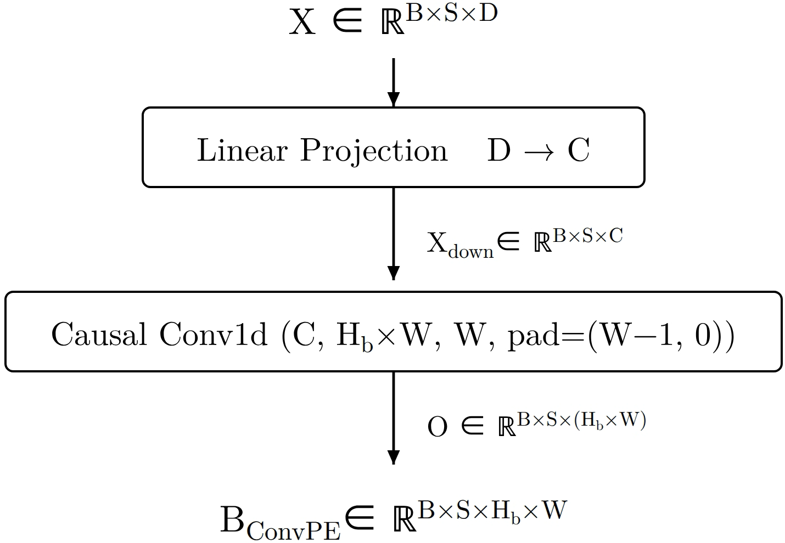

# ConvPE: content-dependent local positional bias for attention scores

<!-- source-sha256: cd9c6146ca9fd49eaedb1f3688ebaad076489228499ea79875da1590b68dced2 -->

[简体中文](README.md)

## Paper information

| Field | Value |
| --- | --- |
| Paper | [arXiv 2611.07749](https://arxiv.org/abs/2611.07749); [pinned v1 full text](https://arxiv.org/html/2611.07749v1) |
| Original title | ConvPE: Convolutional Position Embedding Improves Transformers |
| Company / institution | First author Zehao Wang: Nanjing University |
| Original publication | arXiv v1: 2026-11-05 09:55:15 UTC; announced on 2026-11-06 |
| Original author code | [wzhagi/convpe](https://github.com/wzhagi/convpe), public source verified at commit `e9775beb8185dbe7fab7e207e60e75c78e3fdd13`; no explicit code license found. Independently implemented from the equations |
| Local adapter / key | `convpe`; `adapter: null`, no Evolve integration |
| Local code | `src/auto_research/foundation_models/convpe.py` |
| Implementation status | `component_only`: 1-D positional bias, L1 diagnostic. CUDA status is established only by the actual batch receipt |
| Full experiment | Not reproduced because of excessive cost (review DONE); `not_reproduced_high_cost` |

## Original method

### Motivation and change

RoPE rotates queries and keys. ConvPE instead adds a term to the pre-softmax scores. It projects layer hidden states to a few channels, then learns relative-distance biases from the current and recent states. Each query receives a bias inside the window; **zero bias outside the window does not mask distant keys**. Causal and padding masks are still the attention layer's responsibility. The paper also studies grouped, low-rank and 2-D variants; this implementation is the default ungrouped, unfactorized 1-D form in Section 3.1.


<!-- paper-figure:start -->
### Original paper figure



The left panel of Figure 2 is from the [original paper](https://arxiv.org/html/2611.07749v1#S3.F2), converted from the author JPEG to PNG without cropping. Copyright remains with the author; the paper is CC BY 4.0. Source, checksums and visual review are in `assets/provenance.json`.
<!-- paper-figure:end -->

### Equations

Let $W$ be window size, $C$ projection dimension, $H_b$ the number of bias heads and $H$ the number of attention heads. Project $X_d=XW_p$, then use a width-$W$ Conv1d with $W-1$ positions of left padding to map $C$ channels to $H_bW$ outputs per query. Reshape to $U\in\mathbb R^{B\times S\times H_b\times W}$. The score mapping of Eqs. (2)-(4) is:

$$
b_{n,h,s,t}=
\begin{cases}
U_{n,s,h\bmod H_b,s-t}, & 0\le s-t<W,\\
0, & \text{otherwise}.
\end{cases}
$$

$H_b$ must divide $H$. For $H=4,H_b=2$, heads 0 and 2 share a bias, as do 1 and 3; adjacent pairs do not. There are $DC+CH_bW^2+H_bW$ parameters. The final term is the convolution bias, not a bias in the projection.

### Reported outcomes, not local results

In the 3B-token pretraining comparison in Section 4.3, mean loss over the last 0.1B tokens is 3.1195 with RoPE and 3.0316 with ConvPE; training time per step rises by roughly 6.5%. Table 1's mean accuracy over eight tasks goes from 43.72% to 44.75%. TruthfulQA-MC1 decreases, and both arms are below the paper's random baseline on that task. The language-model results use a single run, so small gaps do not establish across-seed stability. No production online A/B is reported. These are not locally measured model results.

## Local implementation

### Data protocol and code mapping

`ConvPEBias.compact_bias` consumes floating-point `[batch, query, model_dim]` and returns `[batch, query, bias_head, lag]`. Its `forward` maps those entries into a dense reference score matrix. It does not compute QK, masks or softmax. A decoding chunk needs the absolute `query_start` and the preceding `min(query_start, W-1)` **raw hidden states**, not projected KV. That history must not be reused across sequences.

```bash
PYTHONPATH=src python -m pytest tests/test_nov06_llm.py -q
PYTHONPATH=src python -c 'from auto_research.foundation_models.convpe import diagnostic; print(diagnostic(42, "cuda"))'
```

### Results, negative controls and boundaries

`diagnostic` compares tiny seeded tensors against independent per-tap summation and checks modulo head sharing, prefix invariance to future input, chunk equivalence and differentiability. CPU seeds 42/43/44 have formula error below $10^{-12}$; actual A100/A30 results are recorded only in the batch's GPU receipt. Hand-set kernels distinguish tap order, nonadjacent head sharing and zero bias outside the window. Tests reject incomplete decoding history. The dense reference does not reduce quadratic attention cost or establish throughput, extrapolation or capability gains.

### High-cost full experiment

Section 4 trains two 12-layer language models of about 125M/128M parameters from scratch on 3B tokens, sweeps ten tiny and eight base configurations, and adds 150M long-context training tokens and vision comparisons. Based on this configuration, the full training and TileLang comparisons exceed the lightweight budget of one A100/A30 or a local Mac: **not reproduced because of excessive cost (review DONE)**. No model or data is downloaded. Grouped, low-rank, 2-D and fused serving kernels are outside scope.
