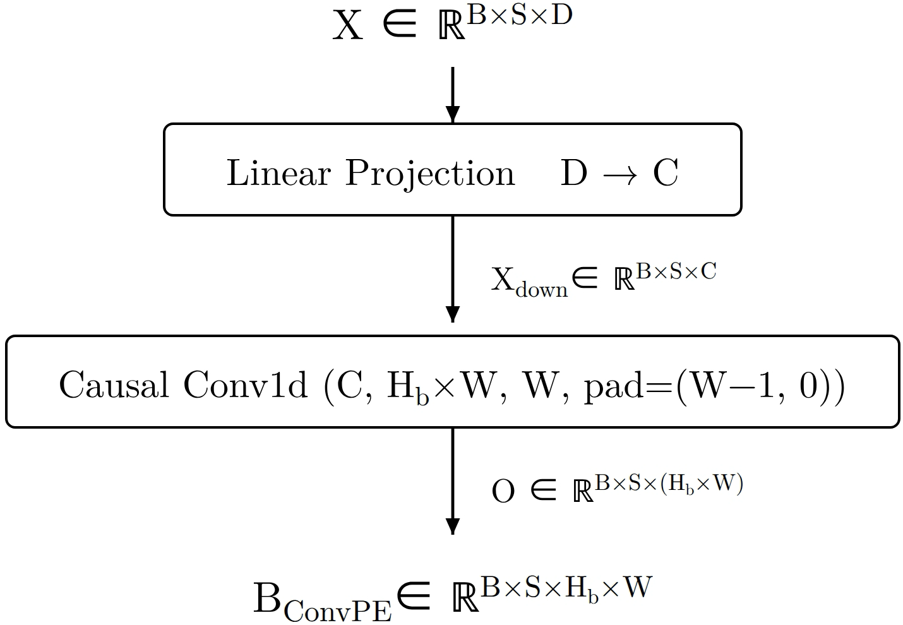

# ConvPE：在注意力分数上加内容相关的局部位置偏置

[English](README-en.md)

## 论文信息

| 字段 | 内容 |
| --- | --- |
| 论文链接 | [arXiv 2611.07749](https://arxiv.org/abs/2611.07749)；[固定 v1 全文](https://arxiv.org/html/2611.07749v1) |
| 原文标题 | ConvPE: Convolutional Position Embedding Improves Transformers |
| 公司 / 机构 | 一作 Zehao Wang：南京大学 |
| 首次公开日期 | arXiv v1 2026-11-05 09:55:15 UTC；2026-11-06 公告 |
| 原作者代码 | [wzhagi/convpe](https://github.com/wzhagi/convpe)，已核对公开源码提交 `e9775beb8185dbe7fab7e207e60e75c78e3fdd13`，未找到明确代码许可证；本地按公式独立实现 |
| 本地 adapter / 稳定键 | `convpe`；`adapter: null`，未接入 Evolve |
| 本地复现代码目录 | `src/auto_research/foundation_models/convpe.py` |
| 实现状态 | `component_only`：一维位置偏置 L1 诊断；CUDA 证据以本批实际收据为准 |
| 完整实验 | 成本过高，不复现（审查 DONE）；`not_reproduced_high_cost` |

## 原始论文总结

### 背景与主要改动

RoPE 旋转 query/key；ConvPE 改的是 softmax 前的加性分数。它先把当前层隐状态投影到少量通道，再从当前及最近若干隐状态学习各相对距离的偏置。每个查询只得到窗口内偏置；**窗口外偏置为零，不是把远处 key 屏蔽**。因果和 padding mask 仍由注意力层负责。论文还讨论分组、低秩与二维变体，此处仅实现 §3.1 的默认无分组、无分解一维公式。


<!-- paper-figure:start -->
### 原论文关键图



图片来自[原论文](https://arxiv.org/html/2611.07749v1#S3.F2) Figure 2 左图，作者 JPEG 无裁切转换为 PNG。版权归原作者所有，原论文许可为 CC BY 4.0。来源、校验值和目视核对见 `assets/provenance.json`。
<!-- paper-figure:end -->

### 核心公式

令窗口为 $W$，投影维度为 $C$，偏置头数为 $H_b$，注意力头数为 $H$。先求 $X_d=XW_p$，再用核宽 $W$、左填充 $W-1$ 的 Conv1d，把每查询的 $C$ 通道变为 $H_bW$ 通道。重排得到 $U\in\mathbb R^{B\times S\times H_b\times W}$；原文 Eq. (2)-(4) 的分数映射为：

$$
b_{n,h,s,t}=
\begin{cases}
U_{n,s,h\bmod H_b,s-t}, & 0\le s-t<W,\\
0, & \text{其余位置}.
\end{cases}
$$

$H_b$ 必须整除 $H$。例如 $H=4,H_b=2$ 时头 0 与 2 共用偏置，头 1 与 3 共用偏置，不是相邻头两两共享。参数量是 $DC+CH_bW^2+H_bW$；最后一项是卷积常数偏置，线性投影不带常数项。

### 论文离线与线上效果

原文 §4.3 的 3B-token 预训练对比，最后 0.1B tokens 的平均 loss 从 RoPE 的 3.1195 降至 ConvPE 的 3.0316，但每步训练时间约增加 6.5%。表 1 的八项准确率均值 43.72% → 44.75%，TruthfulQA-MC1 是退步项，且两者都低于论文的随机线。语言模型结果来自单次运行，不能将小差距当作跨 seed 稳定性。生产线上 A/B：未报告；以上均非本地训练结果。

## 本地复现

### 数据协议与代码映射

`ConvPEBias.compact_bias` 输入浮点 `[batch, query, model_dim]`，输出 `[batch, query, bias_head, lag]`。其 `forward` 将这些偏置映射到稠密参考分数矩阵，不计算 QK、mask 或 softmax。解码块须传入绝对 `query_start` 与前置的 `min(query_start, W-1)` 个**原始隐状态**，而不是已经投影的 KV；跨序列不复用这些状态。

```bash
PYTHONPATH=src python -m pytest tests/test_nov06_llm.py -q
PYTHONPATH=src python -c 'from auto_research.foundation_models.convpe import diagnostic; print(diagnostic(42, "cuda"))'
```

### 结果、负控与边界

`diagnostic` 用固定 seed 的小张量与独立逐 tap 求和参考比较，检查偏置头共享、前缀不受未来输入改变、解码块与全序列切片一致，以及可微性。本地 CPU seeds 42/43/44 的公式误差小于 $10^{-12}$；实际 A100/A30 结果仅认本批 GPU 收据。测试用手工卷积核区分 tap 顺序、非连续的头共享与窗口外零偏置，也拒绝不完整的解码历史。稠密参考不会降低注意力的二次开销，不报告吞吐、外推或能力提升。

### 高成本完整实验

§4 对两套约 125M/128M 参数的 12 层语言模型从头训练 3B tokens，另有 10 个 tiny、8 个 base 的超参配置，以及额外 150M tokens 的长上下文训练和视觉对照。依据论文配置判断，完整训练/TileLang 对比超出单张 A100/A30 或 Mac 的本轮低成本预算，**成本过高，不复现（审查 DONE）**。未下载权重或数据，不运行完整模型，不实现分组/低秩/二维或融合服务核。
