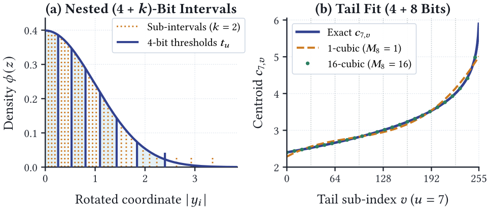

# GINGER: nested quantization for lower-bandwidth graph retrieval

<!-- source-sha256: 3154fe69c58ad591db91f62f71fa0ae3a4e72a4a1c9271a02cbd50fe9e8a46d3 -->

[简体中文](README.md)

> **L1 mechanism diagnostic, not an end-to-end retrieval reproduction.** The local component checks Nested TurboQuant codebooks, split streams, scaling, and floating-point scoring. The authors' large-scale graph retrieval experiments are **too costly and not reproduced (review DONE)**.

## Paper information

| Field | Details |
| --- | --- |
| Paper | [GINGER: Spicing Up Graph-Based Vector Search](https://arxiv.org/abs/2611.08306v1); [fixed v1 full text](https://arxiv.org/html/2611.08306v1) |
| Company / author institutions | First author **Daniel Salwasser**, **Google Research and Karlsruhe Institute of Technology (KIT)**. The other authors list Google Research; some also list UMD, CMU, or EPFL. |
| First publication | **2026-11-05 17:09:45 UTC**, arXiv v1; [cs.IR announcement](https://arxiv.org/list/cs.IR/recent) on November 6. This is a backfill from the same bulletin, not a November 7 first publication. |
| Original author code | **Verifiable method source has not been released.** The paper links to [google/ginger](https://github.com/google/ginger) and identifies it as the official PiPNN II implementation. On November 7, 2026, the [pinned HEAD tree](https://api.github.com/repos/google/ginger/git/trees/ce77e5faa3b0451b84908acf399e610f5349446b?recursive=1) contained only documentation, an Apache-2.0 license, and a contributor guide. The [pinned README](https://github.com/google/ginger/blob/ce77e5faa3b0451b84908acf399e610f5349446b/README.md) states that source and build definitions are still being prepared for release. |
| Local adapter / key | `ginger`; `adapter: null`, CPU L1 component only, not integrated into Evolve. |
| Local code | `src/auto_research/foundation_models/ginger.py` |

## Original paper

### Motivation and main changes

Graph navigation randomly reads many candidates and needs only low-precision ordering. Only the shortlist needs high-precision reranking. Storing coarse codes alongside full-precision vectors duplicates data. GINGER's **Nested TurboQuant (NTQ)** retains the same 4-bit navigation prefix in the refined code: navigation reads the coarse stream and scale; only shortlisted vectors require the refinement stream and scale.

The full library also builds graphs with PiPNN, reorders vertices so neighboring IDs are closer, compresses adjacency lists with AdaptiveGap, and uses PCA and candidate prefiltering to reduce search work. NTQ reduces bandwidth for vector representations. Graph compression, search, and SIMD kernels are separate contributions, not automatic benefits of a low-bit codebook.

<!-- paper-figure:start -->
### Key figure from the paper

[](https://arxiv.org/html/2611.08306v1#S3.F2)

The image is from [the original paper](https://arxiv.org/html/2611.08306v1#S3.F2), v1 Figure 2. The author SVG was rasterized without cropping or redrawing. Copyright remains with the authors; the paper is CC BY 4.0. The left panel shows nested intervals. The 4+8-bit piecewise cubic fit at right is outside the local scope. See `assets/provenance.json` for the source, visual review, and hashes.
<!-- paper-figure:end -->

### Core equations

Sections 3.1–3.2 rotate a nonzero vector into a common coordinate system and normalize it: $y=\sqrt d\,Rx/\lVert x\rVert_2$. The 4-bit coarse code has one sign bit and three positive-half-line interval bits. Fit eight Lloyd–Max centroids on the positive half of the standard normal, fix the coarse thresholds, then independently fit $2^k$ fine centroids inside each interval $[t_u,t_{u+1})$. Fine cells must not cross coarse boundaries.

For a fine cell $[a,b)$, neighboring centroid midpoints update the boundaries and the conditional mean updates the centroid:

$$
c_{u,v}=\frac{\int_a^b z\phi(z)\,dz}{\int_a^b\phi(z)\,dz}
=\frac{\phi(a)-\phi(b)}{\Phi(b)-\Phi(a)}.
$$

Each coordinate first determines its coarse code $u$, then fine code $v$ from the corresponding conditional codebook. These are neither two independent quantizers nor one residual codebook shared across all intervals. For a reconstruction $\tilde y_B$ at bit width $B$, analytical Gaussian distortion $D_B$ is used to correct shrinkage:

$$
s_B(x)=\frac{\lVert x\rVert_2}{\sqrt{1-D_B}\,\lVert\tilde y_B\rVert_2},
\qquad
\widehat{\langle q,x\rangle}=s_B(x)\langle Rq,\tilde y_B\rangle .
$$

This is the full-precision query reference from Section 3.1. Actual navigation uses int8 queries and coarse lookup tables; Sections 3.3–3.4 separately describe vectorized decoding and scoring.

### Offline and online results

The authors compare against seven libraries on 14 public vector search datasets. At 95% $10@10$ recall, GINGER averages about 1.8× the QPS of the fastest comparator on each dataset. The billion-vector Deep index occupies about 288 GB. Section 6.3 isolates quantization with brute-force scoring over five million data points and reports that 12-bit NTQ approaches floating-point recall. These are author-reported offline results under a particular hardware configuration, not outcomes inferred from local reconstruction error. The paper reports no production A/B test.

## Local reproduction

### Data protocol and code mapping

`build_codebook` fits the positive-half-line codebooks using analytical standard normal interval moments and supports four coarse bits plus one to four refinement bits. `encode` accepts `Rx` already rotated by a common orthogonal transform, then normalizes and encodes it and computes both scales. `decode_navigation` reads coarse bytes and scale only; `decode_refined` also reads the refinement stream. `inner_product` scores a full-precision query in the same rotated space. The first coarse nibble is the low nibble, and final padding bits are zero. The reference packing format is not advertised as compatible with the production index format.

```bash
PYTHONPATH=src python -c 'from auto_research.foundation_models.ginger import diagnostic; print(diagnostic(42, "cpu"))'
PYTHONPATH=src python -m pytest -q tests/test_nov07_ginger.py
```

### Results, negative controls, and boundaries

CPU seeds 42, 43, and 44 each generate 192 independent 31-dimensional Gaussian vectors and compare 4-bit and 4+2-bit reconstructions. Analytical distortions are approximately 0.0095010 and 0.00065794. Across the seeds, empirical per-coordinate MSE is 0.0083278–0.0088983 and 0.00054024–0.00058357, respectively. Signed packing and floating-point inner products match hand calculations. Changing refinement width does not change the navigation stream or scale. Invalid widths, nonzero padding, and zero norms are rejected. Navigation reads 16 coarse-code bytes per vector and reranking reads eight additional refinement bytes, excluding scales and object overhead. These are synthetic diagnostics, not recall or speed benchmarks.

### Full experiment cost

The paper uses two 72-core Xeon CPUs, 2.3 TB RAM, and six NUMA nodes across 14 public datasets, seven libraries, up to a billion vectors, and up to 4,096 dimensions. A Mac or a single A100/A30 cannot faithfully reproduce this CPU memory and bandwidth matrix. **Too costly; not reproduced (review DONE).** No datasets were downloaded and no indexes were built. The production non-power-of-two rotation, Highway SIMD, PCA, TurboSlice, AdaptiveGap, and production graph search are not implemented. This is a CPU-only component; GPU validation is not required.
