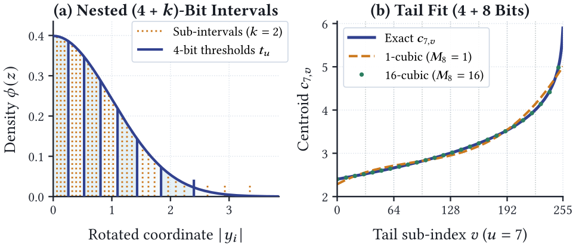

# GINGER：用嵌套量化减少近邻图检索的内存流量

> **L1 机制诊断，不是端到端检索复现。** 本地只验证 Nested TurboQuant 的码本、拆流、缩放与浮点打分；作者的大规模图检索实验**成本过高，不复现（审查 DONE）**。

## 论文信息

| 字段 | 内容 |
| --- | --- |
| 论文 | [GINGER: Spicing Up Graph-Based Vector Search](https://arxiv.org/abs/2611.08306v1)；[固定 v1 正文](https://arxiv.org/html/2611.08306v1) |
| 公司 / 作者机构 | 一作 **Daniel Salwasser**，**Google Research 与 Karlsruhe Institute of Technology（KIT）**；其余作者署名 Google Research，部分同时署名 UMD、CMU 或 EPFL。 |
| 原始发布日期 | **2026-11-05 17:09:45 UTC**，arXiv v1；2026-11-06 [cs.IR 公告](https://arxiv.org/list/cs.IR/recent)。本次是同公告补收，不是 11 月 7 日首发。 |
| 原作者代码 | **尚未发布可核验方法源码。** 论文指向 [google/ginger](https://github.com/google/ginger)，并称其为 PiPNN II 官方实现。2026-11-07 核对[固定 HEAD 文件树](https://api.github.com/repos/google/ginger/git/trees/ce77e5faa3b0451b84908acf399e610f5349446b?recursive=1)，仅有说明、Apache-2.0 许可证与贡献指南；[固定 README](https://github.com/google/ginger/blob/ce77e5faa3b0451b84908acf399e610f5349446b/README.md) 说明源码和构建定义仍在准备发布。 |
| 本地 Adapter / key | `ginger`；`adapter: null`，只收录 CPU L1 组件，不接入 Evolve。 |
| 本地代码 | `src/auto_research/foundation_models/ginger.py` |

## 原始论文总结

### 背景与主要改动

近邻图搜索在导航时随机读取大量候选，只需低位宽排序；最后的少量候选才需要高精度重排。若同时存粗码和完整浮点向量，会重复存储。GINGER 用 **Nested TurboQuant（NTQ）** 让高精度码保留同一个 4-bit 导航前缀：先读取粗码和粗尺度，最后才为入围向量读细码和细尺度。

完整库另外用 PiPNN 构建近邻图、重排顶点使邻居 ID 更集中、以 AdaptiveGap 压缩邻接表，并提供 PCA 投影与候选预筛以节省搜索开销。NTQ 降低向量表示的读带宽；图压缩、搜索和 SIMD 内核是独立贡献，不是低比特码本自动带来的收益。

<!-- paper-figure:start -->
### 原论文关键图

[](https://arxiv.org/html/2611.08306v1#S3.F2)

图片来自[原论文](https://arxiv.org/html/2611.08306v1#S3.F2) v1 Figure 2，作者 SVG 全图栅格化、未裁切或重绘。版权归原作者所有，论文许可 CC BY 4.0。左图是嵌套区间；右图的 4+8 bit 分段三次近似不在本地范围。来源、视觉核对与哈希见 `assets/provenance.json`。
<!-- paper-figure:end -->

### 核心公式

§3.1–3.2 先将非零向量变换到共同旋转空间，再做归一化：$y=\sqrt d\,Rx/\lVert x\rVert_2$。4-bit 粗码由 1 个符号位和 3 个正半轴区间索引位组成。先在标准正态正半轴上拟合 8 个 Lloyd–Max 质心，再固定粗阈值；区间 $[t_u,t_{u+1})$ 内独立拟合 $2^k$ 个细质心，不能跨越粗边界。

对任意细分单元 $[a,b)$，最近质心之间的中点更新边界，条件均值更新质心：

$$
c_{u,v}=\frac{\int_a^b z\phi(z)\,dz}{\int_a^b\phi(z)\,dz}
=\frac{\phi(a)-\phi(b)}{\Phi(b)-\Phi(a)}.
$$

因此同一坐标始终先决定粗码 $u$，再从其条件码本中决定细码 $v$；它不是两套独立量化，也不是所有区间共用同一个残差码本。若位宽 $B$ 的重建为 $\tilde y_B$，以该码本的解析高斯失真 $D_B$ 抵消收缩：

$$
s_B(x)=\frac{\lVert x\rVert_2}{\sqrt{1-D_B}\,\lVert\tilde y_B\rVert_2},
\qquad
\widehat{\langle q,x\rangle}=s_B(x)\langle Rq,\tilde y_B\rangle .
$$

这是 §3.1 的全精度查询参考；实际导航把查询和粗码表量化到 int8，论文 §3.3–3.4 另有向量化解码与打分。

### 论文离线与线上效果

作者在 14 个公开向量检索数据集上和七个库对照：在 95% 的 $10@10$ 召回下，GINGER 相对每个数据集最快对照平均约 1.8× QPS；10 亿向量的 Deep 索引约 288 GB。§6.3 另用 500 万数据点的暴力评分拆出量化误差，报告 12-bit NTQ 接近浮点召回。以上是作者离线数据与特定硬件配置结果，不能用本地重建误差推出；原文未报告生产线上 A/B。

## 本地复现

### 数据协议与代码映射

`build_codebook` 用标准正态的解析区间矩拟合正半轴码本，支持 4-bit 加 1–4 个细化位。`encode` 接收调用方已用共同正交变换旋转的 `Rx`，本地执行归一化、编码与两种尺度；`decode_navigation` 只接收粗字节和粗尺度，`decode_refined` 才读细位流。`inner_product` 在同一旋转空间对完整精度查询评分。粗码低 nibble 在前，尾部填充位为零；本地细码流只保证此参考的打包协议，不声明与生产索引序列化兼容。

```bash
PYTHONPATH=src python -c 'from auto_research.foundation_models.ginger import diagnostic; print(diagnostic(42, "cpu"))'
PYTHONPATH=src python -m pytest -q tests/test_nov07_ginger.py
```

### 结果、负控与边界

CPU 种子 42、43、44 各生成 192 条 31 维独立高斯向量，对比 4-bit 与 4+2-bit 重建。解析失真分别约 0.0095010、0.00065794；三种子经验每坐标 MSE 分别为 0.0083278–0.0088983、0.00054024–0.00058357。手算符号打包和浮点内积误差检查通过；改变细位宽不改变导航码流和尺度，异常位宽、非零填充与零范数不静默处理。导航只读每向量 16 个粗码字节，重排额外读取 8 个细码字节（两项均不含尺度及对象开销）。这些是合成诊断，不是召回或速度基准。

### 高成本完整实验

原文使用双路 72 核 Xeon、2.3 TB RAM 和 6 个 NUMA 节点，扫 14 个公开数据集、七个库、最高十亿向量与 4096 维。单 Mac 或单 A100/A30 不适合重做该 CPU 内存和带宽矩阵。**成本过高，不复现（审查 DONE）**：未下载数据或构建索引，未实现非二幂生产旋转、Highway SIMD、PCA、TurboSlice、AdaptiveGap 或生产图搜索。本地仅 CPU，不要求 GPU 验收。
