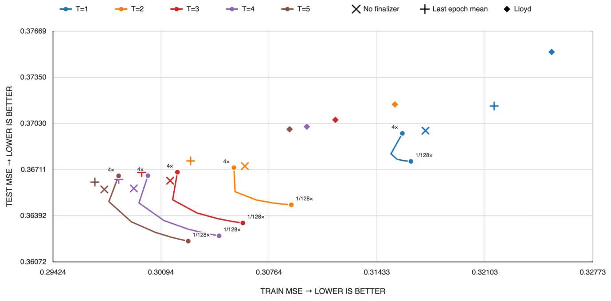

# e-means: mini-batch EMA for vector clustering

<!-- source-sha256: 7c8f826171ba2a89e83fec48c10f3f73e5bfa9b84a1e46ead32d7f0d82b94478 -->

[简体中文](README.md)

> **L1 mechanism diagnostic.** This is a dense CPU clustering reference, not a reproduction of DINO10B, retrieval quality, or GPU speed.

## Paper information

| Field | Details |
| --- | --- |
| Paper | [arXiv:2611.09501v1](https://arxiv.org/abs/2611.09501v1); [fixed v1 full text](https://arxiv.org/html/2611.09501v1) |
| Institutions | First author **Swann Bessa**, **FAIR at Meta** and École Nationale des Ponts et Chaussées |
| Date | arXiv v1 submission history: **2026-11-06 14:22:43 UTC**; discovered through the official Atom API on November 9. The category announcement date was not independently verified. Public source code preceded the paper. |
| Author code | [Meta Faiss `contrib/e_means`](https://github.com/facebookresearch/faiss/tree/731286f8bf0aebdb0185e5d00f9cd6f6ceae055c/contrib/e_means), MIT. The [initial public reference PR](https://github.com/facebookresearch/faiss/pull/5812) dates to October 31, 2026. The local reference does not depend on Faiss. |
| Local adapter / key | `e-means`; `adapter: null`, not integrated into Evolve |
| Local code | `src/auto_research/foundation_models/e_means.py` |

## Original paper

### Motivation and main changes

Lloyd updates centers after a complete pass. e-means updates per-cluster counts and vector sums after each mini-batch. It revives weak clusters by splitting active ones every five batches, then averages points assigned to each cluster during the final epoch without a new assignment pass. The paper also fits scaling laws for the batch size and initial step, and compares exact, reduced-precision, and IVF assignment at scale.

<!-- paper-figure:start -->
### Key figure from the paper

[](https://arxiv.org/html/2611.09501v1#A9.F22)

Figure 22 compares the last-epoch mean (plus), no finalizer (cross), slow EMA (curves), and Lloyd (diamond). This CPU component implements only the default last-epoch mean. The PNG is unchanged from [the original paper](https://arxiv.org/html/2611.09501v1#A9.F22); copyright remains with the authors.
<!-- paper-figure:end -->

### Core equations

Assign by squared L2 to current centers $c_j=S_j/N_j$ and collect batch counts $n_j$ and sums $s_j$. Equations 2–5 are:

$$
N_j\gets(1-\alpha_t)N_j+\alpha_t n_j,\qquad
S_j\gets(1-\alpha_t)S_j+\alpha_t s_j,\qquad
\alpha_t=\alpha_0[0.1+0.45(1+\cos(\pi t/M))].
$$

The schedule uses the zero-based index specified in Equation 5. Every five completed batches, centers with mass below 10% of the mean are candidates for revival. Draw distinct active donors weighted by mass, split each donor's mass evenly, and apply opposite multiplicative perturbations to alternating coordinates. Reconstruct sums from the resulting centers and masses. The final-epoch means minimize squared error for the recorded assignments; this is not a guarantee about held-out error.

### Author results

Table 4 reports 1.4–2.6 epochs to match Flash-KMeans at 25 epochs, corresponding to 9.5–45.5× wall-clock speedups on the measured configurations. Table 3 reports 22.8 GPU hours for the 10-billion-vector IVF setting at the target loss. The paper does not report a production A/B test. The local experiment establishes neither these speedups nor search recall.

## Local reproduction

`fit` implements float64 squared-L2 assignment, lowest-ID tie breaking, independent epoch shuffles, cosine-step EMA, weighted donor revival, and closing means. Batch size must divide the bounded input size. Weak slots without a distinct active donor wait until the next check. Zero-mass or unassigned closing slots retain their most recent valid center. The fixture uses a fixed step rather than extrapolating the fitted scaling law.

```bash
PYTHONPATH=src python -c 'from auto_research.foundation_models.e_means import diagnostic; print(diagnostic(42, device="cpu"))'
PYTHONPATH=src python -m pytest -q tests/test_nov09_e_means.py
```

[Three-seed metrics](metrics/component-cpu-seeds42-44.json). Each seed uses 256 training vectors and 64 separate held-out vectors in 12 dimensions, 16 centers, four passes, and the same initial rows for Lloyd. Seeds 42–44 reduce fixed-label training MSE from 1.69955, 1.66349, and 1.63722 to 1.69521, 1.65357, and 1.63545. Revival counts are 3, 5, and 3. Held-out e-means / Lloyd MSE is 1.87753 / 1.84352, 1.86277 / 3.61104, and 1.99276 / 2.01018. The seed 42 loss is retained.

### Cost and scope

**Full experiment too costly, not reproduced (review DONE).** The paper covers several vector datasets, uses 64-core CPUs and 80 GB H100s (some 1B configurations use eight GPUs), and fits scaling laws on 75,000 runs. The local code excludes slow-EMA finalization, scaling-law fits, low-precision kernels, IVF, and distributed clustering. It downloads no data and does not require GPU validation.
