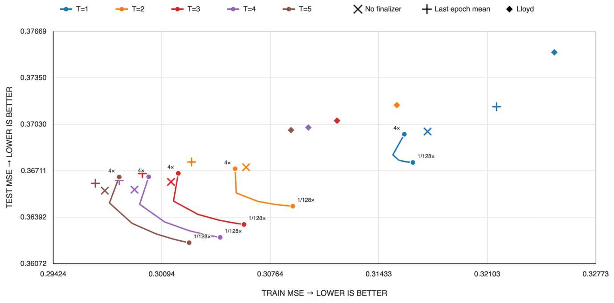

# e-means：用小批量 EMA 加快向量聚类训练

[English](README-en.md)

> **L1 机制诊断。** 本地执行稠密 CPU 聚类，不是 DINO10B、近邻检索或 GPU 加速复现。

## 论文信息

| 字段 | 内容 |
| --- | --- |
| 论文链接 | [arXiv:2611.09501v1](https://arxiv.org/abs/2611.09501v1)；[固定 v1 全文](https://arxiv.org/html/2611.09501v1) |
| 公司 / 机构 | 一作 **Swann Bessa**：**FAIR at Meta**、École Nationale des Ponts et Chaussées |
| 首次公开日期 | arXiv v1 提交记录 **2026-11-06 14:22:43 UTC**；2026-11-09 通过官方 Atom API 发现，分类公告日期未独立确认。代码 PR 在论文之前已经公开。 |
| 原作者开源代码 | [Meta Faiss `contrib/e_means`](https://github.com/facebookresearch/faiss/tree/731286f8bf0aebdb0185e5d00f9cd6f6ceae055c/contrib/e_means)，MIT；[首个公开参考实现 PR](https://github.com/facebookresearch/faiss/pull/5812) 日期为 2026-10-31。本地为独立实现，不使用 Faiss。 |
| 本地 adapter / key | `e-means`；`adapter: null`，未接入 Evolve |
| 本地复现代码 | `src/auto_research/foundation_models/e_means.py` |

## 原始论文总结

### 背景与主要改动

Lloyd 每扫完一轮数据才更新质心。e-means 每批更新各簇的 EMA 计数与向量和，让同一轮中的后续批次立即使用新质心。每五批检查低计数簇，借活跃簇分裂复苏；末轮按过程中产生的分配取均值，不额外做一轮全量分配。原文另拟合批大小与峰值步长的缩放律，在大规模场景比较精确、低精度与 IVF 分配。

<!-- paper-figure:start -->
### 原论文关键图

[](https://arxiv.org/html/2611.09501v1#A9.F22)

> **原论文 Figure 22（关键图）**：末轮均值（加号）、不收尾（叉号）、慢速 EMA（曲线）与 Lloyd（菱形）对训练和测试误差的影响不同。本地只实现默认末轮均值，不实现慢速 EMA。图片来自[原论文](https://arxiv.org/html/2611.09501v1#A9.F22)，版权归原作者所有；保留官方 PNG 原字节。
<!-- paper-figure:end -->

### 核心公式

按当前 $c_j=S_j/N_j$ 的平方 L2 最近邻分配，统计本批每簇点数 $n_j$ 与向量和 $s_j$。论文式 2–5 的更新为：

$$
N_j\gets(1-\alpha_t)N_j+\alpha_t n_j,\qquad
S_j\gets(1-\alpha_t)S_j+\alpha_t s_j,\qquad
\alpha_t=\alpha_0[0.1+0.45(1+\cos(\pi t/M))].
$$

在式 5 的零基步数上计算余弦，按已执行的批数每五批复苏。低于平均质量 10% 的簇按附录 H 从活跃簇中按质量抽取不重复 donor，将其计数对半分配，沿交替坐标施加反向乘性扰动，再重算向量和。末轮最终中心是该轮历史标签下的均值；在这些固定标签上它最小化平方误差，但不保证测试误差改善。

### 论文离线与线上效果

原论文 Table 4 在所测硬件与数据上用 1.4–2.6 轮达到 Flash-KMeans 25 轮的误差，对应 9.5–45.5 倍墙钟加速。Table 3 的 100 亿向量 IVF 场景用 22.8 GPU 小时达到目标误差。它们是作者系统结果，无生产线上 A/B；本地不推断这些速度或召回。

## 本地复现

### 数据协议与代码映射

`fit` 使用 NumPy float64 精确平方 L2 分配、确定性同分处理、每轮重新洗牌、余弦步长 EMA、低质量簇复苏、末轮均值。仅接受批大小整除行数的有界输入。若弱簇多于可用的不重复活跃 donor，余下弱簇延到下一次检查；若零计数（例如首步步长为 1）或末轮无分配，保留该簇最近有效中心。这里用固定的小样本步长，不把原文拟合范围外的缩放律当作最佳值。

```bash
PYTHONPATH=src python -c 'from auto_research.foundation_models.e_means import diagnostic; print(diagnostic(42, device="cpu"))'
PYTHONPATH=src python -m pytest -q tests/test_nov09_e_means.py
```

### 结果、负控与边界

[三种子指标产物](metrics/component-cpu-seeds42-44.json)。每个种子用 256 个 12 维训练向量和 64 个独立留出向量，16 个中心，跑四轮；Lloyd 对照用相同初始行和四轮。以每点平方 L2 为 MSE，42、43、44 的末轮固定标签误差由 1.69955、1.66349、1.63722 降到 1.69521、1.65357、1.63545；复苏次数分别是 3、5、3。留出误差 e-means / Lloyd 分别为 1.87753 / 1.84352、1.86277 / 3.61104、1.99276 / 2.01018；保留第一组反例，不宣称算法总是更好。

### 高成本完整实验

原文使用 64 物理核 CPU、H100 80GB（部分 1B 配置使用 8 GPU）、DINO10B 及多套向量数据，并用 7.5 万次运行拟合缩放律。仅 DINO10B 的十亿级以上数据就超出本地短跑范围。**成本过高，不复现（审查 DONE）**。未实现慢速 EMA 收尾、缩放律拟合、低精度 GPU/IVF/分布式内核，也未下载原数据。CPU 组件不需要 GPU 验证。
