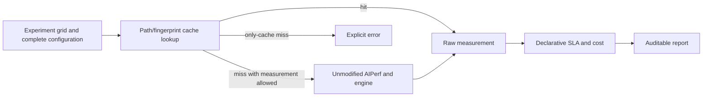
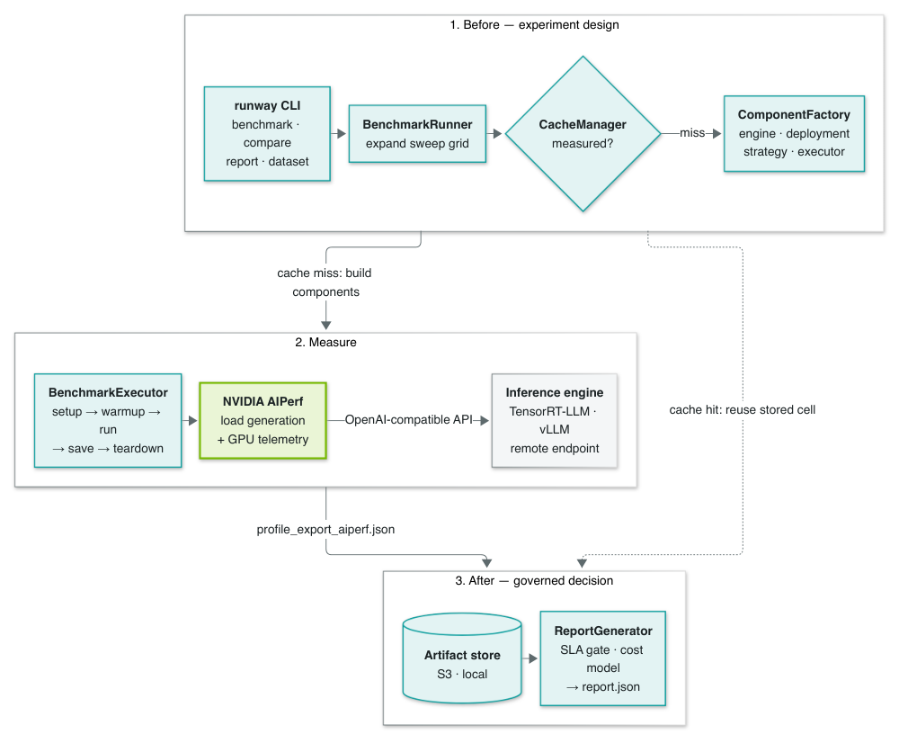

# Runway: separating inference measurements, cache, SLAs and cost decisions

<!-- source-sha256: df20d30bedf0842b652b0a3b410e3b97e5e3b716603f1a1aebcda02d9b9944d6 -->

[简体中文](README.md)

> **CPU L1 cache/SLA/cost protocol; diagnostic only.** No model deployment, AIPerf execution or cloud-instance job is performed. The full engine/instance/concurrency/MTP sweep is **not reproduced due to cost (review DONE)**.

## Paper information

| Field | Value |
| --- | --- |
| Paper | [arXiv:2611.12737](https://arxiv.org/abs/2611.12737); [fixed v2](https://arxiv.org/html/2611.12737v2) |
| Original title | Inference Validation for Regulated AI: A Governed Decision Pipeline for LLM Serving |
| Institution/company | First author Dev Akre: **MasterControl, Inc.** |
| Original publication | **November 9, 2026, 17:21:17 UTC**, arXiv v1; reviewed v2 updated November 11, 2026, 16:36:55 UTC |
| Authors' code | **Runway is internal; no public author repository found.** [NVIDIA AIPerf](https://github.com/ai-dynamo/aiperf) is a public dependency, not a release of Runway |
| License | No verifiable released Runway source license; paper/original figure CC BY 4.0 |
| Local adapter/key | `runway-inference-protocol`; `adapter=null`, `promotion_eligible=false`, `evolve_integrated=false` |
| Local code | `src/auto_research/foundation_models/runway_inference_protocol.py`: `cache_key`, `result_for_cell`, `evaluate_sla`, `cost_per_successful_request` |

## Original paper

### Motivation and changes

Inference throughput depends on input/output length, concurrency, streaming, warm-up, hardware and engine configuration. Regulated deployment also needs traceable configuration, predeclared SLA acceptance, cost per successful request and a report reproducible from the same raw measurements.

Runway preserves AIPerf's measurement semantics and separates **Before / Measure / After**: expand experiment grids, measure with unmodified AIPerf, then evaluate SLAs/cost/audit. A cache hit reuses an old measurement; it **does not produce another independent sample**.

### Architecture and protocol



### Core equations and cache contract

For hourly price $p$, measurement duration $t$ seconds and $N>0$ completed requests,

$$
C_{\mathrm{successful\ request}}=\frac{p\,t}{3600N}.
$$

Tokens/s cannot replace requests/s, nor can peak throughput replace completed counts. SLA rules retain metric/statistic, direction and units. Comparing the bare numbers in `p95=2000 ms` and `<=2.5 s` is invalid; the local protocol fails closed on unit mismatches rather than guessing conversions.

The paper's path identifies dataset/instance/model/engine/version, optional experiment and I/O/concurrency. The fingerprint compares streaming, extra AIPerf arguments, duration and data format. Engine settings are recorded but isolated through a new experiment path. The local implementation uses an explicitly **more conservative convention**: all these fields plus dataset/model revisions, warm-up and engine configuration enter a canonical JSON SHA256, avoiding accidental reuse when an experiment name is unchanged.

### Reported results and limits

The authors observe concurrency-dependent engine ranking reversals, lower per-request cost on a more expensive instance, and speculative-decoding configurations outweighing engine choice. These are specific serving sweeps, not user A/B outcomes or local measurements. They do not justify a universal fastest-engine claim without workloads, durations, errors and independent repetitions.

<!-- paper-figure:start -->
### Key original figure

[](https://arxiv.org/html/2611.12737v2#S3.F1)

Original `architecture.png` from fixed v2, not redrawn. AIPerf alone touches the engine in the original system; the local protocol does not execute that stage. Copyright remains with the authors; CC BY 4.0. [Source and SHA256](assets/provenance.json).
<!-- paper-figure:end -->

## Local implementation

### Data contract and mapping

`result_for_cell` requires an explicitly supplied measurement callback on misses; there is no default inference backend. Cache-only misses raise; no-cache forces a fresh callback; deep copies prevent callers from mutating stored raw results. Raw measurements and derived SLA decisions remain separate. A fixture callback's dictionary is never presented as AIPerf evidence.

```bash
PYTHONPATH=src python -c 'from auto_research.foundation_models.runway_inference_protocol import diagnostic; print(diagnostic(42, device="cpu"))'
PYTHONPATH=src python -m pytest tests/test_nov18_eval_protocols.py -q
```

### Checks and evidence boundary

Tests cover callback-skipping cache hits, engine/revision/warm-up invalidation, cache-only misses, forced remeasurement, missing/unit-mismatched critical metrics and seconds/hour cost arithmetic. Warnings are not critical failures; an empty SLA does not pass implicitly. Teaching constants are neither cloud quotes nor throughput observations. Actual runs are component diagnostic artifacts. This CPU-only protocol has no CUDA path: `REQUIRES_GPU_VALIDATION=False`.

### High-cost full experiment

The paper varies TensorRT-LLM/vLLM, instances, I/O lengths, concurrency and speculative decoding, with actual deployments, telemetry and internal campaigns. That full hardware matrix is not a short protocol check on one A100/A30 or Mac and is **not reproduced due to cost (review DONE)**. No cloud instances are launched and no author performance result is claimed locally.
