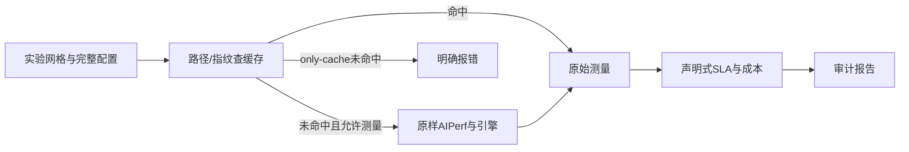
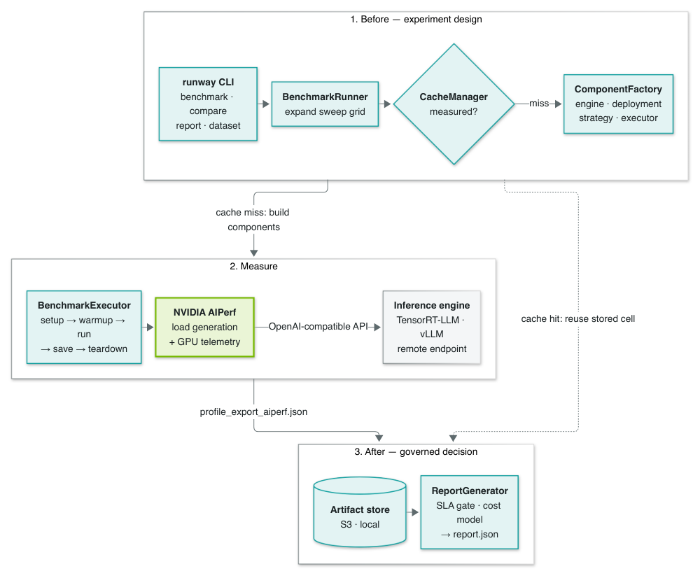

# Runway：将推理测量、缓存、SLA 与成本决策分开

[English](README-en.md)

> 状态：CPU **L1 缓存/SLA/成本协议组件，diagnostic only**。不部署模型、不执行 AIPerf、不提交云实例任务。完整多引擎/实例/并发/MTP 压测：**成本过高，不复现（审查 DONE）**。

## 论文信息

| 字段 | 内容 |
| --- | --- |
| 论文链接 | [arXiv 2611.12737](https://arxiv.org/abs/2611.12737)；[固定 v2 全文](https://arxiv.org/html/2611.12737v2) |
| 原文标题 | Inference Validation for Regulated AI: A Governed Decision Pipeline for LLM Serving |
| 公司 / 作者机构 | 一作 Dev Akre；**MasterControl, Inc.** |
| 首次公开日期 | **2026-11-09 17:21:17 UTC**，arXiv v1；核查 v2 更新于 2026-11-11 16:36:55 UTC |
| 原作者开源代码 | **Runway 为内部 harness，未找到作者公开仓库**；底层 [NVIDIA AIPerf](https://github.com/ai-dynamo/aiperf) 是公开依赖，不等同 Runway 已开源 |
| 原作者代码许可 | Runway 未发布可核验源码许可；论文与原图 CC BY 4.0 |
| 本地 Adapter / key | `runway-inference-protocol`；`adapter=null`，`promotion_eligible=false`，`evolve_integrated=false` |
| 本地复现代码 | `src/auto_research/foundation_models/runway_inference_protocol.py`；`cache_key`、`result_for_cell`、`evaluate_sla`、`cost_per_successful_request` |

## 原始论文总结

### 背景与主要改动

推理吞吐不是单一模型或引擎的属性，它随输入输出长度、并发、streaming、warm-up、硬件和引擎配置变化。受监管场景还必须能回答：测量对应什么配置、是否满足既定 SLA、每个成功请求多少钱、报告能否由同一份原始测量重建。

Runway 不修改 AIPerf 的测量定义，而是采用 **Before / Measure / After**：前置扩展实验网格；中间用原样 AIPerf；后置计算 SLA、成本和审计。缓存命中重用旧测量，**不是又获得一个独立样本**。

### 架构与流程



### 核心公式

若实例每小时价格为 $p$、测量持续 $t$ 秒、完成请求数为 $N>0$：

$$
C_{\mathrm{successful\ request}}=\frac{p\,t}{3600N}.
$$

不能把 tokens/s 直接作为 requests/s，也不能用峰值吞吐代替实际完成数。SLA 必须保留指标、统计量、比较方向和单位；`p95=2000 ms` 不能与 `<=2.5 s` 的数字直接比较而误判。本地故意在单位不一致时 fail closed，而不是猜测转换。

原文缓存路径编码 dataset/instance/model/engine/version、可选 experiment 和 I/O/concurrency；fingerprint 比较 streaming、额外 AIPerf 参数、时长、数据格式。engine config 被记录但由新 experiment 路径隔离。本地采用**更保守的本地约定**：所有这些字段、数据/模型 revision、warm-up 和 engine config 全部纳入 canonical JSON SHA256，避免未改 experiment 名时误复用。

### 论文离线与线上效果

原文报告引擎排名会随并发反转，单价更高的实例可能每请求更便宜，MTP 配置可压过引擎选择。它是特定 serving sweep 观察，不是线上用户 A/B，也不是本地复测。没有固定 workload、时长、错误数和独立重复次数，不应照搬一个“最快引擎”结论。

<!-- paper-figure:start -->
### 原论文关键图

[](https://arxiv.org/html/2611.12737v2#S3.F1)

固定 v2 的原始 `architecture.png`，未重绘。原图中 AIPerf 是唯一触达被测引擎的组件；本地协议不执行这一环。版权归原作者，CC BY 4.0。[来源与 SHA256](assets/provenance.json)。
<!-- paper-figure:end -->

## 本地复现

### 数据协议与代码映射

`result_for_cell` 只接受明确注入的 measurement callback；默认没有推理后端。cache-only miss 抛错，no-cache 强制新 callback，返回 deepcopy 防止调用方篡改缓存对象。原始结果与后置 SLA 决策分开；fixture callback 的字典不叫作 AIPerf 观测。

```bash
PYTHONPATH=src python -c 'from auto_research.foundation_models.runway_inference_protocol import diagnostic; print(diagnostic(42, device="cpu"))'
PYTHONPATH=src python -m pytest tests/test_nov18_eval_protocols.py -q
```

### 结果、负控与边界

检查 cache-hit 不再次调用 callback、engine/revision/warm-up 改动使缓存失效、cache-only miss、no-cache 重测、单位错配/缺失关键指标拒绝和秒/小时成本换算。warning 不冒充 critical failure；空 SLA 不默认合格。教学常数不代表云实例报价或吞吐，实际诊断由组件指标产物记录。CPU 协议无 CUDA 路径，`REQUIRES_GPU_VALIDATION=False`。

### 高成本完整实验

论文实验跨 TensorRT-LLM/vLLM、实例、I/O 长度、并发和 speculative decoding 配置；还依赖实际部署、遥测和内部 campaign。完整硬件压测矩阵不是单张 A100/A30 或 Mac 上短时协议检查，**成本过高，不复现（审查 DONE）**。不启动云实例、不声称本地复制作者性能。
