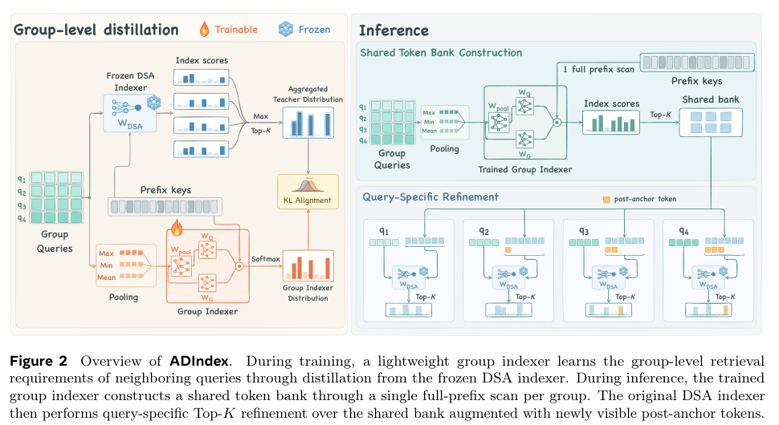

# ADIndex: layer-adaptive shared banks for sparse attention

<!-- source-sha256: 40695a1f88a78659747bd168ea114fd40ca8ff6bf280f69df9177eb61fea57f5 -->

[简体中文](README.md)

> **L1 mechanism component.** This is a small group indexer and candidate-refinement reference, not a reproduction of DeepSeek/GLM capabilities, SGLang serving, or speedups.

## Paper information

| Field | Value |
| --- | --- |
| Paper | [arXiv:2611.12956v1](https://arxiv.org/abs/2611.12956v1); [fixed text](https://arxiv.org/html/2611.12956v1) |
| Institution/company | First author Jin-Fei Qi: Nanjing University and Alibaba Group; the first-page note identifies an Alibaba internship |
| Original release | November 7, 2026, 06:35:09 UTC; found through the November 11 announcement, not first published on November 11 |
| Authors' source code | No ADIndex repository found in fixed v1 or author links. SGLang, DSA, and baseline repositories are not this paper's code |
| Local adapter/key | adindex; adapter is null; no Evolve integration |
| Local code | src/auto_research/foundation_models/adindex.py |

## Original paper

### Motivation and changes

DSA scans the causal prefix separately for every query. ADIndex exploits layer-dependent overlap between neighboring queries: calibrate group sizes and bank capacities, train a smaller-head group indexer, share one prefix scan, then retain the original DSA's query-specific refinement. Newly visible post-anchor tokens are added before refinement; final indices are not forced to be identical across queries.

### Key original figure

Rendered crop of Figure 2 and its caption on PDF page 5; copyright remains with the authors. It describes the paper's system, not an end-to-end system executed locally.

### Equations

On the anchor-visible prefix, standardize each query's scores, apply temperature-3 softmax, then take tokenwise maxima:

$$
\pi_{i,s}=\operatorname{softmax}_s[(I_{i,s}-\mu_i)/(\max(\sigma_i,10^{-6})\tau_T)],
\qquad m_s=\max_i\pi_{i,s}.
$$

Keep the Top-P support of m and renormalize it for the teacher. The student projects concatenated max/min/mean query latents and averages hidden features. Anchor-position RoPE is followed by query–key dot products, per-head ReLU, and sigmoid-gated head summation. Only three projections train under forward KL(T‖S); backbone features and keys remain frozen.

At query i, refine over the shared bank plus newly visible positions:

$$
\mathcal C_i=\mathcal P_t\cup\{t+1,\ldots,i\},\qquad
\mathcal T_i=\operatorname{TopK}_{s\in\mathcal C_i}I_{i,s}.
$$

Short prefixes and incomplete groups fall back to the original indexer. Calibration uses the maximum union size of original Top-K sets, not their average size.

~~~mermaid
flowchart LR
  A[Frozen query features and historical keys] --> B[Per-query standardized softmax]
  B --> C[Tokenwise max and Top-P teacher]
  A --> D[Max min mean pooling and student]
  C --> E[Forward KL on student parameters only]
  D --> E
  D --> F[Shared token bank]
  F --> G[Add newly visible tokens and refine per query]
~~~

### Paper results

The authors evaluate DeepSeek-V3.2 and GLM-5.1 on LongBench, LongBench v2, and RULER. They report up to 6.22×/3.40× prefill/decode indexing-kernel speedups at 256K and 1.54× end-to-end serving speedup at 128K. These are their B300/SGLang measurements, **not local results**. No randomized production-traffic A/B is reported.

## Local component

### Inputs and code

GroupIndexer consumes externally supplied normalized latents, hidden features, and strictly anchor-visible keys; these inputs are detached. teacher_distribution, forward_kl, refine_indices, and union_capacity implement the teacher, distillation, refinement, and capacity statistic. No backbone, 128K cost-based layer-configuration search, or fused sparse-MLA kernel is provided.

    PYTHONPATH=src python -c 'from auto_research.foundation_models.adindex import diagnostic; print(diagnostic(42, device="cpu"))'
    PYTHONPATH=src python -m pytest tests/test_nov11_foundation.py -q

### Evidence and limitations

[Three-seed CUDA metrics](metrics/component-cuda-seeds42-44.json) and the [real-GPU receipt](../../gpu-validations/adindex-a100-20261111.json) record device, executed source, and seeds. The diagnostic optimizes four queries over 32 historical keys for 64 steps, checking training KL, frozen gradients, causality, newly visible tokens, and fallback. A lower training loss establishes neither held-out long-context quality nor throughput. No formal capability comparison or Evolve promotion is claimed.

### Full experiment not reproduced

The paper caches all-layer features from 1,000 sequences of 128K tokens for two large backbones, with 100 disjoint calibration sequences. Each layer uses 256,000 training and 64,000 validation groups and 1,000 updates across eight data-parallel workers; model evaluation uses B300 GPUs. **Too costly; not reproduced (review DONE).** No weights, corpus, large caches, or serving matrix were downloaded or attempted.
