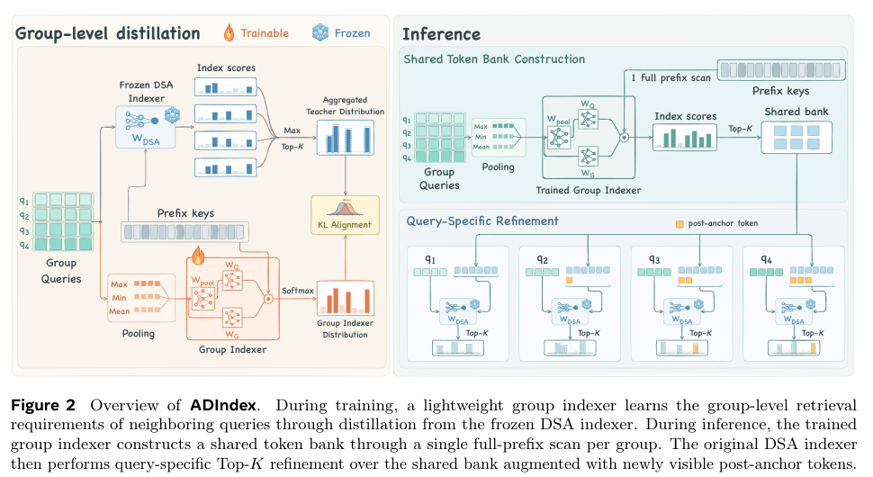

# ADIndex：按层复用稀疏注意力候选库

[English](README-en.md)

> **L1 机制组件**：小张量组索引器与候选精排，不是 DeepSeek/GLM 长文能力、SGLang serving 或加速比复现。

## 论文信息

| 字段 | 内容 |
| --- | --- |
| 论文链接 | [arXiv:2611.12956v1](https://arxiv.org/abs/2611.12956v1)；[固定全文](https://arxiv.org/html/2611.12956v1) |
| 公司 / 机构 | 一作 Jin-Fei Qi：Nanjing University、Alibaba Group；首页脚注注明工作在阿里实习期间完成 |
| 首次公开日期 | arXiv v1：2026-11-07 06:35:09 UTC；本轮 11 月 11 日公告补发现，不计为 11 月 11 日首发 |
| 原作者开源代码 | 固定 v1 与作者链接中未找到 ADIndex 原作者代码。SGLang、DSA 及基线仓库不是本文代码 |
| 本地 adapter / key | `adindex`；adapter 为 null，独立组件，未接入 Evolve |
| 本地复现代码 | src/auto_research/foundation_models/adindex.py |

## 原始论文总结

### 背景与主要改动

DSA 为每个 query 独立扫描整个因果前缀来选 Top-K。ADIndex 发现相邻 query 的候选有层相关的重叠：先校准各层组大小与候选库容量，再训练一个较少 head 的组索引器。组内先共享一次全前缀扫描，随后原 DSA 仍逐 query 精排，并补入 anchor 后新可见的 token；不是把所有 query 的最终索引强行设为相同。

<!-- paper-figure:start -->
### 原论文关键图

图来自原论文第 5 页 Figure 2，版权归原作者；本地渲染裁取架构图与原图注，未重绘为本地已运行的完整系统。
图片来自[原论文](https://arxiv.org/pdf/2611.12956v1#page=5)，版权归原作者所有；图中完整系统或实验结果不等于本地组件结果。

<!-- paper-figure:end -->

### 核心公式

对 anchor 可见的历史分数逐 query 标准化，温度为 3 后 softmax，再取逐 token 最大值：

$$
\pi_{i,s}=\operatorname{softmax}_s[(I_{i,s}-\mu_i)/(\max(\sigma_i,10^{-6})\tau_T)],
\quad m_s=\max_i\pi_{i,s}.
$$

只在 m 的 Top-P 支持上归一化为教师分布。学生把 query latent 的 max/min/mean 拼接后线性池化，hidden 取均值；anchor RoPE 后的 query–key 点积先 ReLU，再按 sigmoid head gate 加权。仅训练三个投影，以前向 KL(T‖S) 蒸馏，冻结 backbone 输入和历史 keys。

推理候选是共享库与新可见区间的并集：

$$
\mathcal C_i=\mathcal P_t\cup\{t+1,\ldots,i\},\qquad
\mathcal T_i=\operatorname{TopK}_{s\in\mathcal C_i} I_{i,s}.
$$

短前缀和不完整组回退到原索引器。容量校准使用组内原 Top-K 集合并集的最大值，不是平均值。

~~~mermaid
flowchart LR
  A[冻结的组内 query 与历史 key] --> B[逐 query 标准化后 softmax]
  B --> C[逐 token max 再 Top-P 归一化教师]
  A --> D[max min mean 池化与组索引器]
  C --> E[仅训练学生的前向 KL]
  D --> E
  D --> F[共享候选库]
  F --> G[补入新可见 token 后逐 query 精排]
~~~

### 论文离线与线上效果

原文在 DeepSeek-V3.2、GLM-5.1 上报告 LongBench、LongBench v2 和 RULER 结果；256K 时索引 prefill/decode kernel 最高加速分别为 6.22×/3.40×，128K 端到端 serving 最高为 1.54×。这些是作者 B300/SGLang 系统测量，**不是本地结果**；没有生产随机流量 A/B 报告。

## 本地复现

### 数据协议与代码映射

GroupIndexer 接受外部提供的归一化 query latent、hidden 与严格 anchor 可见的 keys；本地冻结这些输入。teacher_distribution、forward_kl、refine_indices 与 union_capacity 对应教师、蒸馏、精排和容量统计。没有加载 backbone，没有执行 128K 成本模型下的逐层配置搜索，也没有融合 sparse-MLA kernel。

    PYTHONPATH=src python -c 'from auto_research.foundation_models.adindex import diagnostic; print(diagnostic(42, device="cpu"))'
    PYTHONPATH=src python -m pytest tests/test_nov11_foundation.py -q

### 结果与复现边界

[三种子 CUDA 指标](metrics/component-cuda-seeds42-44.json)与[真实 GPU 回执](../../gpu-validations/adindex-a100-20261111.json)记录实际设备、执行源码和种子。诊断只在 4 个 query、32 个历史 key 上执行 64 步学生优化，检查训练 KL、冻结梯度、因果索引、新可见 token 和回退分支。训练损失降低不证明留出长文质量或速度；没有形式能力比较，不能晋级 Evolve。

### 高成本完整实验

论文为两个大型 backbone 缓存 1,000 条 128K 序列的全层特征，以不重叠的 100 条序列校准；每层有 256,000 训练组、64,000 验证组，并用 8 个 data-parallel worker 训练 1,000 步，评测在 B300 上进行。**成本过高，不复现（审查 DONE）**。未下载权重、语料或大缓存，也不尝试重跑作者吞吐矩阵。
