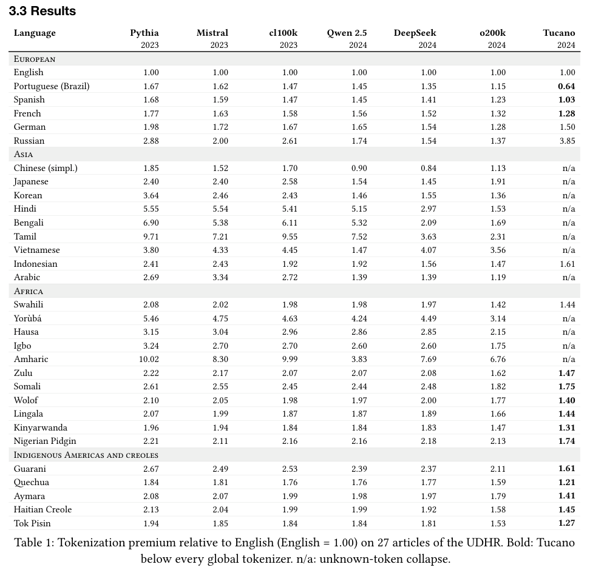

# Tokenization Premium: matched-content cost and abstention-safe evaluation

<!-- source-sha256: 7132c68508e01b7db33723dde8c0c61675eb44d0f843a750be2e1ee5d4a2f990 -->

[简体中文](README.md)

> **L1 CPU arithmetic component.** It implements matched-content token ratios, UNK exclusion, and calibration/selective-risk readouts. It does not train the proprietary model or claim to rerun all 31 languages × 7 tokenizers.

## Paper information

| Field | Value |
| --- | --- |
| Paper | [arXiv:2611.13441v1](https://arxiv.org/abs/2611.13441v1); [original Zenodo release](https://doi.org/10.5281/zenodo.22899768) |
| Institution/company | First author Paulo Câmara: LUA Vision Tecnologia, São Paulo, Brazil |
| Original release | **September 22, 2026**, Zenodo v1.0. Official API created timestamp: 15:08:28.012501 UTC; publication_date has date precision. ArXiv v1: November 10, 2026, 01:32:16 UTC. The PDF says Version 1.2; arXiv upload is not the first public release |
| Authors' code | Released: [Zenodo data.zip](https://zenodo.org/api/records/22899768/files/LUA-paper-Inherited-Weights-data.zip/content), containing measure_udhr_31_languages.py and results.json, CC BY 4.0. Reviewed archive MD5 e624311cbfc5df3138003b9b44499f24. The proprietary architecture is not open and must not be confused with the measurement scripts |
| Local adapter/key | tokenization-premium; adapter null; no Evolve integration |
| Local code | src/auto_research/foundation_models/tokenization_premium.py; tests/test_nov18_data_protocols.py |

## Original paper

### Motivation and changes

Fine-tuning inherits a base model's tokenizer, knowledge, license and biases. The authors measure the token cost of identical meaning using parallel UDHR text: 31 languages, 7 tokenizers, and 27 common articles. A low count caused by collapsing a script into unknown tokens is not a cost advantage. [Section 3](https://arxiv.org/pdf/2611.13441v1#page=2)

The paper also proposes eight black-box sovereignty audits. An abstaining system should report coverage, selective risk, full-sample calibration and correct answers per joule, not only accuracy on a small retained subset.

### Key original table

Table 1 and caption, fixed arXiv-v1 PDF page 3, CC BY 4.0. These are the authors' measurements, not local reruns. [Provenance and SHA256](assets/provenance.json).

Image from the [original paper](https://arxiv.org/pdf/2611.13441v1); copyright belongs to the original authors.

### Equations

$$
P_\tau(\ell)=N_\tau(\ell)/N_\tau(\mathrm{en}).
$$

The same 27 articles are **sorted by number, joined with spaces, then encoded once**, following the authors' public script. This is neither the mean of per-article ratios nor necessarily the sum of separately encoded article counts. Default articles are 1, 2, 4, 5, 7, 8, and 10–30.

$$
\mathrm{coverage}=n_{\rm answered}/n,\quad \mathrm{risk}=1-n_{\rm correct,answered}/n_{\rm answered}.
$$

ECE uses all items, not only high-confidence answers. Correct answers per joule requires energy measured over the full evaluation, including abstained items. At zero coverage, risk is unavailable, not fictitiously zero.

### Paper results

Table 1 reports an Amharic premium up to 10.02 for an older tokenizer and 6.76 for o200k. Tucano's non-Latin-script UNK-collapse cells are n/a. Small internal calibration results for a proprietary architecture are not a full public benchmark or general evidence of multilingual gains. No production A/B is reported.

## Local component

### Inputs and code

measure_aligned_texts receives caller-provided parallel articles and a tokenizer callable, joining and encoding once; it downloads no weights. tokenization_premium only reads supplied totals and cannot establish boundary consistency itself. Any UNK conservatively makes a cell unavailable: the paper specifies no universal threshold, and local code invents none. selective_audit consumes external confidences, independently evaluated correctness, and full-run energy. It is a scorer, not a selection policy that reads gold.

    PYTHONPATH=src python -c 'from auto_research.foundation_models.tokenization_premium import diagnostic; print(diagnostic(42, device="cpu"))'

### Controls and limits

Checks cover total-ratio versus mean-ratio, cross-article merges, misleading UNK costs, unchanged all-item ECE under abstention, and coverage/energy denominators. Constructed arithmetic is not a 31-language experiment. No hardware energy is measured; the eight audit data-collection procedures and AURC curves are not fully implemented.

### Full experiment status

The 31×7 tokenizer/corpus campaign is out of this component's scope; it is **not arbitrarily labeled high-cost**. The proprietary architecture and internal tasks are unavailable, so the full model experiment is not reproduced, review DONE. Public scripts/data and proprietary-model reproducibility are recorded separately, with no automatic retry.
