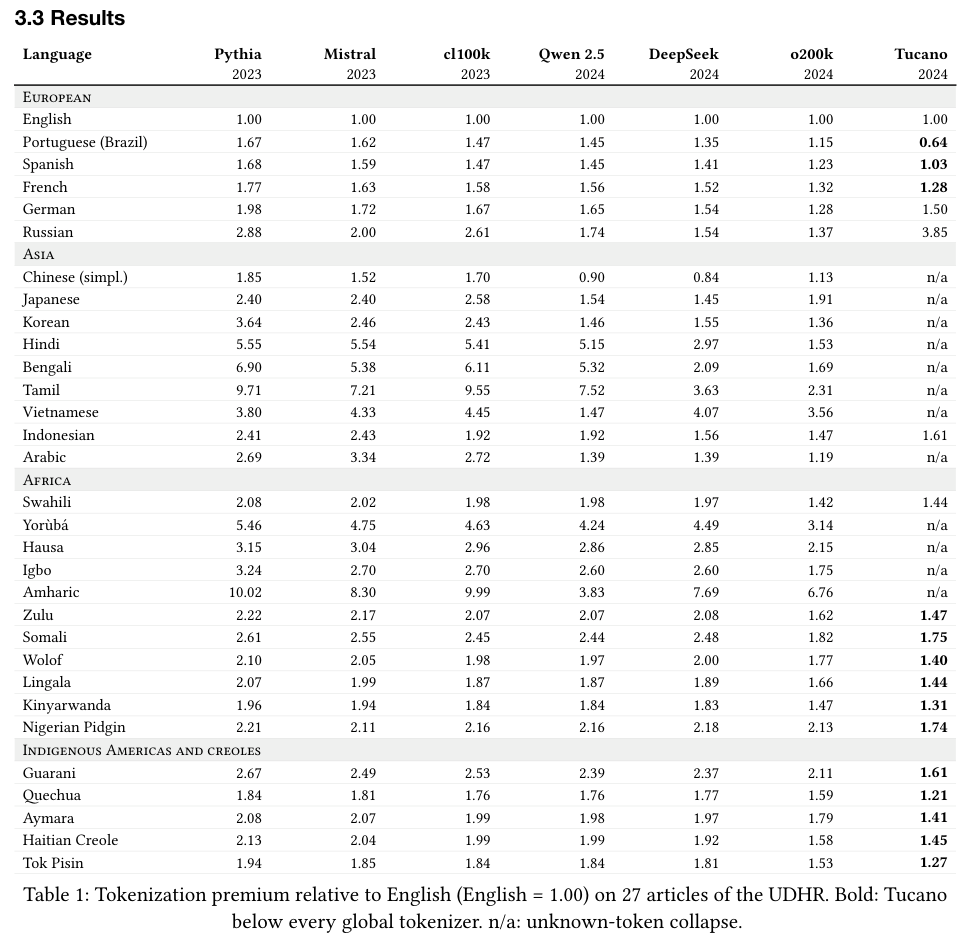

# Tokenization Premium：同内容成本与不可被拒答美化的评测

[English](README-en.md)

> **L1 CPU 算术组件。** 实现配对内容的 token 比、UNK 排除和校准/选择性风险读出；不训练作者的专有模型，不声称复现 31 语言 × 7 tokenizer 的完整测量。

## 论文信息

| 字段 | 内容 |
| --- | --- |
| 论文链接 | [arXiv:2611.13441v1](https://arxiv.org/abs/2611.13441v1)；[原始 Zenodo 发布](https://doi.org/10.5281/zenodo.22899768) |
| 公司 / 机构 | 一作 Paulo Câmara：LUA Vision Tecnologia, São Paulo, Brazil |
| 首次公开日期 | **2026-09-22**（Zenodo v1.0，官方 API created 为 15:08:28.012501 UTC，publication_date 精度为日期）；arXiv v1 为 2026-11-10 01:32:16 UTC。PDF 标注 Version 1.2，不能据此把 arXiv 上传误当首次公开 |
| 原作者开源代码 | 已发布：[Zenodo data.zip](https://zenodo.org/api/records/22899768/files/LUA-paper-Inherited-Weights-data.zip/content)，包含 `measure_udhr_31_languages.py` 与 `results.json`，CC BY 4.0；本次核对压缩包 MD5 `e624311cbfc5df3138003b9b44499f24`。专有架构未开放，不与测量脚本混为一谈 |
| 本地 adapter / key | `tokenization-premium`；adapter 为 null，未接入 Evolve |
| 本地复现代码目录 | `src/auto_research/foundation_models/tokenization_premium.py`；专测 `tests/test_nov18_data_protocols.py` |

## 原始论文总结

### 背景与主要改动

微调通常继承基础模型的 tokenizer、知识、许可证与偏见。作者用《世界人权宣言》的平行内容，把“相同意思花多少 token”转成可比较成本：31 种语言、7 个 tokenizer、27 个共同条款。不能把大量字符压成 UNK 导致的低 token 数当作低成本优势。[原文 §3](https://arxiv.org/pdf/2611.13441v1#page=2)

作者另提出八项黑盒主权审计，并强调拒答系统应同时报告覆盖率、选择性风险、全样本校准和每焦耳正确回答，不能只展示筛剩少数题的准确率。

<!-- paper-figure:start -->
### 原论文关键表

固定 arXiv v1 第 3 页 Table 1 与图注，CC BY 4.0；这些是作者数据，不是本地重新测得。[来源与 SHA256](assets/provenance.json)。
<!-- paper-figure:end -->

### 核心公式

$$P_\tau(\ell)=N_\tau(\ell)/N_\tau(\mathrm{en}).$$

分子分母是**相同 27 个条款按编号排序、用空格拼接后一次编码**的总 token 数，与作者公开脚本一致；不是逐条款比率的平均，也不保证等于独立编码 token 数之和。默认条款为 1、2、4、5、7、8、10—30。

$$\mathrm{coverage}=n_{\rm answered}/n,\quad \mathrm{risk}=1-n_{\rm correct,answered}/n_{\rm answered}.$$

ECE 在全部题上计算，不能先按置信度丢掉难题；每焦耳正确回答的能量分母必须覆盖全部评测，包括拒答题。无题作答时 risk 不可用，不伪造为零。

### 论文离线与线上效果

Table 1 中旧 tokenizer 的阿姆哈拉语溢价达 10.02，o200k 为 6.76；Tucano 的非拉丁文字 UNK 坍缩单元标为 n/a。作者专有模型的小型内部校准结果并非公开完整 benchmark，不能推广成所有语言的性能提升；原文无生产 A/B。

## 本地复现

### 数据协议与代码映射

`measure_aligned_texts` 接收调用者提供的平行条款和 tokenizer callable，一次拼接编码；不下载权重。`tokenization_premium` 是外部总数的比率读出，不能自行证明分词边界一致。任意 UNK 被保守标成 unavailable：原文没有给出通用阈值，本地不会捏造阈值。`selective_audit` 接收外部置信度、独立评测 correctness 及全程能量；它是 scorer，不是会读取 gold 的选择策略。

    PYTHONPATH=src python -c 'from auto_research.foundation_models.tokenization_premium import diagnostic; print(diagnostic(42, device="cpu"))'

### 结果、负控与边界

检查总数比与均值比的差别、跨条款 token 合并、UNK 假性低成本、拒答前后 ECE 不变，以及覆盖率/能量分母。人工输入算术不冒充 31 语言实测；不测硬件能耗，不实现八项主权审计的全部数据采集或 AURC 曲线。

### 完整实验状态

本轮不执行 31×7 的 tokenizer/语料测量；这是明确的范围界限，**不凭空称其高成本**。专有架构及内部任务没有公开，完整模型实验不复现，审查 DONE。公开测量脚本、数据与专有模型的可复现性分开记录，不自动重试。
