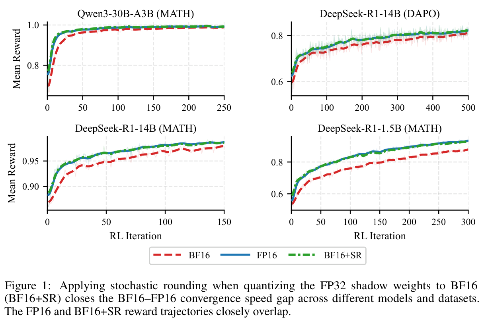
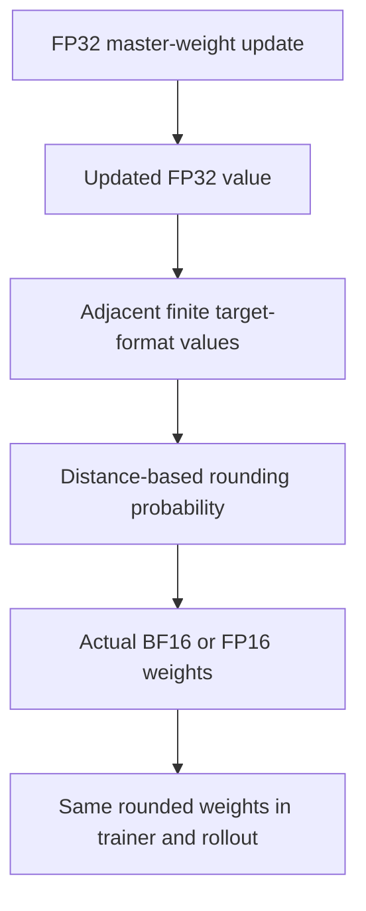

# Closing the BF16-FP16 Convergence Speed Gap in RL Post-Training with Stochastic Rounding

<!-- source-sha256: 2d38215ff494778a4ddd9cf33755f3e69edf0422d2af49ca3b99e521070b44c3 -->

[简体中文](README.md)

> **L1 mechanism component, diagnostic only.** CPU and three-seed real NVIDIA A100 validation passed. Full experiment not reproduced due to cost (review DONE). Not integrated with Evolve.

## Paper information

| Field | Value |
| --- | --- |
| Paper | [arXiv:2611.13545v1](https://arxiv.org/abs/2611.13545v1); [fixed v1 full text](https://arxiv.org/html/2611.13545v1) |
| First author and affiliation | **Mahdi Nazemi**; **NVIDIA** |
| Original publication date | **2026-11-10 04:07:19 UTC**, arXiv v1 submission |
| Author code | No verified author implementation repository was found in fixed v1 as of 2026-11-11. The cited trainer-generator mismatch Hugging Face Space belongs to related work, not this paper. |
| Local adapter / key | `stochastic-rounding`; `adapter: null`, independent component |
| Local code | `src/auto_research/foundation_models/stochastic_rounding.py` |
| Validation scope | CPU checks and real A100 seeds 42/43/44 L1 validation; [sanitized GPU receipt](../../gpu-validations/stochastic-rounding-a100-20261111.json) |

## Paper summary

### Motivation and main change

Small FP32 master-weight updates may disappear when rounded to BF16, leaving the rollout policy unchanged. Across ordinary normal-number ranges, BF16 spacing is eight times FP16 spacing. Stochastic rounding preserves the updated value in conditional expectation by choosing adjacent low-precision values according to distance, rather than inflating the learning rate.

<!-- paper-figure:start -->
### Key original figure

[](https://arxiv.org/pdf/2611.13545v1#page=1)

Original Figure 1, PDF page 1: four RL reward trajectories compare BF16, FP16 and BF16+SR. This is the authors' full-training result plot, not an architecture diagram or a local scalar/A100 component result.

Rendered from fixed v1 PDF with the complete figure and its original caption. No scientific content was redrawn or altered. Copyright remains with the authors; source, page, crop and SHA-256 are recorded in [assets/provenance.json](assets/provenance.json).
<!-- paper-figure:end -->



This local diagram explains Section 2. Distributed synchronization is a required integration contract, not an implemented training system.

### Core equation

For adjacent target-format values $w^-\le x\le w^+$:

$$
Q_{SR}(x)=\begin{cases}
w^+,&\text{with probability }p=(x-w^-)/(w^+-w^-),\\
w^-,&\text{otherwise},
\end{cases}
\qquad\mathbb E[Q_{SR}(x)\mid x]=x.
$$

Exactly representable values are returned directly, avoiding division by zero. Negative values, signed zero and subnormals require numerical neighbors, not a naive integer-bit increment. Conditional unbiasedness does not guarantee lower per-step error, noise-free gradients or faster convergence for every training problem. Inputs outside the finite target range are rejected rather than clipped.

### Paper evidence and limitations

The paper compares precisions and rounding in multiple RL post-training settings and links swallowed updates to convergence differences. Rounding also introduces variance. Trainer/rollout mismatch remains possible unless both use the same actual quantized weights. Local scalar checks do not reproduce language-model convergence.

## Local implementation

### Protocol and code mapping

`adjacent_values` uses target-format `torch.nextafter`; `stochastic_cast` samples using an explicit generator and returns BF16/FP16 from FP32 input. Probability arithmetic uses float64, including target-format subnormals. Exact values remain exact. Only CPU/CUDA and finite in-range values are supported. The function uses `no_grad` and supplies no straight-through gradient. Callers must maintain FP32 master weights and synchronize rollout parameters.

```bash
PYTHONPATH=src python -c 'from auto_research.foundation_models.stochastic_rounding import diagnostic; print(diagnostic(42, device="cpu"))'
PYTHONPATH=src python -m pytest -q tests/test_nov11_stochastic_rounding.py
```

### Checks and boundaries

The diagnostic rounds 65536 copies of $1+1/1024$ to BF16. Nearest rounding returns 1; SR should round upward with probability $1/8$. Checks require the empirical mean within six theoretical standard errors and outputs restricted to adjacent endpoints. Tests cover both signs, exact values, signed zero, subnormals and the largest finite value. Seed 42's CPU absolute mean bias is about $7.51\times10^{-6}$ versus $1/1024$ for nearest rounding; this is not an RL metric.

All checks passed on a real **NVIDIA A100** for seeds 42/43/44; see [per-seed CUDA metrics](metrics/component-cuda-seeds42-44.json) and the [sanitized receipt](../../gpu-validations/stochastic-rounding-a100-20261111.json), bound to frozen source `ef3521b7a3bdef545a584bc356ada87c68938a99`. Tests cover device-alias resolution; the real cross-GPU mismatch case requires at least two GPUs and is not claimed executed by single-GPU validation. Optimizer/master-weight wrappers, verl/rollout synchronization, distributed RNG and throughput experiments are omitted. Evolve integration is absent.

### High-cost full experiment

Section 3.1 covers DeepSeek-R1-Distill-Qwen 1.5B/14B, Qwen3-30B-A3B and Qwen3-1.7B. DrGRPO uses 512 prompts×8 completions per iteration and up to 8192 generated tokens. Controlled parity runs use **64 H100s**; other experiments use **64 B200s**. The full experiment is **not reproduced: high cost, review DONE**. No checkpoints, reduced-scale impersonation of the full study or costly training probes are attempted.
