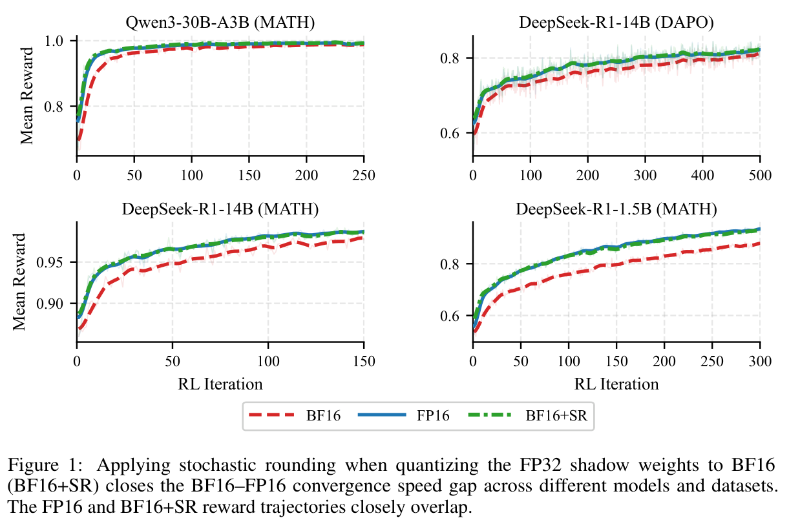
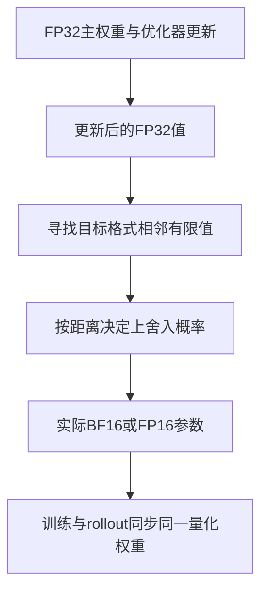

# 随机舍入：让小的 FP32 更新不再被 BF16 格点吞掉

[English](README-en.md)

> **L1 机制组件，diagnostic only。** CPU 与真实 NVIDIA A100 三种子验证已通过；完整实验成本过高，不复现（审查 DONE）；未接入 Evolve。

## 论文信息

| 字段 | 内容 |
| --- | --- |
| 论文链接 | [arXiv:2611.13545v1](https://arxiv.org/abs/2611.13545v1)；[固定 v1 全文](https://arxiv.org/html/2611.13545v1) |
| 公司 / 作者机构 | 一作 **Mahdi Nazemi**：**NVIDIA** |
| 首次公开日期 | **2026-11-10 04:07:19 UTC**，以 arXiv v1 提交记录为准 |
| 原作者开源代码 | 截至2026-11-11，固定v1未给出已核实作者实现仓库；正文所引trainer-generator mismatch Hugging Face Space是相关工作，非本篇开源。 |
| 本地 adapter / key | `stochastic-rounding`；`adapter: null`，独立组件 |
| 本地复现代码 | `src/auto_research/foundation_models/stochastic_rounding.py` |
| 验收范围 | CPU 检查及真实 A100 42/43/44 三种子 L1 验证；[脱敏 GPU 收据](../../gpu-validations/stochastic-rounding-a100-20261111.json) |

## 原始论文总结

### 背景与主要改动

FP32 主权重在训练中发生小变化，转为 BF16 后却可能仍落在同一格点，导致 rollout 策略看不到更新。BF16 在一般正规数区间的格距比 FP16 大八倍，因此相似的小步长可表现出不同的有效更新速度。随机舍入按到相邻格点的距离选上下端点，在条件期望上保留主权重变化，而不是强行放大学习率。

<!-- paper-figure:start -->
### 原论文关键图

[](https://arxiv.org/pdf/2611.13545v1#page=1)

原论文 Figure 1（PDF 第 1 页）：四组 RL reward 曲线比较 BF16、FP16 与 BF16+SR。这是作者完整训练的结果图，不是模型架构图，也不是本地标量或 A100 组件成绩。

来自固定 v1 PDF；裁图保留完整图与原图注，未重绘或修改科学内容。版权归原作者，来源、页码、裁切范围和 SHA-256 见 [assets/provenance.json](assets/provenance.json)。
图片来自[原论文](https://arxiv.org/pdf/2611.13545v1#page=1)，版权归原作者所有；图中完整系统或实验结果不等于本地组件结果。

<!-- paper-figure:end -->



图为依据 §2 绘制的说明图。最后的分布式同步是接口约束，不是本地训练系统已实现。

### 核心公式

给定 $w^-\le x\le w^+$，其中两端是目标格式的相邻值：

$$
Q_{SR}(x)=\begin{cases}
w^+,&\text{概率 }p=(x-w^-)/(w^+-w^-),\\
w^-,&\text{概率 }1-p,
\end{cases}
\qquad \mathbb E[Q_{SR}(x)\mid x]=x.
$$

若 $x$ 已可精确表示，直接返回它，不能计算 $0/0$。负数的下邻居仍是数值更小的一端；零/subnormal 也必须按数值相邻处理，不能简单给整数 bit pattern 加一。无偏只指量化条件期望，不保证每一步更接近、梯度无噪声或任意训练必然收敛更快。超出目标有限范围的输入直接拒绝，不能静默 clipping 后仍声称无偏。

### 原文结果与限制

原文在多个语言模型和 RL 后训练配置比较 FP16/BF16 与舍入策略，解释“小更新被吞掉”的收敛差异。量化随机性也会增加噪声，且若 trainer 与 rollout 加载的不是同一组实际量化权重，仍会出现训推失配。论文训练结果不能从本地标量无偏检查推导出来。

## 本地复现

### 数据协议与代码映射

`adjacent_values` 以真实目标格式的 `torch.nextafter` 构造上下邻居；`stochastic_cast` 从 FP32 输入按显式 generator 采样，返回 BF16/FP16。概率计算提升为 float64，覆盖目标格式 subnormal；精确值保持不变。只接受 CPU/CUDA，拒绝非有限值、越界值和其他目标格式。函数用 `no_grad`，不偷偷提供 straight-through estimator。调用方仍须维护 FP32 主权重并同步 rollout。

```bash
PYTHONPATH=src python -c 'from auto_research.foundation_models.stochastic_rounding import diagnostic; print(diagnostic(42, device="cpu"))'
PYTHONPATH=src python -m pytest -q tests/test_nov11_stochastic_rounding.py
```

### 结果、负控与边界

诊断对 65536 个值 $1+1/1024$ 作 BF16 舍入：round-to-nearest 全部回到 1，而 SR 上舍入概率应为 $1/8$。检查经验均值落在六个理论标准误内、输出只取相邻两端；另覆盖正负对称、可精确表示的值、正负零、subnormal 与最大有限值。seed 42 的 CPU 均值绝对偏差约 $7.51\times10^{-6}$，RN 偏差为 $1/1024$；不是 RL 收敛指标。

真实 **NVIDIA A100** 的 42/43/44 三种子全部检查已通过，见[逐种子 CUDA 指标](metrics/component-cuda-seeds42-44.json)与[脱敏收据](../../gpu-validations/stochastic-rounding-a100-20261111.json)，绑定冻结源码 `ef3521b7a3bdef545a584bc356ada87c68938a99`。测试覆盖设备别名解析；真实双 GPU 错配用例需要至少两张卡，单卡验收不冒充该用例已执行。没有 optimizer/master-weight wrapper、verl/rollout 权重同步、分布式 RNG 或训练吞吐复现；未接入 Evolve。

### 高成本完整实验

§3.1 覆盖 DeepSeek-R1-Distill-Qwen 1.5B/14B、Qwen3-30B-A3B、Qwen3-1.7B；DrGRPO 每 iteration 512 prompt×8 completion，最多生成 8192 token。受控 parity 运行 **64 张 H100**，其他实验 **64 张 B200**。这显著超出单卡 A100/A30 或 Mac：**成本过高，不复现（审查 DONE）**。本地不下载模型、不用缩小配置冒充原实验，也不为证明昂贵去试训。
