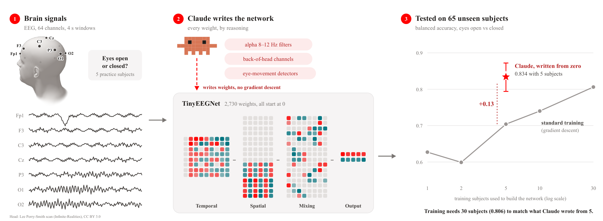

<!-- source-sha256: d7341e9e52e1b342ac71624e146eeed692a6766d710df5ddfd6d2177a7ce0950 -->
# Mixed Signals: A bounded weight-space editing interface

[简体中文](README.md)

> **L0 interface**: external weight patches, practice-call budgets and evaluator arithmetic. No LLM, TinyEEGNet/ECGResNet reproduction or patient data; no claim that a model understands or repairs networks.

## Paper information

| Field | Content |
| --- | --- |
| Paper | [Mixed Signals: Weight-Space Programming for EEG and ECG](https://arxiv.org/abs/2611.13758v1); [fixed full text](https://arxiv.org/html/2611.13758v1) |
| Institution | First author Dara Varam: EPFL, Embedded Systems Laboratory |
| First publication | 2026-11-10 08:59:09 UTC, arXiv v1 |
| Original source code | No verifiable author source-repository link was found on the [official BioWSP project](https://daravaram.github.io/BioWSP/) during this review. A showcase page is not an open-source implementation |
| Local adapter / key | `mixed-signals-weights`; adapter is null; no Evolve integration |
| Local code | `src/auto_research/foundation_models/mixed_signals_weights.py`; tests: `tests/test_nov18_root_components.py` |

## Paper summary

### Motivation and changes

LLMs read/write network parameters for EEG/ECG tasks, including reading weights, improvement, repair and writing a network from zero. **Weight-space programming excludes gradient descent and iterative fitting**; an SGD editor is not an equivalent reproduction. Network, data access and evaluate/probe budgets differ by experiment. [Section II](https://arxiv.org/html/2611.13758v1#S2)

<!-- paper-figure:start -->
### Original figure

Original Figure 1 and author results, copyright belongs to its authors. The displayed 0.834 is not measured locally. [Source and SHA256](assets/provenance.json).
<!-- paper-figure:end -->

### Core formulas

EEG balanced accuracy averages class recalls; micro accuracy is not a substitute. Repair recovery is:

$$\mathrm{recovery}=\frac{m_{repaired}-m_{faulty}}{m_{healthy}-m_{faulty}}.$$

Local code does not clip negative or above-one recovery; a zero denominator is rejected. All parameter names, shapes, dtypes and finite values are validated before atomic mutation; a failure leaves no partially edited model. Every actual practice-call attempt consumes budget before execution, including failures. Exceptions never become fabricated scores.

### Author results

The paper reports TinyEEGNet with 2,730 weights and ECGResNet with 941,189 trainable parameters, testing multiple LLMs and gradient baselines. Figure 1's 0.834 is an author result under its specific unseen-subject configuration. No production A/B. A local linear-harness forward pass does not establish EEG/ECG accuracy or support medical decisions.

## Local implementation

### Data and code mapping

`apply_weight_patch` edits explicitly supplied registered parameters, not arbitrary Python or buffers. `PracticeBudget` wraps only an external practice callback. Test labels belong solely to evaluator functions, never the edit provider. `balanced_accuracy` / `recovery_fraction` calculate external-output metrics. Diagnostic `nn.Linear(4,2)` is **a custom test harness, not paper TinyEEGNet**; its handwritten patch is not labeled LLM-generated.

    PYTHONPATH=src python -c 'from auto_research.foundation_models.mixed_signals_weights import diagnostic; print(diagnostic(42, device="cpu"))'

### Controls and limits

Seeds 42/43/44 check atomic rejection, a real changed forward pass, budget exhaustion, failure accounting, balanced accuracy and unclipped recovery. CUDA runs only this loading/forward interface. There is no LLM editor, biosignal recording, practice sampler, execution sandbox or withheld-test capability trial. A same-process callback is not an adversarial-code security sandbox; real editors need process/permission isolation.

### High-cost full experiments

The original spans models, experiments, tool turns and token/API budgets. A network edit takes roughly 38–39 minutes, versus roughly 2–5 seconds for its small-network GD A100 baseline. **Not reproduced due to cost; review DONE.** No paid models, full editing matrix or automatic retry. The local interface does not implement the complete paper pipeline.
