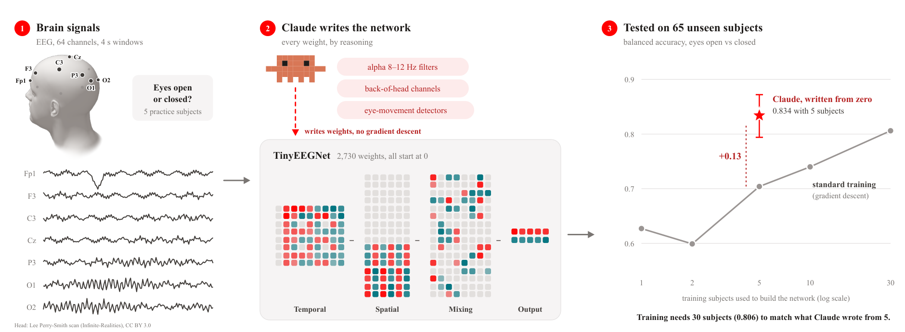

# Mixed Signals：权重空间编程的受限编辑接口

[English](README-en.md)

> **L0 接口**：实现外部权重补丁、practice 调用预算和评价算术。没有调用 LLM，没有复现 TinyEEGNet/ECGResNet，没有患者数据，不声称模型会理解或修复网络。

## 论文信息

| 字段 | 内容 |
| --- | --- |
| 论文链接 | [Mixed Signals: Weight-Space Programming for EEG and ECG](https://arxiv.org/abs/2611.13758v1)；[固定全文](https://arxiv.org/html/2611.13758v1) |
| 公司 / 机构 | 一作 Dara Varam：EPFL, Embedded Systems Laboratory |
| 首次公开日期 | 2026-11-10 08:59:09 UTC（arXiv v1） |
| 原作者开源代码 | 截至本次核对，[官方项目页 BioWSP](https://daravaram.github.io/BioWSP/) 未找到可核验的作者源码仓库链接；不把项目展示页写成开源实现 |
| 本地 adapter / key | `mixed-signals-weights`；adapter 为 null，未接入 Evolve |
| 本地复现代码目录 | `src/auto_research/foundation_models/mixed_signals_weights.py`；专测 `tests/test_nov18_root_components.py` |

## 原始论文总结

### 背景与主要改动

论文让 LLM 通过阅读/写入网络参数解决 EEG/ECG 任务，覆盖读权重、改善、修复和从零写网络。关键区别是 **weight-space programming 不使用梯度下降或迭代拟合**；把 SGD 包装成“编辑器”不能视为等价复现。不同实验的网络、数据权限和 evaluate/probe 预算不同。[§II](https://arxiv.org/html/2611.13758v1#S2)

<!-- paper-figure:start -->
### 原论文关键图

原论文 Figure 1 与作者结果，版权归原作者；图中 0.834 不是本地测量。[图源与 SHA256](assets/provenance.json)。
图片来自[原论文](https://arxiv.org/html/2611.13758v1)，版权归原作者所有。
<!-- paper-figure:end -->

### 核心公式

评价器 EEG balanced accuracy 为各类别 recall 的平均；不能用 micro accuracy 冒充。修复比例：

$$
\mathrm{recovery}=\frac{m_{repaired}-m_{faulty}}{m_{healthy}-m_{faulty}}.
$$

本地不截断负值或大于 1 的恢复比例；分母为零时报错。参数补丁必须先验证所有参数名、形状、dtype 和有限值，全部通过才原子写入；失败不留下半个模型。每次真实 practice 调用在执行前计入预算，失败也消耗一次，不能把异常变成虚构分数。

### 论文离线与线上效果

作者报告 TinyEEGNet 2,730 权重、ECGResNet 941,189 可训练参数，并给出多个 LLM 与梯度基线的实验；Figure 1 的 0.834 属于作者特定配置与未见被试评估。无线上 A/B。不能从本地线性 harness 的 forward 推断 EEG/ECG 精度，更不能用于医疗判断。

## 本地复现

### 数据协议与代码映射

`apply_weight_patch` 只编辑显式传入的已注册参数，不接受任意 Python 程序或 buffer；`PracticeBudget` 只封装外部 practice callback；测试 labels 仅传给评价函数，不传给编辑提供方。`balanced_accuracy` / `recovery_fraction` 复算外部输出指标。诊断里的 `nn.Linear(4,2)` **只是自定义测试 harness，不是论文 TinyEEGNet**；补丁也是明确手写例子，不标成 LLM 生成。

    PYTHONPATH=src python -c 'from auto_research.foundation_models.mixed_signals_weights import diagnostic; print(diagnostic(42, device="cpu"))'

### 结果、负控与边界

种子 42/43/44 验证无效补丁原子拒绝、有效补丁实际改变前向、预算耗尽、失败计数、balanced accuracy 与未截断 recovery。CUDA 只跑此权重加载/前向接口；没有 LLM 编辑、EEG/ECG 记录、实践样本抽取、沙箱执行器或 withheld-test 能力试验。单进程 callback 边界不是恶意代码安全沙箱，真实编辑器接入前还需独立进程与权限隔离。

### 高成本完整实验

作者完整研究包含多模型/多实验、多轮工具和 token/API 预算；单次网络编辑约 38—39 分钟，远高于其小网络 GD 基线约 2—5 秒的 A100 时间。**成本过高，不复现（审查 DONE）**，不调用付费模型、不启动完整编辑矩阵，不自动重试。本地接口没有实现论文完整算法链。
