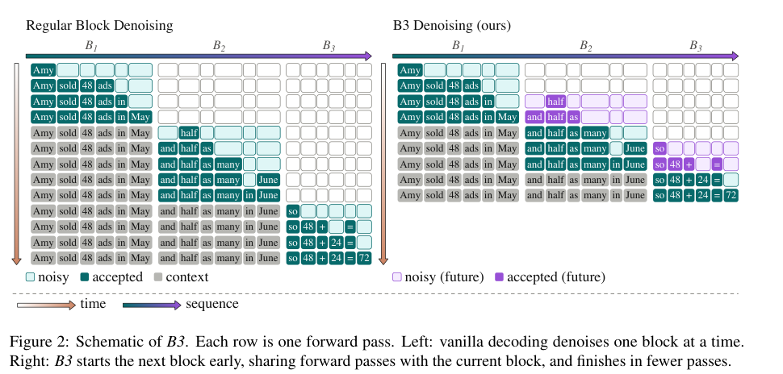

# B3: overlapping diffusion blocks with a self-calibrating gate

<!-- source-sha256: 313b374beb53ce52db0d1de64c082a93a9d16ef08ce2e9b9456f61b2e2017aa0 -->

[简体中文](README.md)

> **L1 CPU mechanism component.** Only the spawn gate and block-causal attention arithmetic are checked. No diffusion model, generated answer, or throughput reproduction is supplied.

## Paper information

| Field | Value |
| --- | --- |
| Paper | [arXiv:2611.14387v1](https://arxiv.org/abs/2611.14387v1); [fixed text](https://arxiv.org/html/2611.14387v1) |
| Institution/company | First author Amir Mann: Technion; work performed during an Amazon internship, with collaborators at Amazon Web Services |
| Original release | November 10, 2026, 17:40:24 UTC, November 11 in Shanghai; November 11 category announcement |
| Authors' source code | No B3 repository found in fixed v1 or author links. Hugging Face and Math-Verify are dependencies, not the authors' B3 release |
| Local adapter/key | b3; adapter is null; no Evolve integration |
| Local code | src/auto_research/foundation_models/b3.py |

## Original paper

### Motivation and changes

Block diffusion waits for the last difficult tokens in the current block before starting the next. B3 starts a future block once the current block is sufficiently settled, sharing the forward pass. Block-causal attention prevents future drafts from changing the current block. The future sampler must support self-editing to correct guesses made before its prefix settled.

### Key original figure

Figure 2 on PDF page 2, including its original caption; copyright remains with the authors. Its model decoding is not a local execution.

### Equations

Let H denote token entropy and r the rightmost cumulatively accepted position. When the frontier advances without an active future block, collect the previous pass's maximum entropy strictly left of the new frontier:

$$
\tau_i^{candidate}=\max_{\ell\in B_b,\ell<r_i}H_{i-1}^{\ell},
\qquad \tau=\operatorname{mean}_{i\in C_\tau}\tau_i^{candidate}.
$$

Spawn on the next pass only when the current maximum entropy is at most the threshold and no EOS is predicted. Candidates carry across blocks. Using current-pass entropy, including the frontier token, or collecting candidates while a future block is active changes the method.

~~~mermaid
flowchart LR
  A[Current entropy and accumulated frontier] --> B{Frontier advances without future block}
  B --> C[Previous-pass entropy left of frontier]
  C --> D[Mean candidate threshold across blocks]
  D --> E{Entropy gate and no EOS}
  E --> F[Future block shares the next forward pass]
~~~

### Paper results

The authors report average TPS improvements of 11.5–14.5% over ten benchmarks using DiffusionGemma 26B and LLaDA 2.1 mini 16B/flash 100B. Per-model average quality changes are −0.40, +0.76, and −0.28 percentage points; not every result improves. No production A/B is reported. Local attention invariance is not evidence of generation quality or TPS.

## Local component

### Inputs and code

SpawnGate consumes caller-supplied entropy, acceptance flags, and EOS state; it does not invent predictions. block_causal_mask builds two-block visibility. Synthetic checks cover the one-pass lag, active-future exclusion, EOS, cross-block thresholds, and equality of current-block softmax-attention outputs with a standalone forward pass.

    PYTHONPATH=src python -c 'from auto_research.foundation_models.b3 import diagnostic; print(diagnostic(42))'

### Evidence and limitations

[Three-seed CPU metrics](metrics/component-cpu-seeds42-44.json) support only these control/arithmetic checks. Native samplers, noise schedules, KV caches, EOS decoding, and self-editing backbones are not integrated; no shared forward pass generates text. The module rejects CUDA and requires no GPU receipt.

### Full experiment not reproduced

The paper uses two A100 40GB GPUs for 26B, two H200 141GB GPUs for 100B, and one A100 40GB for 16B, plus thousands of long-output tasks and decoding ablations. Fitting one model on one GPU does not make the full matrix cheap. **Too costly; not reproduced (review DONE).** No weights or trial inference were downloaded or launched.
