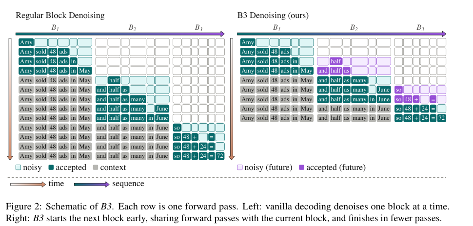

# B3：重叠扩散块与自校准生成门控

[English](README-en.md)

> **L1 CPU 机制组件**：只执行 spawn gate 和块因果掩码的数值检查，没有扩散模型、文本答案或吞吐复现。

## 论文信息

| 字段 | 内容 |
| --- | --- |
| 论文链接 | [arXiv:2611.14387v1](https://arxiv.org/abs/2611.14387v1)；[固定全文](https://arxiv.org/html/2611.14387v1) |
| 公司 / 机构 | 一作 Amir Mann：Technion；工作在 Amazon 实习期间完成，合作者主要为 Amazon Web Services |
| 首次公开日期 | arXiv v1：2026-11-10 17:40:24 UTC；上海时间 11 月 11 日；11 月 11 日分类公告 |
| 原作者开源代码 | 固定 v1 与作者链接未找到 B3 原作者仓库；Hugging Face 与 Math-Verify 是依赖，不当作本文开源 |
| 本地 adapter / key | `b3`；adapter 为 null，未接入 Evolve |
| 本地复现代码 | src/auto_research/foundation_models/b3.py |

## 原始论文总结

### 背景与主要改动

逐块扩散必须等一个块的最后几个困难 token 收敛，才开始下一个块。B3 在当前块足够稳定时提前生成未来块，两块共享前向。块因果掩码阻止当前块读取未来块，因此当前块预测不被未来草稿污染；未来块必须能 self-edit，以修正旧块尚未收敛时形成的猜测。

<!-- paper-figure:start -->
### 原论文关键图

原论文第 2 页 Figure 2，版权归原作者；裁图保留原图注。图中的模型解码不是本地运行结果。
图片来自[原论文](https://arxiv.org/pdf/2611.14387v1#page=2)，版权归原作者所有；图中完整系统或实验结果不等于本地组件结果。

<!-- paper-figure:end -->

### 核心公式

设 H 为逐 token 熵，r 为整个生成过程累积接受位置的最右前沿。只有前沿推进且没有活动未来块时，收集上一拍、前沿左侧的最大熵：

$$
\tau_i^{candidate}=\max_{\ell\in B_b,\ell<r_i}H_{i-1}^{\ell},
\qquad \tau=\operatorname{mean}_{i\in C_\tau}\tau_i^{candidate}.
$$

当当前块最大熵不超过阈值，并且没有预测 EOS，才允许下一拍开启未来块。候选阈值跨块保留；不能错用当前拍熵、包含前沿自身，或在未来块活动时更新候选。

~~~mermaid
flowchart LR
  A[当前块熵与累积接受前沿] --> B{前沿推进且无未来块}
  B --> C[上一拍前沿左侧最大熵]
  C --> D[跨块候选均值阈值]
  D --> E{当前最大熵达标且无 EOS}
  E --> F[允许未来块共享下一次前向]
~~~

### 论文离线与线上效果

作者在 DiffusionGemma 26B、LLaDA 2.1 mini 16B/flash 100B、10 个 benchmark 上报告平均 TPS 提升 11.5–14.5%。平均质量变化依模型分别为 −0.40、+0.76、−0.28 个百分点，并不是每项都改善。没有线上 A/B；本地没有测量 TPS，也不把掩码恒等式当作生成质量证据。

## 本地复现

### 数据协议与代码映射

SpawnGate 接受调用者真实提供的熵、接受标志和 EOS 状态；它不产生或猜测模型预测。block_causal_mask 仅构造两块可见关系。合成输入检查一拍滞后、活动未来块排除、EOS 保护、跨块阈值，以及真实 softmax 注意力下当前块输出与单独前向相同。

    PYTHONPATH=src python -c 'from auto_research.foundation_models.b3 import diagnostic; print(diagnostic(42))'

### 结果与复现边界

[三种子 CPU 指标](metrics/component-cpu-seeds42-44.json)只支持上述控制与算术检查。没有接入原生 sampler、噪声日程、KV cache、EOS 解码或 self-editing backbone，也没有运行共同前向生成文本。模块显式拒绝 CUDA，不需要 GPU 回执。

### 高成本完整实验

原配置中 26B 使用两张 A100 40GB，100B 使用两张 H200 141GB，16B 使用一张 A100 40GB；完整实验还包含几千题长输出和解码参数消融。单卡能装下某一模型不代表完整矩阵便宜。**成本过高，不复现（审查 DONE）**，不下载这些权重或启动试跑。
