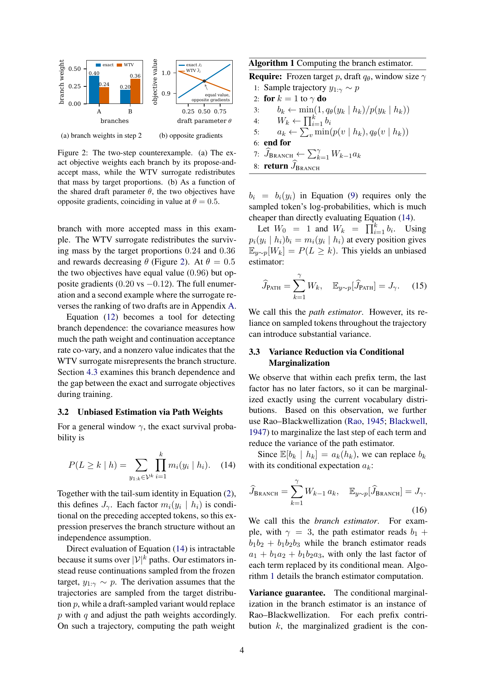
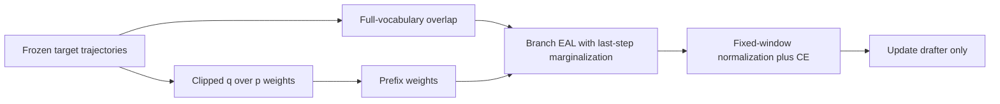

# REAL Loss: train a speculative drafter on actual accepted branches

<!-- source-sha256: 8f341df1e058579ddf183df4bb4ab599bf01787778fae00e9e9efd2a82bd4012 -->

[简体中文](README.md)

> **L1 differentiable loss component, not a model or serving reproduction.** The reference checks path estimation, Rao–Blackwellization, gradients, and masking. The expensive full study is not reproduced (review DONE).

## Paper information

| Field | Value |
| --- | --- |
| Paper | [arXiv:2611.14399v1](https://arxiv.org/abs/2611.14399v1); [fixed text](https://arxiv.org/html/2611.14399v1) |
| Institution | First author Yu Tian: The University of Hong Kong |
| Original publication | **November 10, 2026, 17:45:12 UTC**; November 11 announcement. This is a same-announcement discovery gap, not a November 12 first release |
| Authors' source code | [Reference branch](https://github.com/King-ty/speculators/tree/real-loss), with EAL implementation and counterexample tests checked at commit `3dff4579c5f93f692108df8b5178c9e9200b8536` |
| Local adapter/key | `real-loss`; `adapter=null`; no Evolve integration |
| Local code | `src/auto_research/foundation_models/real_loss.py` |

## Original paper

### Motivation and changes

An accepted token determines the prefix verified next. Multiplying marginal acceptance rates, as in the WTV surrogate, uses target-distributed branch proportions for later acceptance. It can omit the covariance between accepted-branch weight and subsequent difficulty, even reversing the gradient.

REAL preserves propose-and-accept mass along trajectories sampled from a frozen target and analytically marginalizes the final step in each prefix term. It replaces the loss, not the drafter architecture or verifier. Target sampling is an estimator assumption; arbitrary draft trajectories cannot be substituted unchanged.

<!-- paper-figure:start -->
### Key original figure

[](https://arxiv.org/pdf/2611.14399v1#page=4)

The complete PDF page 4 is rendered without content changes. Copyright remains with the authors. Its derivation and experiments are not local model-training results.

<!-- paper-figure:end -->

### Equations and flow

For target p, draft q, and a target-sampled trajectory, define:

$$
b_i=\min(1,q_\theta(y_i\mid h_i)/p(y_i\mid h_i)),\quad W_k=\prod_{i=1}^{k}b_i,\quad
a_k=\sum_v\min(p(v\mid h_k),q_\theta(v\mid h_k)).
$$

**The training ratio is q/p, opposite to serving acceptance p/q on draft proposals.**

$$
\widehat J_{Path}=\sum_k W_k,\qquad
\widehat J_{Branch}=\sum_k W_{k-1}a_k,\quad W_0=1,
$$

$$
\mathcal L_{REAL}=\lambda(1-\widehat J_{Branch}/\gamma)+(1-\lambda)\ell_{CE}.
$$

Both prefix weights and overlap retain draft gradients; target probabilities are detached. EOS itself is acceptable, later positions are masked, and masks must be prefix-contiguous. The divisor stays at fixed gamma, not the random valid length. EAL here excludes the serving acceptance-length bonus token.



### Paper results

The study compares losses with a Qwen3.6-35B-A3B target and Domino drafter across nine task subsets, five sampling seeds, and three repetitions per seed under probabilistic and greedy serving. Its main claim concerns probabilistic acceptance length, not a universal gain under greedy proposals. No production-traffic A/B is reported.

At theta=0.5, the paper's two-token counterexample gives both objectives value 0.96, but gradients +0.20 for the exact objective and −0.12 for WTV. Equal values need not imply equal optimization directions; this independently enumerable example is the local negative control.

## Local component

### Data contract and code

`eal_terms` consumes external `[blocks, gamma, vocabulary]` logits, **target-sampled** tokens, and prefix masks, returning path, branch, WTV, and CE terms. `real_loss` implements Eq.19. The code neither calls a target nor creates genuine training trajectories. A token tensor cannot prove its sampling provenance; that remains the caller's responsibility with real data receipts.

```bash
PYTHONPATH=src python -c 'from auto_research.foundation_models.real_loss import diagnostic; print(diagnostic(42, device="cpu"))'
PYTHONPATH=src python -m pytest tests/test_nov12_foundation_components.py -q
```

### Evidence and limitations

CPU diagnostics at seeds 42/43/44 check exact tree enumeration, path/branch expectations, the gradient reversal, non-detached prefix gradients, frozen targets, post-EOS masks, and fixed gamma. Independent finite-difference gradcheck covers random small tensors. These are not acceptance-length, throughput, or task-quality measurements.

CUDA diagnostics at seeds 42/43/44 passed on a real NVIDIA A100; see the [GPU receipt](../../gpu-validations/real-loss-a100-20261112.json) and [three-seed metrics](metrics/component-cuda-seeds42-44.json). The receipt binds frozen execution sources and the actual device. This remains L1 verification of small-tensor losses and gradients, not large-model training or serving capability, and cannot promote an Evolve candidate.

### Full experiment not reproduced

The original study trains Domino from scratch for about 140K steps using continuations regenerated by a 35B-A3B target, multiple losses, nine subsets, and repeated serving evaluations. Appendix E records approximately 845 ms per REAL step. Extrapolating 140K steps gives roughly 33 hours for one recipe **in the authors' environment, not a measured local A100 runtime**, excluding the other recipes and full evaluation. This exceeds the short single-A100/A30-or-Mac budget: **too costly; not reproduced (review DONE)**. No model/data download or cost probe was attempted; automatic retry and implementation queues are disabled.
