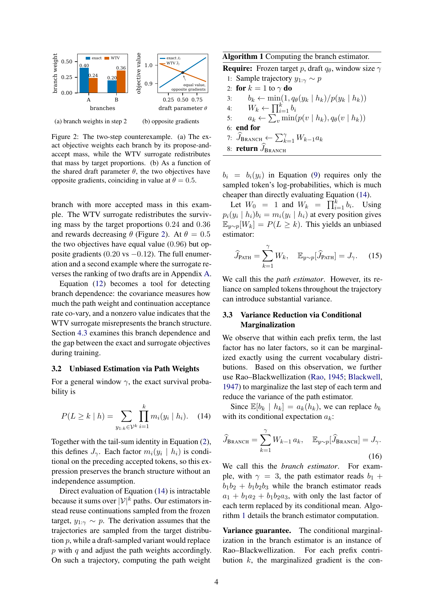
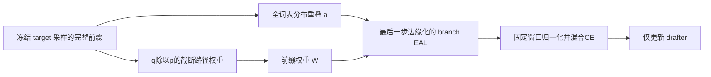

# REAL Loss：按真实接受分支训练投机解码 drafter

> **L1 可微损失组件，不是大模型或 serving 复现。** 本地核对路径估计、Rao–Blackwell 化、梯度与掩码合同；完整模型训练标注为成本过高，不复现（审查 DONE）。

## 论文信息

| 字段 | 内容 |
| --- | --- |
| 论文 | [arXiv:2611.14399v1](https://arxiv.org/abs/2611.14399v1)，[固定原文](https://arxiv.org/html/2611.14399v1) |
| 公司 / 机构 / 学校 | 一作 Yu Tian：The University of Hong Kong |
| 原始发布日期 | **2026-11-10 17:45:12 UTC**；11/11 公告，本轮为同公告补漏，不是 11/12 新首发 |
| 原作者开源代码 | [作者参考分支](https://github.com/King-ty/speculators/tree/real-loss)，核对提交 `3dff4579c5f93f692108df8b5178c9e9200b8536` 的 EAL 实现与反例测试 |
| 本地 adapter / key | `real-loss`；`adapter=null`；未接入 Evolve |
| 本地代码 | `src/auto_research/foundation_models/real_loss.py` |

## 原始论文总结

### 背景与主要改动

投机解码接受了哪个 token，会改变下一步被验证的前缀。逐步接受率相乘的 WTV 代理把目标分布中的分支比例用于后续接受率，可能丢失“接受分支权重”和“后续难易度”的协方差，甚至给出相反梯度。

REAL 用冻结 target 采样的轨迹，保留每步 propose-and-accept 质量，并将每个前缀乘积的最后一步解析边缘化。它只替换 drafter 的损失，不改变原 drafter 或推理 verifier；路径估计的采样分布是算法前提，不能任意换成 draft 轨迹。

### 原论文关键图

[](https://arxiv.org/pdf/2611.14399v1#page=4)

图片来自[原论文](https://arxiv.org/pdf/2611.14399v1#page=4)，版权归原作者所有。PDF 第 4 页完整渲染，包含 Figure 2 与 Algorithm 1，未改动原图内容。图中的实验与推导不是本地训练结果。

### 架构与流程



### 核心公式

令 target 为 (p)、draft 为 (q_\theta)，轨迹 (y\sim p)。训练路径权重和单步分布重叠为：

$$
b_i=\min(1,q_\theta(y_i\mid h_i)/p(y_i\mid h_i)),\quad
W_k=\prod_{i=1}^{k}b_i,\quad
a_k=\sum_v\min(p(v\mid h_k),q_\theta(v\mid h_k)).
$$

**这里是 (q/p)，不是 serving 时对 draft 提案使用的 (p/q)。**

$$
\widehat J_{Path}=\sum_{k=1}^{\gamma}W_k,\qquad
\widehat J_{Branch}=\sum_{k=1}^{\gamma}W_{k-1}a_k,\quad W_0=1,
$$

$$
\mathcal L_{REAL}=\lambda(1-\widehat J_{Branch}/\gamma)+(1-\lambda)\ell_{CE}.
$$

目标概率冻结；W 和 a 都保留 draft 梯度。EOS 本身可接受，EOS 后位置屏蔽，mask 必须前缀连续；分母始终是固定窗口 gamma，不按随机有效长度归一化。本文的 EAL 不含 serving 接受长度中的 bonus token；两者不要混写。

### 论文离线与线上效果

论文用 Qwen3.6-35B-A3B target 与 Domino drafter，比较相同训练配置下不同 loss，在 9 个任务子集、5 个采样 seed、每 seed 3 次重复上评估 probabilistic 与 greedy serving。其主要结论针对 probabilistic 接受长度；不等于所有贪心配置都有相同收益。正文未报告生产用户流量 A/B。

Eq.13 的两 token 反例在 (\theta=0.5) 时，真实目标和 WTV 都为 0.96，但梯度分别为 +0.20 和 −0.12。相同目标值不代表相同优化方向；本地用这一可独立枚举的反例做机制负控。

## 本地复现

### 数据协议与代码映射

`eal_terms` 输入 `[blocks, gamma, vocab]` 的外部 logits、**target 采样** token 和前缀 mask，计算 path、branch、WTV 与 CE；`real_loss` 执行 Eq.19。函数不下载或调用 target，不产生真实训练轨迹，也不能从一个 token 张量反推出其采样来源；采样来源仍由调用方与真实数据回执保证。

```bash
PYTHONPATH=src python -c 'from auto_research.foundation_models.real_loss import diagnostic; print(diagnostic(42, device="cpu"))'
PYTHONPATH=src python -m pytest tests/test_nov12_foundation_components.py -q
```

### 结果、负控与边界

本地 CPU 42/43/44 诊断已执行，独立树枚举验证 path 与 branch 的期望；检查反向梯度、前缀梯度未被 detach、target 无梯度、EOS 后 mask 与固定 gamma，并用有限差分 gradcheck 核对随机小张量。它不测试实际接受长度、吞吐或任务质量。

真实 NVIDIA A100 上的 CUDA 42/43/44 诊断已通过，见 [GPU 回执](../../gpu-validations/real-loss-a100-20261112.json) 和 [三 seed 指标](metrics/component-cuda-seeds42-44.json)。回执绑定冻结源码提交并记录实际设备；这仍只是小张量损失与梯度 L1 验证，不是大模型训练或 serving 能力测评，不用于 Evolve 晋级。

### 高成本完整实验

原配置从头训练 Domino 约 140K steps，处理 35B-A3B target 的再生成 continuation，采用多损失、9 子集及多次 serving 重复。附录 E 记录 REAL 每步中位约 845 ms，按 140K steps 外推单配方约 33 小时，**这是论文运行环境的量级估算，不是本地 A100 实测时长**，还不含其他配方和完整评估。对单张 A100/A30 或 Mac 的本轮短预算，**成本过高，不复现（审查 DONE）**。未下载模型、数据，未启动成本探针，不进入自动重试或实现队列。
