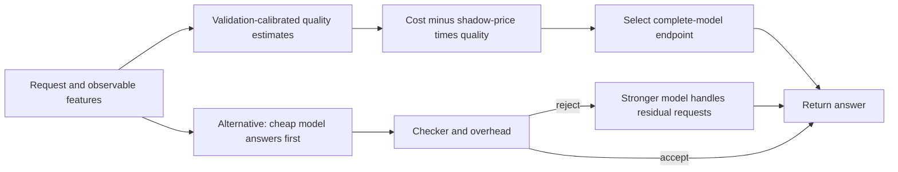
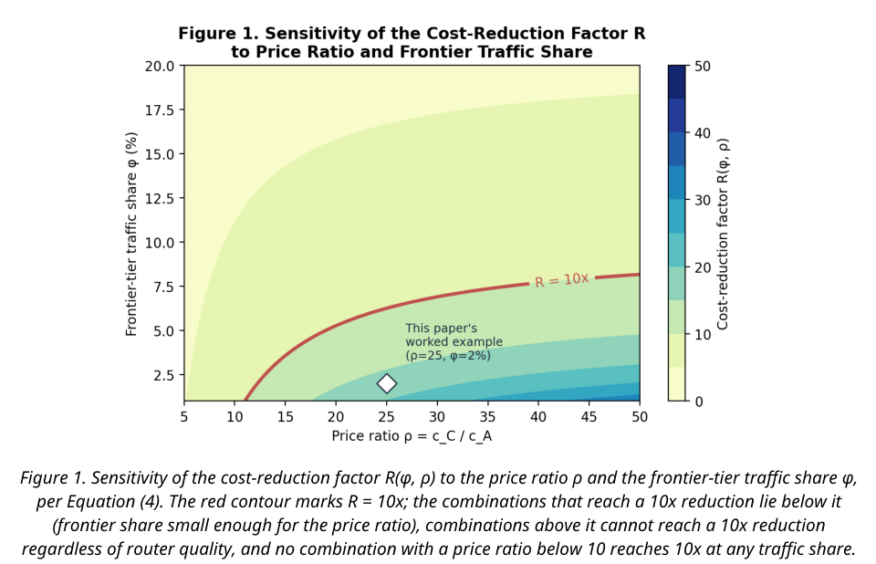

# Smart Model Routing: accounting for overhead, traffic skew and conditional quality

<!-- source-sha256: 9674bf6450a9b74de92d844c4814e42fbebb303ff4de63b4d4346fe713200326 -->

[简体中文](README.md)

> **CPU L1 cost/policy arithmetic; diagnostic only.** This is not a trained router and makes no model requests. “10×” is conditional analysis, not a local or production gain. Full model/API and cross-task campaigns are not run; the high-cost full matrix is explicitly not reproduced.

## Paper information

| Field | Value |
| --- | --- |
| Paper | [arXiv:2611.15911v1](https://arxiv.org/abs/2611.15911v1); [fixed PDF](https://arxiv.org/pdf/2611.15911v1) |
| Original title | Smart Model Routing for Order-of-Magnitude LLM Cost Reduction |
| Institution/company | First author Hesham Elbakoury: **Independent Researcher**, as stated in the paper |
| Original publication | **November 11, 2026, 19:13:21 UTC**, arXiv v1. The cover separately says September 2026; that is not substituted for the verifiable arXiv release timestamp |
| Authors' code | Public: coauthor Deep Shah's [llm-routing-formula-validation](https://github.com/dshah133/llm-routing-formula-validation), linked in fixed v1 Section 5.1/reference [10], with GSM8K traces, accounting and follow-up. Referenced RouteLLM/FrugalGPT are not substituted for this author release |
| Fixed upstream version | `26e0ebd288a7e48fe8cf5ec97fe7f2d8a143d7ac`; only public metadata/README inspected, no external code executed |
| License | GitHub reports no declared code license, so no source is copied; local formulas are independently implemented. Original figure copyright remains with its authors under the arXiv perpetual non-exclusive license, not an asserted open redistribution license |
| Local adapter/key | `smart-model-routing`; `adapter=null`, `promotion_eligible=false`, `evolve_integrated=false` |
| Local code | `src/auto_research/foundation_models/smart_model_routing.py`: `shadow_price_tier`, `cost_reduction`, `cascade_cost`, `two_stage_breakeven`, `cascade_quality` |

## Original paper

### Motivation and changes

This paper studies **application-level selection among complete models/endpoints**, not token-to-expert MoE routing or load balancing between replicas. Costs include the router, checker, discarded cheap-model calls and the additional tokens in difficult requests.

Calibration is not discrimination: predicting 90% cheap-model correctness for every identical-looking request can be perfectly calibrated without identifying failures. With 99% frontier quality and a 98% target, at least 8/9 of requests must still use the frontier tier. An aggregate quality floor can also hide harm to particular languages or difficult subgroups.

### Architecture and protocol



### Core equations

Equation 7 chooses, for a fixed shadow price,

$$
\pi^*(x)=\arg\min_i[c_i(x)-\lambda q_i(x)].
$$

$\lambda$ has cost/quality units and must be selected on validation data to satisfy the constraint. A supplied value does not automatically guarantee quality. Inputs are predicted qualities, not a request's held-out gold answer.

With equal per-request costs, Equation 4 gives $R=\rho/[1+(\rho-1)\phi]$. If frontier-routed requests use $\tau$ times the tokens, Equation 5, extended here with router overhead $r$ in cheap-call units, gives

$$
R=\frac{\rho[(1-\phi)+\phi\tau]}{(1-\phi)+\phi\tau\rho+r}.
$$

A two-stage cascade requires the complete path cost:

$$
E[C]=c_A+c_{\mathrm{check}}+c_{\mathrm{router}}+(1-a)c_B,
\quad
a>\frac{c_A+c_{\mathrm{check}}+c_{\mathrm{router}}}{c_B}.
$$

Equality only breaks even. For K stages, reach probabilities $P_i=\prod_{j<i}(1-a_j)$ weight each stage's cost. Quality uses conditional accepted/residual subsets: $Q=a q_A^{acc}+(1-a)q_B^{rej}$. Unconditional model accuracy cannot replace quality on rejected hard requests.

### Reported results and limits

The headline magnitude depends on stated pricing and traffic assumptions, not current product quotes. Section 5.1 evaluates a Luna-to-Sol cascade on 200 GSM8K development and 1,319 held-out questions: 2.19× lower cost including the checker, with 97.95% versus 97.88% accuracy. The +0.08pp difference interval [-0.15,+0.38] does not establish improvement. Omitting the checker inflates savings to 2.70×; substituting overall for residual fallback quality overstates accuracy by 0.97pp. Costs are reconstructed from traces, not reconciled invoices. There is no production A/B.

The same repository's learned-router follow-up is negative: 96.28% versus 96.32% for cost-matched blind mixing on 2,500 fresh questions, with difference interval [-0.38,+0.22]pp. In Section 5.2's independent CPU test, no learned candidate passes calibration, so the frozen policy falls back to a fixed 3B model: 67.19% quality at 1.00× cost, below the 90% target. Fail-safe fallback is not a routing gain. At 2% frontier traffic and a 25× price ratio, long hard requests invalidate a naive 16.9× claim: the $\tau=100$ counterexample gives only about 1.46× before router overhead.

<!-- paper-figure:start -->
### Key original figure

[](https://arxiv.org/pdf/2611.15911v1#page=13)

Fixed v1, page 13, Figure 1 with its original caption, not redrawn. The plotted equal-cost Equation 4 must not erase Equation 5's token-skew caveat. Copyright remains with the authors under the arXiv non-exclusive publication license. [Source and SHA256](assets/provenance.json).

Image from the [original paper](https://arxiv.org/pdf/2611.15911v1); copyright belongs to the original authors.
<!-- paper-figure:end -->

## Local implementation

### Data contract and mapping

The module implements the shadow-price argmin, input/output token prices, minimum frontier share, token-skew correction, K-stage cascade cost, strict two-stage breakeven and conditional quality sums. Terminal acceptance must be one; negative costs, non-finite values and invalid probabilities are rejected. Shadow prices are not selected on test data, and no gold-answer input exists. It does not estimate quality, train difficulty classifiers, call providers or fabricate checkers.

```bash
PYTHONPATH=src python -c 'from auto_research.foundation_models.smart_model_routing import diagnostic; print(diagnostic(42, device="cpu"))'
PYTHONPATH=src python -m pytest tests/test_nov18_eval_protocols.py -q
```

### Checks and evidence boundary

Checks cover overhead increasing costs, token skew reducing apparent gains, equality not constituting savings, residual-conditional rather than unconditional quality, and a calibrated-but-nondiscriminating counterexample. Fixed teaching arithmetic is not model training or a capability ranking; actual three-seed records are component diagnostic artifacts. `REQUIRES_GPU_VALIDATION=False`; there is no CUDA path.

### High-cost full experiment

The analytic formulas are implemented and are not themselves labeled expensive. Offline analysis of the authors' public traces is also inexpensive, but is outside this round's independent-formula execution scope and is not claimed complete. Recollecting pilot/follow-up answers, checks and retries requires thousands of paid calls; Section 5.2 additionally runs 0.5B/1.5B/3B CPU models. The complete collection/inference and wider task matrix exceeds this short-run budget and is **not reproduced due to cost (review DONE)**. The complete GSM8K pipeline was not attempted; arithmetic examples are not a benchmark pass receipt.
