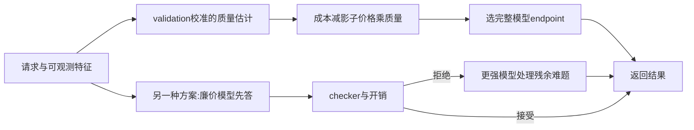
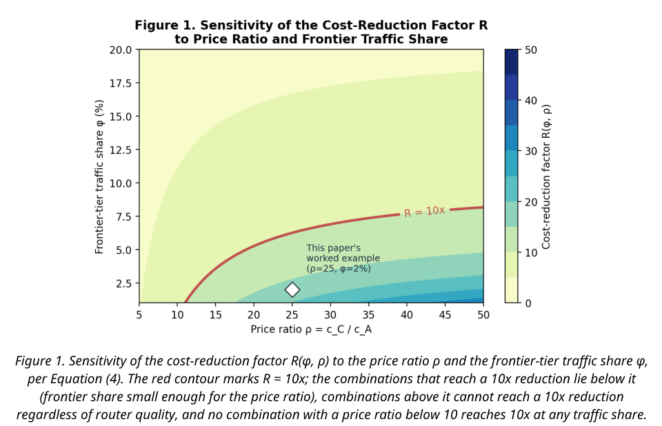

# Smart Model Routing：把路由开销、流量偏斜和条件质量算清楚

[English](README-en.md)

> 状态：CPU **L1 成本/策略算术组件，diagnostic only**；不是训练好的 router，不发送真实模型请求。“10×”是条件化分析，不是本地或生产收益。完整模型/API 与跨任务实验不运行；高成本完整矩阵标注不复现。

## 论文信息

| 字段 | 内容 |
| --- | --- |
| 论文链接 | [arXiv 2611.15911v1](https://arxiv.org/abs/2611.15911v1)；[固定 v1 PDF](https://arxiv.org/pdf/2611.15911v1) |
| 原文标题 | Smart Model Routing for Order-of-Magnitude LLM Cost Reduction |
| 公司 / 作者机构 | 一作 Hesham Elbakoury；原文署名 **Independent Researcher（独立研究者）** |
| 首次公开日期 | **2026-11-11 19:13:21 UTC**，arXiv v1；封面另写 September 2026，不据此替换可核验的 arXiv 首发时间 |
| 原作者开源代码 | 已公开：共同作者 Deep Shah 的 [llm-routing-formula-validation](https://github.com/dshah133/llm-routing-formula-validation)，固定 v1 §5.1/参考文献 [10] 给出；包括 GSM8K traces、成本分析与 follow-up；不把引用的 RouteLLM/FrugalGPT 当作本文作者实现 |
| 上游固定版本 | `26e0ebd288a7e48fe8cf5ec97fe7f2d8a143d7ac`；只核验公开仓库元数据/README，不执行外部代码 |
| 原作者代码许可 | GitHub 元数据未声明 license，不复制其源码；本地公式独立实现。原图版权归作者，arXiv perpetual non-exclusive license，不声明开放再许可 |
| 本地 Adapter / key | `smart-model-routing`；`adapter=null`，`promotion_eligible=false`，`evolve_integrated=false` |
| 本地复现代码 | `src/auto_research/foundation_models/smart_model_routing.py`；`shadow_price_tier`、`cost_reduction`、`cascade_cost`、`two_stage_breakeven`、`cascade_quality` |

## 原始论文总结

### 背景与主要改动

本文研究**应用层在多个完整模型/endpoint 之间选路**，不是 MoE 内部 token→expert，也不是同一模型副本的负载均衡。核心问题是：在可接受质量下，让每个请求尽量使用便宜模型，同时计入 router、checker、被拒绝的小模型调用和长难题的额外 token 成本。

作者区分 calibration 与 discrimination：所有请求都预测“便宜模型 90% 正确”可以完全校准，却无法辨别哪一条会错。若 frontier 为 99%、目标 98%，无区分信号时至少 8/9 请求仍需 frontier。平均质量约束也可能掩盖特定语言或难题子群受损。

### 架构与流程



### 核心公式

Eq.7 给出固定影子价格下的选择：

$$
\pi^*(x)=\arg\min_i[c_i(x)-\lambda q_i(x)].
$$

$\lambda$ 是成本/质量单位的变量，要在 validation 上满足约束，不是随意设置后质量自然达标。实现输入是预测质量，不是请求的 test gold。

常成本两层路由的 Eq.4 为 $R=\rho/[1+(\rho-1)\phi]$；若 frontier 请求平均 token 为便宜请求的 $\tau$ 倍，Eq.5（附本地 router 开销 $r$，以 cheap-call 单位计）为：

$$
R=\frac{\rho[(1-\phi)+\phi\tau]}{(1-\phi)+\phi\tau\rho+r}.
$$

两阶段 cascade 必须比较完整路径成本：

$$
E[C]=c_A+c_{\mathrm{check}}+c_{\mathrm{router}}+(1-a)c_B,
\quad
a>\frac{c_A+c_{\mathrm{check}}+c_{\mathrm{router}}}{c_B}.
$$

等号只是打平，不算节省。K 阶段用到达概率 $P_i=\prod_{j<i}(1-a_j)$ 加权各阶段开销。质量要用接受/残余子集的条件质量，$Q=a q_A^{acc}+(1-a)q_B^{rej}$，不能拿模型总体准确率代替难题残余的准确率。

### 论文离线与线上效果

标题量级来自指定价格与流量假设的分析；本文使用的价格不能当成实时产品报价。原文 §5.1 在 GSM8K 200 development/1,319 heldout 上比较 Luna→Sol cascade，含 checker 后报告 2.19× 成本下降、97.95% vs 97.88% 正确率；+0.08pp 的区间 [-0.15,+0.38] 不能建立准确率提升。忽略 checker 会虚增为 2.70×，按总体而非 residual fallback 质量会高估 0.97pp。成本是 trace 重建，不是发票核销，没有生产 A/B。

同仓库 learned-router follow-up 是负结果：2,500 fresh questions 上 96.28% vs 同成本 blind mixing 96.32%，差异区间 [-0.38,+0.22]pp。§5.2 独立 CPU 测试中没有 learned candidate 过 calibration gate，冻结策略退回固定 3B，67.19% 质量/1.00× 成本，没达到90%目标；不能把安全回退算路由增益。困难请求更长时，2% frontier、25 倍单价并不必然省 16.9 倍：原文 $\tau=100$ 反例仅约 1.46 倍，尚未计额外 router 开销。

<!-- paper-figure:start -->
### 原论文关键图

[](https://arxiv.org/pdf/2611.15911v1#page=13)

固定 v1 第 13 页 Figure 1 与图注，未重绘；图采用常请求成本 Eq.4，不能省略正文 Eq.5 的 token 偏斜限制。版权归原作者，arXiv 非独占发布许可。[来源与 SHA256](assets/provenance.json)。
<!-- paper-figure:end -->

## 本地复现

### 数据协议与代码映射

本地只实现影子价格 argmin、输入/输出 token 计费、frontier 最小份额、token 偏斜修正、K 阶段 cascade 成本、严格两阶段 breakeven 和条件质量求和。terminal stage 必须接受；负成本、无穷值、越界概率会拒绝。影子价格不由 test 选择，接口不接收 gold 答案。模块不会估计质量、训练 difficulty classifier、请求 provider 或假造 checker。

```bash
PYTHONPATH=src python -c 'from auto_research.foundation_models.smart_model_routing import diagnostic; print(diagnostic(42, device="cpu"))'
PYTHONPATH=src python -m pytest tests/test_nov18_eval_protocols.py -q
```

### 结果、负控与边界

检查 router/checker 增加成本、token 偏斜降低表观收益、breakeven 等号不算赢、条件 residual quality 与总体质量不可替换，以及“已校准但不区分”反例。固定教学算术不是训练效果或能力排名；实际三种子协议记录由组件指标产物保存。`REQUIRES_GPU_VALIDATION=False`，没有 CUDA 路径。

### 高成本完整实验

解析公式已作为低成本组件实现，不把理论本身称为高成本。作者公开 traces 的离线复算本身不是高成本，但不在本轮独立公式组件的执行范围，也未假称已完成。重新采集原文 pilot/follow-up 的多模型回答、checker 与重试需要数千次付费调用；§5.2 另用0.5B/1.5B/3B CPU推理。完整收集/推理与后续跨任务矩阵相对本轮短时预算成本高，**完整实验不复现（审查 DONE）**。未尝试作者 GSM8K 全流程，不能把算术例子当作该 benchmark 的通过记录。
