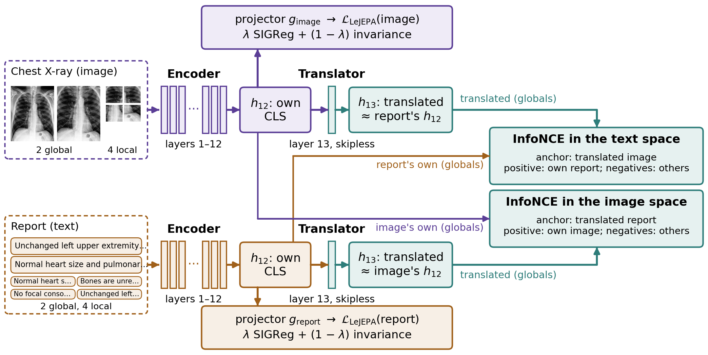

# DuoJEPA: translate within target spaces instead of forcing coincidence

<!-- source-sha256: a9014f50664d09ff5dae4989e99ffb5db0b9ce66818b60edce48fc5cc68fb6e5 -->

[简体中文](README.md)

> **L1 mechanism component.** Two target-space CLS InfoNCE terms and one single-head skipless image translator with its initialization. No full LeJEPA, text translator, patch term or distributed pretraining.

## Paper information

| Field | Value |
| --- | --- |
| Paper | [arXiv:2611.15968v1](https://arxiv.org/abs/2611.15968v1); [fixed text](https://arxiv.org/html/2611.15968v1) |
| Institution/company | Mahmut S. Gokmen: Kentucky Center for Digital Innovation, University of Louisville |
| Original release | November 11, 2026, 20:10:52 UTC; announced November 13. An announcement backfill, not a November 15 first release |
| Authors' code | No released original DuoJEPA repository found in fixed v1, arXiv resources or author links |
| Local adapter/key | duojepa; adapter null; no Evolve integration |
| Local code | src/auto_research/foundation_models/duojepa.py; tests/test_nov15_foundation.py |

## Original paper

### Motivation and changes

Each encoder retains its LeJEPA space. A single translator layer maps into the other modality's own space. The objective is computed there, without directly comparing own embeddings across modalities. Both encoders nevertheless train jointly; no direct alignment term does not mean independent optimization. Residual translators permit an identity shortcut, so only the translator loses both residual additions. [Section 5](https://arxiv.org/html/2611.15968v1#S5)

### Key original figure

Original fixed-v1 Figure 3 PNG, not redrawn; authors retain copyright under the arXiv perpetual non-exclusive license. The full dual-tower training was not run locally. [Provenance](assets/provenance.json).

### Equations

Let $u(x)=LN(x)/\|LN(x)\|$, with nonlearned LN. In target space $m$, translated anchors come from the other modality. The positive is the normalized sum of the same sample's normalized global views:

$$
q^m_{i,v}=u(\tau_{\bar m}(x_{i,v})),\quad
c_i^m=\frac{\sum_vu(e_m(x_{i,v}))}{\|\sum_vu(e_m(x_{i,v}))\|},\quad
L_m=-\frac1{BN}\sum_{i,v}\log\frac{e^{q^m_{i,v}\cdot c_i^m/T}}{\sum_j e^{q^m_{i,v}\cdot c_j^m/T}}.
$$

Losses from both spaces are added. **Target centroids also receive gradients**; replacing them with EMA/stopped targets changes the method.

The image layer is $y=\gamma_1\odot Attn(LN_1(x))$, followed by $x'=\gamma_2\odot MLP(LN_2(y))$, with neither $x+$ nor $y+$. Initialization uses $W_QW_K^T=2Z+0.6I$, gain-three orthogonal V/O, orthogonal MLP matrices and zero biases. Local code explicitly adopts row-vector matrix conventions and one head. [Section 5.2–5.3 and Appendix A](https://arxiv.org/html/2611.15968v1#S5)

### Paper results

The authors compare classification/retrieval, residual versus skipless layers, and target detachment on radiograph/report and optical/radar data. Unaligned own spaces can support cross-modal tasks; arbitrary shallow mappings are not guaranteed to do so. The planted-rotation illustration is not evidence about trained medical-model geometry. There is no production A/B, nor local AUC/retrieval measurement.

## Local component

### Inputs and code

target_space_loss accepts external [batch,global_views,width] own/translated CLS tensors with within-batch negatives, correct positive identities and gradients on both sides. SkiplessTranslator implements only a pre-norm single-head image path. There are no ViT/BERT backbones, LeJEPA projectors, cross-device gather, patch-neighborhood term, datasets or augmentations.

    PYTHONPATH=src python -c 'from auto_research.foundation_models.duojepa import diagnostic; print(diagnostic(42, device="cpu"))'

### Controls and limits

One backward pass checks both target gradients and translator gradients. QK matches its initialized product. Zeroing the last layer makes output exactly zero, excluding a hidden identity route. A paired permutation preserves loss; shuffling targets alone does not. See the [GPU receipt](../../gpu-validations/duojepa-a100-20261115.json) and [three-seed artifact](metrics/component-cuda-seeds42-44.json). These controls do not train complete spaces or demonstrate retrieval from unaligned representations.

### Full experiment not reproduced

Table 8 reports satellite training for 100k steps/batch256 on two H200s in 28h49m; radiograph/report training uses 20k steps/batch128 on two H200s in 2h34m, plus ablations. **Too costly; not reproduced (review DONE).** No images, reports or weights are downloaded, no complete matrix is attempted, and no automatic retry is queued.
