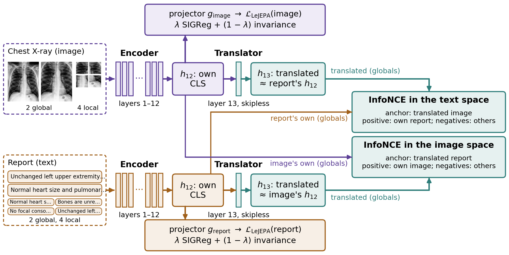

# DuoJEPA：在目标空间翻译，而不是强制两个空间重合

[English](README-en.md)

> **L1 机制组件**：双目标空间CLS InfoNCE、无残差单head图像translator及初始化。没有完整LeJEPA、文本translator、patch项或分布式预训练。

## 论文信息

| 字段 | 内容 |
| --- | --- |
| 论文链接 | [arXiv:2611.15968v1](https://arxiv.org/abs/2611.15968v1)；[固定全文](https://arxiv.org/html/2611.15968v1) |
| 公司 / 机构 | 一作 Mahmut S. Gokmen：Kentucky Center for Digital Innovation, University of Louisville |
| 首次公开日期 | 2026-11-11 20:10:52 UTC（v1）；11月13日公告，本轮公告补发现，不计为11月15日新首发 |
| 原作者开源代码 | 固定v1、arXiv资源与作者链接未找到已发布的DuoJEPA原作者源码仓库 |
| 本地 adapter / key | `duojepa`；adapter 为 null，未接入 Evolve |
| 本地复现代码目录 | `src/auto_research/foundation_models/duojepa.py`；专测 `tests/test_nov15_foundation.py` |

## 原始论文总结

### 背景与主要改动

每个encoder用LeJEPA保留自己的空间，额外单层translator将其输出映射到另一模态的own space。目标在对方空间计算，不直接比较两个own embedding；但两encoder仍被联合优化，不能把“没有直接对齐损失”说成“完全独立训练”。残差translator会提供接近identity的捷径，论文因此只在translator移除两条残差。[§5](https://arxiv.org/html/2611.15968v1#S5)

<!-- paper-figure:start -->
### 原论文关键图

固定v1 Figure 3原始PNG，无重绘；版权归原作者，arXiv perpetual non-exclusive license。图中完整双塔训练没有在本地运行。[来源与 SHA256](assets/provenance.json)。
图片来自[原论文](https://arxiv.org/html/2611.15968v1)，版权归原作者所有。
<!-- paper-figure:end -->

### 核心公式

$u(x)=LN(x)/\|LN(x)\|$，LN无可学习参数。对目标空间$m$，翻译后的anchor来自另一模态，positive是$m$同样本全局视图单位向量之和再归一化：

$$
q^m_{i,v}=u(\tau_{\bar m}(x_{i,v})),\quad
c_i^m=\frac{\sum_vu(e_m(x_{i,v}))}{\|\sum_vu(e_m(x_{i,v}))\|},\quad
L_m=-\frac1{BN}\sum_{i,v}\log\frac{e^{q^m_{i,v}\cdot c_i^m/T}}{\sum_j e^{q^m_{i,v}\cdot c_j^m/T}}.
$$

两个空间的损失相加，**target centroid也反传**，不能悄悄改成EMA/stop-gradient JEPA。

图像层为$y=\gamma_1\odot Attn(LN_1(x))$，$x'=\gamma_2\odot MLP(LN_2(y))$，没有$x+$或$y+$。初始化令$W_QW_K^T=2Z+0.6I$，V/O以增益3正交初始化，MLP正交、bias零；本地用明确的row-vector矩阵约定和单head实现。[§5.2—5.3、Appendix A](https://arxiv.org/html/2611.15968v1#S5)

### 论文离线与线上效果

作者在胸片/报告和光学/雷达数据上比较分类、检索、残差/无残差和target detach；训练空间未对齐仍可有跨模态任务性能，不保证任意单层映射都能达到。植入旋转的合成图只是说明，不是已训练医学模型的几何证明；没有生产A/B。本地不报告其AUC或检索准确率。

## 本地复现

### 数据协议与代码映射

`target_space_loss`接收`[batch,global_views,width]`外部own/translated CLS，在批内保留不同样本负例、正确positive身份和双侧梯度。`SkiplessTranslator`只实现图像pre-norm单head路径；没有原ViT/BERT、LeJEPA projectors、跨设备gather、patch局部邻域项、medical/satellite数据或数据增强。

    PYTHONPATH=src python -c 'from auto_research.foundation_models.duojepa import diagnostic; print(diagnostic(42, device="cpu"))'

### 结果、负控与边界

一次反向检查target双方和translator有梯度、QK乘积符合初始化；将末层归零后输出严格为0，排除隐藏identity捷径。配对置换不改loss，单独打乱target身份会改loss。CUDA证据见[回执](../../gpu-validations/duojepa-a100-20261115.json)与[三种子产物](metrics/component-cuda-seeds42-44.json)；没有训练完整空间，也不声称本地形成未对齐但可检索的表征。

### 高成本完整实验

Table 8记载卫星双ViT训练100k步/batch256，2×H200耗时28h49m；胸片/报告20k步/batch128，2×H200耗时2h34m，另有多臂消融。**成本过高，不复现（审查 DONE）**；不下载影像、报告、权重，不试跑全矩阵、不自动重试。
