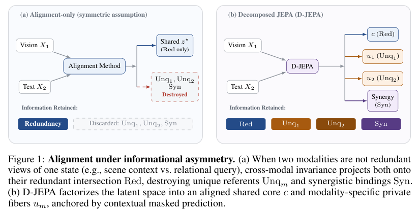

# D-JEPA: alignment alone does not preserve private information

<!-- source-sha256: 8a2b4116620b1775b241ac6aaaaa8077f0237ea8cdd9616bee4f260e9c283dbd -->

[简体中文](README.md)

> **L1 single-context objective.** Shared/private subspaces, separate SIGReg, stopped reconstruction targets, and four correlation penalties; not CLEVR capability, PID estimation, or full training.

## Paper information

| Field | Value |
| --- | --- |
| Paper | [arXiv:2611.16639v1](https://arxiv.org/abs/2611.16639v1); [fixed text](https://arxiv.org/html/2611.16639v1) |
| Institution/company | Yusuf Shihata; fixed v1 lists a name/email but **no institution**. No university/company is inferred |
| Original release | November 12, 2026, 11:13:13 UTC; announced November 13 |
| Authors' code | [Vixel2006/D-JEPA](https://github.com/Vixel2006/D-JEPA), MIT; models/training source reviewed at 5e99bdde79716d742622e53cc0c1fa60dfeb459a |
| Local adapter/key | d-jepa; adapter null; no Evolve integration |
| Local code | src/auto_research/foundation_models/d_jepa.py; tests/test_nov15_foundation.py |

## Original paper

### Motivation and changes

An image and its question need not contain equivalent information. Exact alignment may retain only redundancy and discard private details or synergistic information. The paper bounds information retained by exactly aligned solutions, then introduces shared cores and private fibers. That bound is not a theorem about every complete model with auxiliary objectives, nor proof that all JEPAs collapse. [Sections 2–3](https://arxiv.org/html/2611.16639v1#S2)

### Key original figure

Figure 1 and caption on fixed-v1 PDF page 2; copyright retained by the authors, arXiv perpetual non-exclusive license. Its information decomposition is not a local measurement. [Provenance](assets/provenance.json).

### Equations

Each modality maps $h_m\mapsto[c_m\|u_m]$. Shared alignment uses unit-normalized cosine energy. SIGReg acts on the four subspaces separately, not once on their concatenation. Reconstruction predicts another view's stopped representation from $[c_m^a,u_m^a]$, never an answer label.

$$
L_{ind}=C(u_v,c_v)+C(u_t,c_t)+C(u_v,c_t)+C(u_t,c_v),\quad
C(A,B)=\|Corr(A,B)\|_F^2/\max(d_A,d_B).
$$

There is **no** $C(u_v,u_t)$ term, allowing private fibers to coordinate on joint tasks.

$$
L=(1-\lambda)(L_{inv}+L_{cross})+\lambda L_{sig}+w_{rec}L_{rec}+w_{ind}L_{ind}.
$$

The local single-context regularizer follows the four-subspace $\frac12\sum$ normalization in paper Eq.5. The fixed author commit uses additional multi-view averaging, so complete numerical parity is not claimed. Reconstruction follows the author's elementwise MSE reduction; paper Eq.6 uses norm notation, and summing over features would require rescaled weights rather than mixing conventions. ECF uses the author's 17-knot $2\int_0^3$ quadrature, not a substituted variance penalty. [Section 3.1](https://arxiv.org/html/2611.16639v1#S3)

### Paper results

The paper reports CLEVR downstream accuracy 39.61±3.07%, versus alignment-only 21.25±0.69%, using frozen backbones and capacity-matched probes. These are not local metrics. The text lists both 3,000 scenes times six questions and 12,000 pairs, an internal count inconsistency we do not silently repair. No production A/B is reported.

## Local component

### Inputs and code

objective consumes externally supplied subspaces, a within-modality invariance scalar, prediction/target features and random directions; targets are detached explicitly. correlation_penalty/independence/sigreg retain sample-correlation normalization, the four selected pairs and ECF. There is no DINOv2, BERT, view sampler, CLEVR, probe or flow-PID. Tiny linear heads and generated features are test fixtures, not the authors' backbone.

    PYTHONPATH=src python -c 'from auto_research.foundation_models.d_jepa import diagnostic; print(diagnostic(42, device="cpu"))'

### Controls and limits

Twelve optimization steps check target isolation, trainable heads, finite terms and loss reduction. Tests explicitly exclude private–private decorrelation. See the [GPU receipt](../../gpu-validations/d-jepa-a100-20261115.json) and [three-seed artifact](metrics/component-cuda-seeds42-44.json). No information quantity, synergy, CLEVR accuracy or Evolve promotion is established.

### Full experiment not reproduced

The full CLEVR multi-arm, three-seed suite requires backbone extraction, 3,000 updates per trained arm, 60-epoch probes and 400-step flow-PID, plus a separate synthetic suite. Downloads and the multistage campaign exceed a short single-device budget. **Too costly; not reproduced (review DONE).** A tiny synthetic loss check is not relabeled as the full study; no automatic retry is queued.
