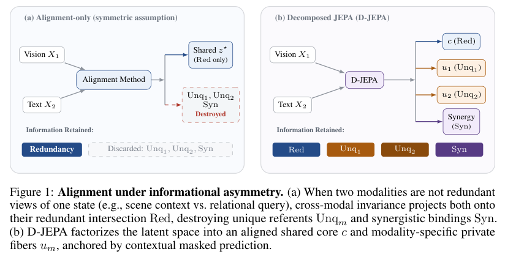

# D-JEPA：共享与私有表征不能只做对齐

[English](README-en.md)

> **L1 单context目标组件**：共享/私有分解、分开SIGReg、重建stop-gradient与四组相关惩罚；不是CLEVR能力、PID估计或完整训练复现。

## 论文信息

| 字段 | 内容 |
| --- | --- |
| 论文链接 | [arXiv:2611.16639v1](https://arxiv.org/abs/2611.16639v1)；[固定全文](https://arxiv.org/html/2611.16639v1) |
| 公司 / 机构 | 一作 Yusuf Shihata；固定v1首页仅列姓名、邮箱，**未列机构**，不推断学校或公司 |
| 首次公开日期 | 2026-11-12 11:13:13 UTC（v1）；11月13日公告 |
| 原作者开源代码 | [Vixel2006/D-JEPA](https://github.com/Vixel2006/D-JEPA)，MIT，核对commit `5e99bdde79716d742622e53cc0c1fa60dfeb459a` 的模型和训练源码 |
| 本地 adapter / key | `d-jepa`；adapter 为 null，未接入 Evolve |
| 本地复现代码目录 | `src/auto_research/foundation_models/d_jepa.py`；专测 `tests/test_nov15_foundation.py` |

## 原始论文总结

### 背景与主要改动

图像和问题不一定是信息等价的两种视图。强迫两者完全对齐可能只保留共享部分，丢掉私有细节和联合推理所需信息。论文先对严格对齐解给出信息保留界，再设计共享core与私有fiber；这个界不适用于任意带辅助目标的完整模型，也不证明所有JEPA都塌缩。[§2—3](https://arxiv.org/html/2611.16639v1#S2)

<!-- paper-figure:start -->
### 原论文关键图

固定v1第2页Figure 1与图注，版权归原作者；arXiv perpetual non-exclusive license。原图中的信息论分解不是本地已测得的结果。[来源与 SHA256](assets/provenance.json)。
图片来自[原论文](https://arxiv.org/html/2611.16639v1)，版权归原作者所有。
<!-- paper-figure:end -->

### 核心公式

每模态$h_m\mapsto[c_m\|u_m]$，共享部分用单位归一化余弦能量；SIGReg独立作用于四个子空间，不能在拼接后只做一次。重建预测器读$[c_m^a,u_m^a]$，目标是另一view的冻结/停止梯度表示，不是答案标签。

$$
L_{ind}=C(u_v,c_v)+C(u_t,c_t)+C(u_v,c_t)+C(u_t,c_v),\quad
C(A,B)=\|Corr(A,B)\|_F^2/\max(d_A,d_B).
$$

**没有**$C(u_v,u_t)$，允许私有分支为联合任务协调。

$$
L=(1-\lambda)(L_{inv}+L_{cross})+\lambda L_{sig}+w_{rec}L_{rec}+w_{ind}L_{ind}.
$$

本地按论文Eq5的$\frac12\sum$四子空间定义单context正则；作者固定commit的多view循环使用另一层平均，不能声称数值完全一致。重建采用作者源码的逐元素MSE reduction；论文Eq6使用范数简写，跨特征维求和时需相应重标权重，不能混用。ECF实现参考作者的17点$2\int_0^3$离散积分，不将方差惩罚替代SIGReg。[§3.1 Eq3—8](https://arxiv.org/html/2611.16639v1#S3)

### 论文离线与线上效果

论文报告CLEVR下游39.61±3.07%，相对alignment-only的21.25±0.69%；是作者冻结backbone、容量匹配probe的离线结果，不是本地指标。原文同时写3000场景×6问题与12000对，计数存在内在不一致，本地不替作者修造数据切分。没有生产A/B。

## 本地复现

### 数据协议与代码映射

`objective`接收调用方提供的四子空间、同模态invariance标量、预测/目标特征与随机方向；特征目标显式detach。`correlation_penalty/independence/sigreg`分别保留样本相关系数、四对选择和ECF正则。没有DINOv2、BERT、视图采样、CLEVR、probe或flow-PID。诊断里的小线性头和生成特征只是测试夹具，不是原作者backbone。

    PYTHONPATH=src python -c 'from auto_research.foundation_models.d_jepa import diagnostic; print(diagnostic(42, device="cpu"))'

### 结果、负控与边界

12步诊断只检查目标梯度隔离、四分支可训练、各项有限与训练loss下降；专测明确排除私有—私有惩罚。CUDA验收见[回执](../../gpu-validations/d-jepa-a100-20261115.json)与[三种子产物](metrics/component-cuda-seeds42-44.json)。没有信息量、synergy、CLEVR准确率或Evolve晋级证据。

### 高成本完整实验

完整CLEVR多臂×三种子包含冻结backbone提取、每臂3000步、60epoch probe与400步flow-PID，另有合成套件。整套下载和多阶段矩阵超出短时单卡预算，**成本过高，不复现（审查 DONE）**；不尝试用少量合成训练声称完整复现，不自动重试。
