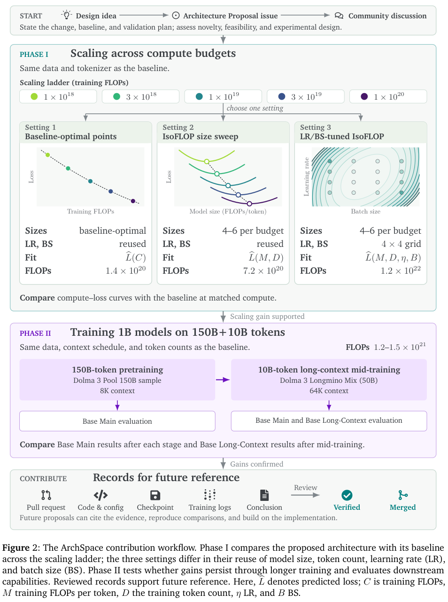

# ArchSpace: comparable budgets for architecture research

<!-- source-sha256: f6418801859e15fc9ebdb43c23db9b1a13c3953d38e5a84b4af5d7e62e515cc6 -->

[简体中文](README.md)

> **L1 arithmetic component.** It evaluates published loss-surface coefficients and budget relations. It is not architecture search and does not execute Evolve candidates.

## Paper information

| Field | Value |
| --- | --- |
| Paper | [arXiv:2611.17332v1](https://arxiv.org/abs/2611.17332v1); [fixed text](https://arxiv.org/html/2611.17332v1) |
| Institution/company | Jie Wang: Shanghai AI Laboratory / East China Normal University, in byline order |
| Original release | November 12, 2026, 18:59:52 UTC; announced November 13 |
| Authors' code | [InternLM/archspace](https://github.com/InternLM/archspace), Apache-2.0; reviewed commit 002e48df32c880898b0813e02c0439544b35cc85. A proposal/record repository does not establish execution of all training data and fitting scripts |
| Local adapter/key | archspace; adapter null; no Evolve integration |
| Local code | src/auto_research/foundation_models/archspace.py; tests/test_nov15_foundation.py |

## Original paper

### Motivation and changes

Reusing a baseline's best hyperparameters can hide architecture gains, while rankings can reverse after learning-rate decay. ArchSpace connects proposals, matched-data/tokenizer compute ladders, longer training and auditable records. Its settings progress from baseline-optimal points to IsoFLOP size sweeps and joint LR/batch sweeps. Validation averages eleven domains equally rather than weighting large domains more. [Sections 3–4](https://arxiv.org/html/2611.17332v1#S3)

### Key original figure

Figure 2 and caption, fixed-v1 PDF page 3; CC BY 4.0, copyright retained by the authors. Its workload costs are not local execution records. [Provenance](assets/provenance.json).

### Equations

$M$ denotes **training FLOPs per token**, not parameter count; $D$ denotes tokens and $C=MD$:

$$
L^*=L_\infty+(\alpha_M M^{-\gamma_M}+\alpha_D D^{-\gamma_D})^{\gamma_{MD}}.
$$

Optimal LR, batch size and penalty height follow power laws in $M,D$. For $e=\log(\eta/\eta^*)$ and $b=\log(B/B^*)$:

$$
\hat L=L^*+2h[\cosh(e-b/2)-1]+2h\rho[\cosh(b)-1].
$$

The conditional optimum is therefore $\eta=\eta^*\sqrt{B/B^*}$, not an independently chosen LR. The paper fits the base to each model/budget group's minimum loss, freezes it, then fits the hyperparameter penalty to all runs. Local code **does not refit**: it uses published Qwen3.5/OLMo3 coefficients from Tables 1–2. [Section 4.2](https://arxiv.org/html/2611.17332v1#S4)

### Paper results

The authors report approximately 0.25%/0.27% all-run loss-prediction MAPE for the two baselines. These are their fits and validation, not local model results. No production A/B is reported. The coefficients cannot automatically be transferred to arbitrary new architectures.

## Local component

### Inputs and code

CoupledLaw.base_loss/recipe/loss/budget_optimum evaluate the published surface, LR/batch coupling and analytic optimum under fixed FLOPs. Only CPU standard-library arithmetic is used: no corpus, model training, paper retrieval, scaling-law fitting, or Evolve execution.

    PYTHONPATH=src python -c 'from auto_research.foundation_models.archspace import diagnostic; print(diagnostic(42, device="cpu"))'

### Controls and limits

Controls check budget conservation, zero penalty at the published recipe, the square-root LR/batch relation, and neighboring sizes around the budget optimum. Repeating seeds does not create independent evidence. Invalid/nonfinite budgets and CUDA requests fail explicitly.

### Full experiment not reproduced

Phase I has five compute budgets, 4–6 sizes per budget and LR/batch grids; Phase II trains 1B models on 150B pretraining plus 10B long-context tokens. **Too costly; not reproduced (review DONE).** No corpus/weights, full matrix or automatic retry is initiated.
