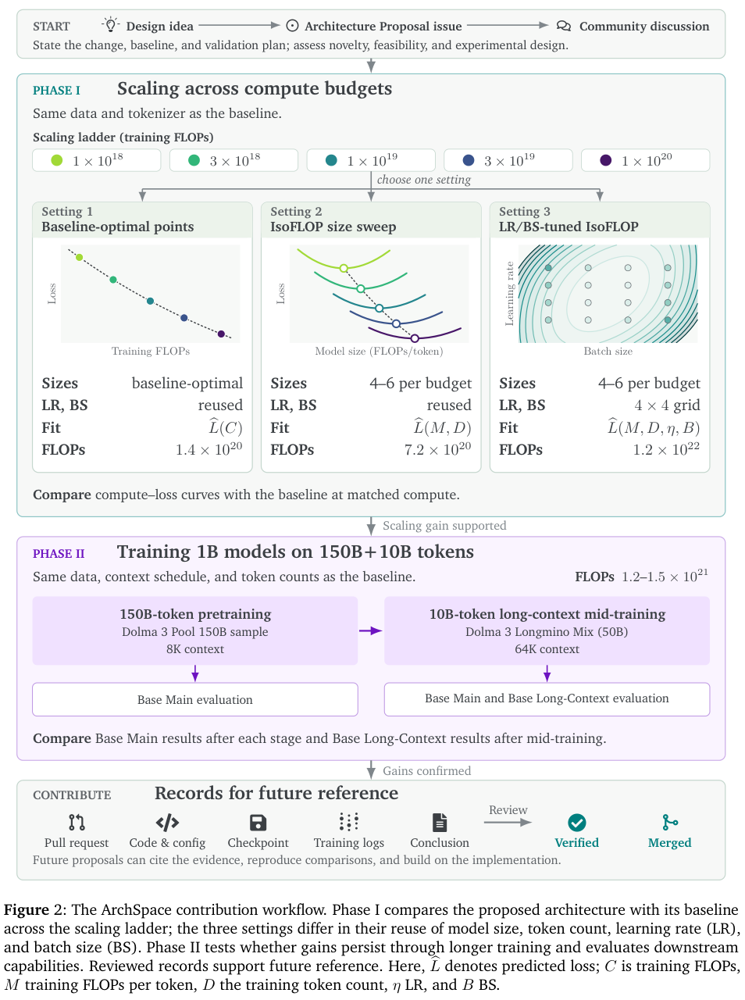

# ArchSpace：用可比较的预算记录架构研究

[English](README-en.md)

> **L1 算术组件**：只复算论文公开系数的损失曲面和预算关系，不是架构搜索平台，不自动生成或执行 Evolve 候选。

## 论文信息

| 字段 | 内容 |
| --- | --- |
| 论文链接 | [arXiv:2611.17332v1](https://arxiv.org/abs/2611.17332v1)；[固定全文](https://arxiv.org/html/2611.17332v1) |
| 公司 / 机构 | 一作 Jie Wang：Shanghai AI Laboratory / East China Normal University，以首页顺序记录 |
| 首次公开日期 | 2026-11-12 18:59:52 UTC（v1）；11月13日公告 |
| 原作者开源代码 | [InternLM/archspace](https://github.com/InternLM/archspace)，Apache-2.0；核对commit `002e48df32c880898b0813e02c0439544b35cc85`。公开提案/记录仓库不等于所有训练数据和拟合脚本已运行 |
| 本地 adapter / key | `archspace`；adapter 为 null，未接入 Evolve |
| 本地复现代码目录 | `src/auto_research/foundation_models/archspace.py`；专测 `tests/test_nov15_foundation.py` |

## 原始论文总结

### 背景与主要改动

复用基线的最佳超参可能掩盖新架构优势；中途checkpoint的排序也可能在完整学习率衰减后反转。ArchSpace把架构提案、相同数据/tokenizer的预算梯度比较、较长训练和可审查记录连起来。比较从复用基线最优点，到IsoFLOP规模搜索，再到同时搜索LR/BS逐级加严；验证损失按11个域等权，不让大域主导。[§3—4](https://arxiv.org/html/2611.17332v1#S3)

<!-- paper-figure:start -->
### 原论文关键图

固定v1第3页Figure 2及图注，版权归原作者，CC BY 4.0；三种setting的原文成本不是本地执行记录。[来源与 SHA256](assets/provenance.json)。
图片来自[原论文](https://arxiv.org/html/2611.17332v1)，版权归原作者所有。
<!-- paper-figure:end -->

### 核心公式

$M$是**每token训练FLOPs**，不是参数量；$D$是训练token数，预算$C=MD$：

$$
L^*=L_\infty+(\alpha_M M^{-\gamma_M}+\alpha_D D^{-\gamma_D})^{\gamma_{MD}}.
$$

最优LR、batch和曲面高度分别是$M,D$的幂律。设$e=\log(\eta/\eta^*)$，$b=\log(B/B^*)$：

$$
\hat L=L^*+2h[\cosh(e-b/2)-1]+2h\rho[\cosh(b)-1].
$$

因此给定batch后的条件最优LR为$\eta^*\sqrt{B/B^*}$，不是独立选择LR。原文先用每个模型/预算组的最小loss拟合base，再冻结base拟合全run的超参惩罚；本地**没有重新拟合**，只录入Table 1—2的Qwen3.5/OLMo3系数。[§4.2](https://arxiv.org/html/2611.17332v1#S4)

### 论文离线与线上效果

作者报告两基线全run损失预测MAPE约0.25%/0.27%；这是其拟合与外推验证，不是本地模型性能。没有线上A/B。本地曲面数值不表示任意新架构也遵循同一系数。

## 本地复现

### 数据协议与代码映射

`CoupledLaw.base_loss/recipe/loss/budget_optimum`复算公开曲面、LR/BS耦合与固定FLOP预算下的解析最优点。仅CPU标准库算术，不读取语料、训练模型、检索论文、拟合scaling law或调用Evolve。

    PYTHONPATH=src python -c 'from auto_research.foundation_models.archspace import diagnostic; print(diagnostic(42, device="cpu"))'

### 结果、负控与边界

检查预算守恒、公开最优点的零惩罚、条件最优LR随batch平方根变化，以及最优点优于邻近规模。重复seed不创造独立统计证据；未完成的拟合或训练不伪装成接入。非法/非有限预算会报错，CUDA请求也明确拒绝。

### 高成本完整实验

完整Phase I有五个FLOP预算、每预算4—6种规模及LR/BS网格；Phase II为1B模型150B预训练token再加10B长文token。**成本过高，不复现（审查 DONE）**，不下载语料/权重，不试跑完整矩阵，不自动重试。
