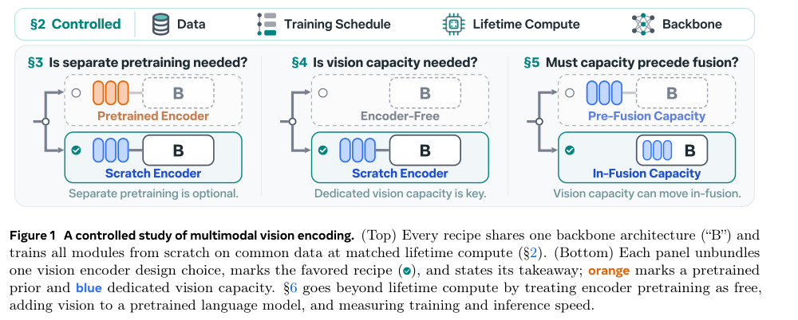

# Unbundling: vision-specific capacity inside fusion

<!-- source-sha256: 54272bc45b34a3b748db3a9602751fa76b0ea0db090b46fbd0eabcad1208af92 -->

[简体中文](README.md)

> **L1 mechanism component.** Additive vision-only QKVO/SwiGLU and joint causal attention, not a trained multimodal model. Full experiments are **too costly; not reproduced (review DONE)**.

## Paper information

| Field | Value |
| --- | --- |
| Paper | [arXiv:2611.17334v1](https://arxiv.org/abs/2611.17334v1); [fixed text](https://arxiv.org/html/2611.17334v1) |
| Institution/company | Ellis Brown: Meta FAIR / New York University, Meta first on the PDF byline; equal contribution with Chris Hoang, ordered randomly |
| Original release | November 12, 2026, 18:59:54 UTC; announced November 13, not first released November 15 |
| Authors' code | No released source link found in fixed v1, arXiv resources, or the [official project](https://unbundling.github.io/); the project page is not a code repository |
| Local adapter/key | unbundling-vision; adapter null; no Evolve integration |
| Local code | src/auto_research/foundation_models/unbundling_vision.py; tests/test_nov15_foundation.py |

## Original paper

### Motivation and changes

Vision encoders bundle three choices: upstream visual pretraining, dedicated visual capacity, and placing that capacity before fusion. Matched-data, matched-lifetime-compute comparisons separate them: pretraining may be optional, but dedicated visual capacity still matters. Early in-fusion capacity can replace a separate pre-fusion location; this does not mean all vision-specific computation is unnecessary. [Sections 2–5](https://arxiv.org/html/2611.17334v1#S2)

### Key original figure

Rendered crop of Figure 1 and its caption on PDF page 1, CC BY 4.0, copyright retained by the authors. It is not a locally executed full model. [Provenance and hashes](assets/provenance.json).

### Equations

With visual-token mask $m_i$:

$$
P(z_i)=W_Pz_i+m_i\Delta W_Pz_i,\qquad P\in\{Q,K,V,O\}.
$$

Q/K/V enter **one joint attention**. Both FFNs consume the same normalized input, not one another's output:

$$
h'_i=h_i+F(N(h_i))+m_i\Delta F(N(h_i)).
$$

All extra QKVO matrices start at zero; the extra SwiGLU output matrix and bias start at zero. The initial function therefore equals the shared path. Text tokens receive no additional projection, but can still attend to visual tokens. [Section 5.1 and Appendix E.1](https://arxiv.org/html/2611.17334v1#S5)

~~~mermaid
flowchart LR
  X[Tokens and visual mask] --> Q[Shared QKV plus visual increment]
  Q --> A[Joint causal attention]
  A --> O[Shared O plus visual increment]
  O --> N[Same normalized input]
  N --> F[Shared SwiGLU]
  N --> V[Visual SwiGLU]
  F --> R[Residual addition]
  V --> R
~~~

### Paper results

The study compares VQA and language tasks across 0.6B–6.4B models under matched data and lifetime FLOPs. It supports early dedicated visual capacity, not arbitrary removal of vision encoders. H200 time-to-first-token results depend on resolution, concurrency, and model settings. No randomized production A/B is established; none of those results are local measurements.

## Local component

### Inputs and code

InFusionBlock is a small, single joint causal-attention layer with FFN-only or QKVO+FFN added capacity. Inputs are external finite tensors and a boolean visual mask. There is no image patch encoder, RoPE/GQA, multilayer backbone, tokenizer, or corpus. RMSNorm and standard PyTorch attention are explicit reference choices, not full architecture parity.

    PYTHONPATH=src python -c 'from auto_research.foundation_models.unbundling_vision import diagnostic; print(diagnostic(42, device="cpu"))'
    PYTHONPATH=src python -m pytest tests/test_nov15_foundation.py -q

### Controls and limits

A 16-step small-tensor diagnostic checks optimization. Tests cover initial equivalence, text-only behavior, identical FFN inputs, modality masks and causality. A lower training MSE is not evidence of visual capability, efficiency or Evolve improvement. CUDA must be real and available, with no CPU fallback. Consult the actual [GPU receipt](../../gpu-validations/unbundling-vision-a100-20261115.json) and [three-seed artifact](metrics/component-cuda-seeds42-44.json).

### Full experiment not reproduced

From-scratch scale ladders, lifetime-compute comparisons around $10^{22}$ FLOPs, eight-GPU training throughput and H200 concurrent TTFT matrices exceed a short single-A100/A30 or Mac budget. **Too costly; not reproduced (review DONE).** No weights or data are downloaded, no full trial is started, and no automatic retry is queued.
