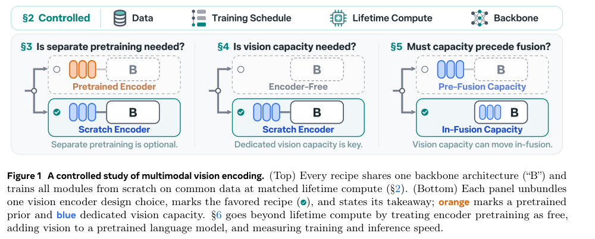

# Unbundling：把视觉专属容量放进融合过程

[English](README-en.md)

> **L1 机制组件**：加性 vision-only QKVO/SwiGLU 与联合因果注意力，不是训练好的多模态模型。完整实验**成本过高，不复现（审查 DONE）**。

## 论文信息

| 字段 | 内容 |
| --- | --- |
| 论文链接 | [arXiv:2611.17334v1](https://arxiv.org/abs/2611.17334v1)；[固定全文](https://arxiv.org/html/2611.17334v1) |
| 公司 / 机构 | 一作 Ellis Brown：Meta FAIR / New York University，首页以 Meta 标记在前；与 Chris Hoang 共同一作、随机排序 |
| 首次公开日期 | 2026-11-12 18:59:54 UTC（v1）；11月13日公告，不是11月15日首发 |
| 原作者开源代码 | 固定v1、arXiv资源与[官方项目页](https://unbundling.github.io/)未找到已发布源码链接；不把项目页当源码仓库 |
| 本地 adapter / key | `unbundling-vision`；adapter 为 null，未接入 Evolve |
| 本地复现代码目录 | `src/auto_research/foundation_models/unbundling_vision.py`；专测 `tests/test_nov15_foundation.py` |

## 原始论文总结

### 背景与主要改动

传统视觉编码器把视觉预训练、视觉专属容量、融合前放置三个选择捆绑在一起。本文在共同数据和相同生命周期计算量下分开比较：视觉先验可以不预训练，但不能把“无需预训练编码器”误读成“无需视觉专属容量”。早期 backbone 内的视觉专属模块也能承担这些容量，不一定要在融合前独立编码。[§2—5](https://arxiv.org/html/2611.17334v1#S2)

<!-- paper-figure:start -->
### 原论文关键图

原论文第1页 Figure 1及图注的渲染裁取，版权归原作者，CC BY 4.0；不是本地已运行的完整模型。[来源与 SHA256](assets/provenance.json)。
图片来自[原论文](https://arxiv.org/html/2611.17334v1)，版权归原作者所有。
<!-- paper-figure:end -->

### 核心公式

对视觉 mask $m_i\in\{0,1\}$，共享投影上增加视觉分支：

$$
P(z_i)=W_Pz_i+m_i\Delta W_Pz_i,\qquad P\in\{Q,K,V,O\}.
$$

Q/K/V仍进入**同一个联合注意力**。额外 FFN 与共享 FFN 消费同一份归一化输入，而不是串联：

$$
h'_i=h_i+F(N(h_i))+m_i\Delta F(N(h_i)).
$$

新增QKVO全部零初始化；新增SwiGLU的输出投影和输出bias为零，使初始函数与共享路径严格一致。文本token不调用额外容量，但视觉token仍可经联合注意力影响文本输出。[§5.1、Appendix E.1](https://arxiv.org/html/2611.17334v1#S5)

~~~mermaid
flowchart LR
  X[图文token及视觉mask] --> Q[共享QKV加视觉专属增量]
  Q --> A[单次联合因果注意力]
  A --> O[共享O加视觉O增量]
  O --> N[同一归一化输入]
  N --> F[共享SwiGLU]
  N --> V[视觉SwiGLU]
  F --> R[残差相加]
  V --> R
~~~

### 论文离线与线上效果

原文用0.6B—6.4B规模、共同数据和生命周期FLOPs对照VQA与语言任务，支持早期专属视觉容量，不支持任意结构都能无损移除编码器。H200 TTFT结果还依赖分辨率、并发和模型设置；没有生产随机流量A/B证据。本地不复用这些数字作为实测结果。

## 本地复现

### 数据协议与代码映射

`InFusionBlock`实现一层小型联合因果注意力，支持FFN-only或QKVO+FFN分支。输入是调用方提供的有限张量和布尔视觉mask；没有图像patch编码器、RoPE/GQA、多层backbone、tokenizer或训练语料。这里的RMSNorm和标准PyTorch注意力是明确的参考实现，不声称作者完整网络一致。

    PYTHONPATH=src python -c 'from auto_research.foundation_models.unbundling_vision import diagnostic; print(diagnostic(42, device="cpu"))'
    PYTHONPATH=src python -m pytest tests/test_nov15_foundation.py -q

### 结果、负控与边界

诊断执行16步小张量优化；专测检查零初始化等价、文本-only分支不变、两FFN同输入、视觉mask及因果性。训练MSE降低只说明该算子可微可更新，不证明视觉能力、效率或Evolve改善。CUDA路径必须真实NVIDIA设备，否则报错，不回退CPU；[GPU回执](../../gpu-validations/unbundling-vision-a100-20261115.json)与[三种子产物](metrics/component-cuda-seeds42-44.json)以本轮实际验收为准。

### 高成本完整实验

完整工作包括从零训练规模梯度、约$10^{22}$生命周期FLOPs比较、八卡训练吞吐及H200并发TTFT矩阵。超出单A100/A30或Mac短时预算，**成本过高，不复现（审查 DONE）**；不下载权重/数据，不启动完整试训，不进入自动重试。
