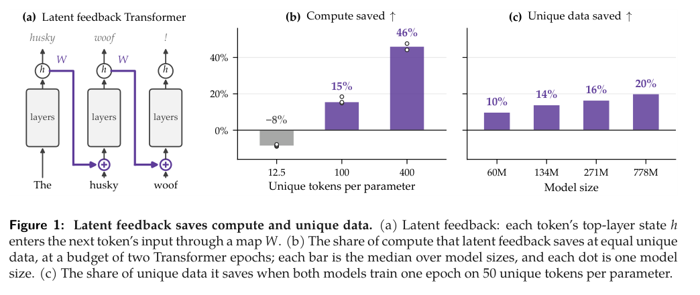

# Latent Feedback: matched-compute scaling with repeated data

<!-- source-sha256: 3915bae6e2e1430176f83ab1893730466e686e758828fa01a27ff37ab5853113 -->

[简体中文](README.md)

> **Review only, not implemented.** Full experiments are **too costly; not reproduced (review DONE)**. No capability improvement or Evolve promotion is claimed.

## Paper information

| Field | Value |
| --- | --- |
| Paper | [arXiv:2611.20404v1](https://arxiv.org/abs/2611.20404v1); [fixed text](https://arxiv.org/html/2611.20404v1) |
| Institution/company | First author Benhao Huang: Institute of Foundation Models / Carnegie Mellon University |
| Original publication | 2026-11-16T02:05:32Z (arXiv v1); separately observed announcement: not confirmed from the current announcement snapshot |
| Authors' code | [Author repository](https://github.com/ifm-ai/LoRM), verified HEAD `2af72d5f6e91a9c62ededcf03bb07efe66d0dcb0`. No upstream source was copied; its license was not separately verified. |
| Local adapter/key | `latent-feedback-scaling`; adapter null; no Evolve integration |
| Local source | None; documentation, original figure and learning material only |

## Original paper

### Motivation and changes

Latent feedback passes the preceding token top-layer state into the next token input at additional per-token cost. The paper lets a plain Transformer spend the same FLOPs on more epochs, controlling unique data and model scale rather than matching token counts alone. [Reviewed method](https://arxiv.org/html/2611.20404v1#S3): 3, 4.

### Key original figure

The fixed-version author figure/table is not a local result. Scientific content was not redrawn. Copyright remains with the original authors; no open-image license is inferred. [Source, crop and SHA256](assets/provenance.json).

### Equations

$$
R=F/c_s,\quad D_s=U[1+R^*(1-e^{-(R-1)/R^*})],\quad L_s=E+[(A/(v_sN)^\alpha)^q+(B/D_s^\beta)^q]^{1/q}.
$$

Below one epoch effective data is RU; later repeat value saturates. The capacity multiplier differs from per-token compute cost. Predictions depend on fitted laws and checked extrapolation, not an unconditional claim that more repetition always saves compute.

~~~mermaid
flowchart LR
 B[Model size unique data and FLOP budget] --> R[Transformer and latent-feedback training grids]
 R --> F[Joint repeat-aware scaling fit]
 F --> H[Held-out scale and downstream checks]
~~~

### Reported results and evidence

The reported quality/efficiency relies on the full paper configuration, which was not reproduced locally. No production randomized-traffic A/B is reported for this method. Benchmarks, single-device serving measurements, or using Meta/Google models are not production A/B evidence.

## Local implementation

### Protocol and code mapping

Review only. Published-coefficient arithmetic is not presented as a new fit, and a generic feedback layer is not presented as capability evidence. Equal FLOPs, unique data and epochs remain distinct axes.

There is no local run command, metrics artifact or GPU receipt. Review DONE is not implementation completion, and no automatic reproduction/retry queue is created.

### Same-topic comparison and boundaries

ArchSpace compares architecture/hyperparameter budget surfaces. This paper studies repeated data and feedback compute. Coefficients are not interchangeable, and a predicted loss is not a trained candidate. Multiple seeds do not upgrade these mechanism checks into L2/L3 capability evidence.

### High-cost full experiments

60M/134M/271M/778Mbackbones,12.5N–400Nunique-tokenpools,nestedLR/decaygrids,100Mvalidationtokensand109downstreamtasks; full experiment high cost.

This is a configuration-based cost assessment, not measured local duration. The budget is one A100 or A30, or the local Mac. No multi-GPU capacity, costly probing run, large-resource download or automatic retry is assumed. Full experiments are **too costly; not reproduced (review DONE)** and do not block review closure.
