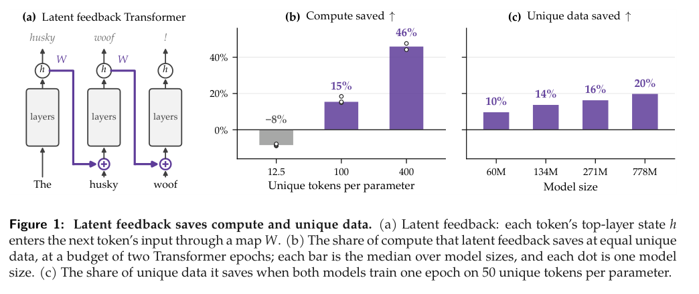

# Latent Feedback：在重复数据下比较相同计算预算

[English](README-en.md)

> **资料收录，未实现**。完整实验**成本过高，不复现（审查 DONE）**；无能力提升或Evolve晋级声明。

## 论文信息

| 字段 | 内容 |
| --- | --- |
| 论文链接 | [arXiv:2611.20404v1](https://arxiv.org/abs/2611.20404v1)；[固定全文](https://arxiv.org/html/2611.20404v1) |
| 公司 / 机构 / 学校 | 一作 Benhao Huang：Institute of Foundation Models / Carnegie Mellon University |
| 首次公开日期 | 2026-11-16T02:05:32Z（arXiv v1）；公告日期另记为 当前公告快照未确认，不据此推断首发 |
| 原作者开源代码 | [作者仓库](https://github.com/ifm-ai/LoRM)；核验HEAD `2af72d5f6e91a9c62ededcf03bb07efe66d0dcb0`。未复制上游源码；许可证未另行核验。 |
| 本地 adapter / key | `latent-feedback-scaling`；`adapter: null`，未接入Evolve |
| 本地复现代码目录 | 无；仅本文档、原图与学习资料，未实现 |

## 原始论文总结

### 背景与主要改动

latent feedback把上一token的顶层状态注入下一token输入，花更多每token计算。本文不只在相同token数比较，而让普通Transformer把相同FLOPs用于更多epoch，并同时控制unique数据和模型规模。 [已核方法位置](https://arxiv.org/html/2611.20404v1#S3)：3, 4。

<!-- paper-figure:start -->
### 原论文关键图

原图/原表来自固定v1，未经科学内容改绘；是作者方法或结果，不是本地测量。[来源、裁切和SHA256](assets/provenance.json)。图片来自[原论文](https://arxiv.org/html/2611.20404v1)，版权归原作者所有。
<!-- paper-figure:end -->

### 核心公式

$$
R=F/c_s,\quad D_s=U[1+R^*(1-e^{-(R-1)/R^*})],\quad L_s=E+[(A/(v_sN)^\alpha)^q+(B/D_s^\beta)^q]^{1/q}.
$$

R<1时有效数据改为RU；R>=1时重复收益逐渐饱和。capacity multiplier与每token额外计算成本不同，loss预测依赖重新拟合和外推验证，不是重复token越多越省的无条件结论。

~~~mermaid
flowchart LR
 B[Model size unique data and FLOP budget] --> R[Transformer and latent-feedback training grids]
 R --> F[Joint repeat-aware scaling fit]
 F --> H[Held-out scale and downstream checks]
~~~

### 论文离线与线上效果

原文以其完整训练/推理与评测配置讨论效果；本地没有复跑该矩阵，不把论文数值写成本地指标。未报告本文方法的生产随机流量线上A/B；benchmark、单卡服务计时或使用Meta/Google模型本身不是A/B证据。具体质量/速度与成本配置须一起阅读。

## 本地复现

### 数据协议与代码映射

仅资料收录，不录入公开系数算术冒充重新拟合，也不实现generic feedback层就声称模型效果。保留equal-FLOP、unique-data与epoch三个轴的证据边界。

本页没有本地运行命令、指标文件或GPU回执。审查DONE不等于完成实现；不进入自动复现或重试队列。

### 同主题比较与边界

ArchSpace比较架构/超参的匹配预算曲面；本篇专门研究重复数据及feedback的额外计算。两种拟合系数不可交换，单独输出预测loss不等于已训练候选。 本地结果只支撑上面列明的算子合同，多个seed不将L1升级成公开能力L2/L3。

### 高成本完整实验

原文有60M/134M/271M/778M四尺度、12.5N—400N unique-token池、嵌套LR/decay网格、100M验证token与109项下游任务。完整预训练/拟合矩阵高成本，不用虚构loss代替。

以上是配置依据的成本判断，不是本地实测耗时。资源预算为单A100或A30，或本地Mac；不假定多卡、不断扩大或试训证明成本。**成本过高，不复现（审查 DONE）**；不下载大模型/数据，不启动完整矩阵，不自动重试，不阻塞本轮审查闭环。
