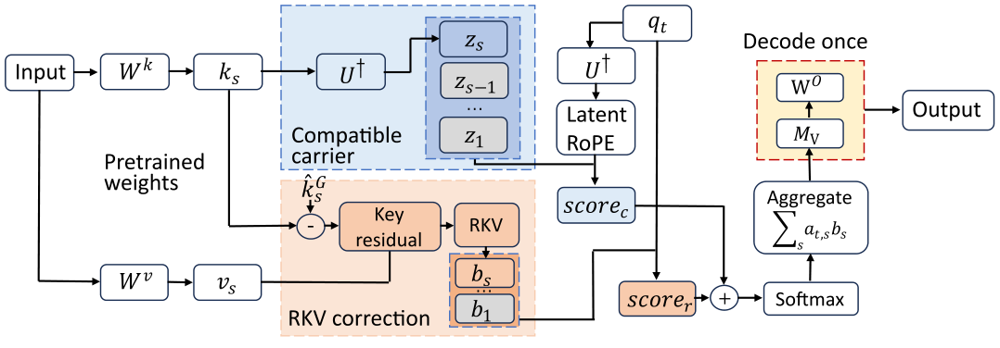

# GaugeRoPE: executable rotary carriers plus residual KV codes

<!-- source-sha256: 80e414217915904b68baaf2cd6462409e4495af1670f3361b457a31f1cbaa7c9 -->

[简体中文](README.md)

> **L1 mechanism component, not a complete model.** Full experiments are **too costly; not reproduced (review DONE)**. No capability improvement or Evolve promotion is claimed.

## Paper information

| Field | Value |
| --- | --- |
| Paper | [arXiv:2611.20524v1](https://arxiv.org/abs/2611.20524v1); [fixed text](https://arxiv.org/html/2611.20524v1) |
| Institution/company | First author Yuanhang Gao: National University of Defense Technology |
| Original publication | 2026-11-16T04:55:39Z (arXiv v1); separately observed announcement: not confirmed from the current announcement snapshot |
| Authors' code | No released method-specific author source was found in fixed v1 and its author links. Dependency libraries are not counted as the paper code. |
| Local adapter/key | `gaugerope`; adapter null; no Evolve integration |
| Local source | `src/auto_research/foundation_models/gaugerope.py` |

## Original paper

### Motivation and changes

Generic low-rank keys need not preserve rotary action and may require historical native reconstruction. GaugeRoPE fits complex carriers within equal-frequency blocks and jointly encodes residual keys/values with energy-balanced PCA. Decoder maps move to queries and post-aggregation output. [Reviewed method](https://arxiv.org/html/2611.20524v1#S3): 4.1–4.3, 5.1.

### Key original figure

[](https://arxiv.org/html/2611.20524v1)

The fixed-version author figure/table is not a local result. Scientific content was not redrawn. Copyright remains with the original authors; no open-image license is inferred. [Source, crop and SHA256](assets/provenance.json).

### Equations

$$
\hat\ell_{t,s,g}=\sum_j\Re[\tilde q_{t,g,j}^{\dagger}e^{i\omega_j(s-t)}z_{s,j}]+(M_K^TS_h^Tq_{t,g})^Tb_s,\qquad o_g=S_hM_V\sum_s\alpha_{t,s,g}b_s.
$$

The retained carrier executes RoPE exactly, but RKV replaces residual position-dependent scores with an unrotated correction. Overall attention remains approximate. PCA uses explicit calibration inputs and does not choose ranks from test answers.

~~~mermaid
flowchart LR
 C[Calibration KV] --> G[Equal-frequency carrier eigenvectors]
 C --> R[Balanced residual KV PCA]
 G --> L[Two-part latent history]
 R --> L
 L --> A[Absorbed query scores and latent values]
~~~

### Reported results and evidence

The reported quality/efficiency relies on the full paper configuration, which was not reproduced locally. No production randomized-traffic A/B is reported for this method. Benchmarks, single-device serving measurements, or using Meta/Google models are not production A/B evidence.

## Local implementation

### Protocol and code mapping

Executes equal-frequency Gram eigenvectors, joint RKV encoding, absorbed GQA scoring and latent value aggregation. Tests cover full-rank native parity and explicit low-rank approximate-path parity. No7B model, long-context benchmark, quantized format or specialized kernel is loaded.


```bash
PYTHONPATH=src python -c 'from auto_research.foundation_models.gaugerope import diagnostic; print(diagnostic(42, device="cpu"))'
PYTHONPATH=src python -m pytest tests/test_nov18_latest_foundation.py -q
```

CPU seeds42/43/44passed the mechanism checks on synthetic tensors, not capability benchmarks. CUDA acceptance requires the [real-device receipt](../../gpu-validations/gaugerope-a100-20261118-latest.json); this text does not preclaim a GPU pass.

### Same-topic comparison and boundaries

Anchor shares TTT state across layers with learned read maps. GaugeRoPE retains per-layer token history in low-rank compatible coordinates. Cross-layer sharing and per-token latent compression are different interventions. Multiple seeds do not upgrade these mechanism checks into L2/L3 capability evidence.

### High-cost full experiments

Mistral/Qwen/CodeLlama7B,13RULERtasks×50 and16LongBenchtasks×50,32Kcontexts plusnativekernelmatrix; full campaign high cost.

This is a configuration-based cost assessment, not measured local duration. The budget is one A100 or A30, or the local Mac. No multi-GPU capacity, costly probing run, large-resource download or automatic retry is assumed. Full experiments are **too costly; not reproduced (review DONE)** and do not block review closure.
