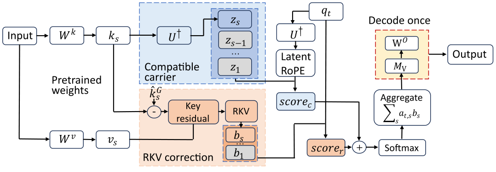

# GaugeRoPE：可执行RoPE carrier与残余KV双支缓存

[English](README-en.md)

> **L1机制组件；不是完整模型**。完整实验**成本过高，不复现（审查 DONE）**；无能力提升或Evolve晋级声明。

## 论文信息

| 字段 | 内容 |
| --- | --- |
| 论文链接 | [arXiv:2611.20524v1](https://arxiv.org/abs/2611.20524v1)；[固定全文](https://arxiv.org/html/2611.20524v1) |
| 公司 / 机构 / 学校 | 一作 Yuanhang Gao：National University of Defense Technology |
| 首次公开日期 | 2026-11-16T04:55:39Z（arXiv v1）；公告日期另记为 当前公告快照未确认，不据此推断首发 |
| 原作者开源代码 | 固定v1及原作者链接未找到可核验的已发布方法源码；未找到/未发布，不把依赖库算原作者代码。 |
| 本地 adapter / key | `gaugerope`；`adapter: null`，未接入Evolve |
| 本地复现代码目录 | `src/auto_research/foundation_models/gaugerope.py` |

## 原始论文总结

### 背景与主要改动

任意低秩K在潜空间通常不保留RoPE作用，需要逐历史token重建。GaugeRoPE只在相同频率块内拟合复数carrier，另用能量平衡后的joint PCA存residual K与V；query吸收decoder，聚合后才解码输出。 [已核方法位置](https://arxiv.org/html/2611.20524v1#S3)：4.1–4.3, 5.1。

<!-- paper-figure:start -->
### 原论文关键图

[](https://arxiv.org/html/2611.20524v1)

原图/原表来自固定v1，未经科学内容改绘；是作者方法或结果，不是本地测量。[来源、裁切和SHA256](assets/provenance.json)。图片来自[原论文](https://arxiv.org/html/2611.20524v1)，版权归原作者所有。
<!-- paper-figure:end -->

### 核心公式

$$
\hat\ell_{t,s,g}=\sum_j\Re[\tilde q_{t,g,j}^{\dagger}e^{i\omega_j(s-t)}z_{s,j}]+(M_K^TS_h^Tq_{t,g})^Tb_s,\qquad o_g=S_hM_V\sum_s\alpha_{t,s,g}b_s.
$$

carrier在保留子空间中精确保持RoPE，但RKV把残余位置相关分数近似为不旋转的校正。因此整体attention一般仍是近似；不能因为carrier兼容就宣称压缩无损。PCA只用显式校准输入，不借测试答案选秩。

~~~mermaid
flowchart LR
 C[Calibration KV] --> G[Equal-frequency carrier eigenvectors]
 C --> R[Balanced residual KV PCA]
 G --> L[Two-part latent history]
 R --> L
 L --> A[Absorbed query scores and latent values]
~~~

### 论文离线与线上效果

原文以其完整训练/推理与评测配置讨论效果；本地没有复跑该矩阵，不把论文数值写成本地指标。未报告本文方法的生产随机流量线上A/B；benchmark、单卡服务计时或使用Meta/Google模型本身不是A/B证据。具体质量/速度与成本配置须一起阅读。

## 本地复现

### 数据协议与代码映射

执行相同频率Gram特征向量、joint RKV编码、GQA query吸收和latent value聚合；测试full-rank native等价及低秩显式近似等价。不加载7B、长上下文基准、量化格式或专用内核。


```bash
PYTHONPATH=src python -c 'from auto_research.foundation_models.gaugerope import diagnostic; print(diagnostic(42, device="cpu"))'
PYTHONPATH=src python -m pytest tests/test_nov18_latest_foundation.py -q
```

CPU seeds42/43/44已通过本组件检查；仅为合成张量机制诊断，不含公开能力benchmark。CUDA验收以[真实GPU回执](../../gpu-validations/gaugerope-a100-20261118-latest.json)为准，不能由CPU通过替代；文档本身不提前宣称GPU已通过。

### 同主题比较与边界

Anchor让多个层共享TTT状态并学习read-map；GaugeRoPE保留每层token历史但改变其坐标/低秩表示。跨层共享和每token潜缓存压缩不是同一个操作。 本地结果只支撑上面列明的算子合同，多个seed不将L1升级成公开能力L2/L3。

### 高成本完整实验

原文使用Mistral/Qwen/CodeLlama 7B，13项RULER每项50例、16项LongBench每项50例与最高32K长度，另有校准和原生内核比较。不下载或试跑该完整矩阵。

以上是配置依据的成本判断，不是本地实测耗时。资源预算为单A100或A30，或本地Mac；不假定多卡、不断扩大或试训证明成本。**成本过高，不复现（审查 DONE）**；不下载大模型/数据，不启动完整矩阵，不自动重试，不阻塞本轮审查闭环。
