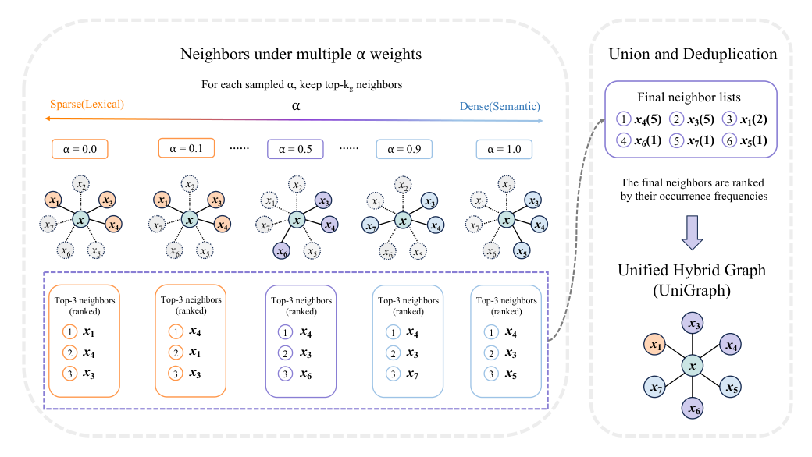

<!-- source-sha256: 8c9c0565a7f420f9ce25aa3c021b7896584157164d1d2aacf1d0110ae1727f3a -->
# UniGraph: A Unified Graph-based Index for Dynamic Hybrid Dense-Sparse Vector Retrieval

[简体中文](README.md)

> L1 bounded mechanism component, not a capability benchmark or Evolve promotion.

## Paper information

| Field | Content |
| --- | --- |
| Paper | [UniGraph: A Unified Graph-based Index for Dynamic Hybrid Dense-Sparse Vector Retrieval](https://arxiv.org/abs/2611.20758v1); [fixed v1](https://arxiv.org/html/2611.20758v1) |
| Institution | First author Keyu Chen: Tongji University; fixed-v1 byline checked |
| First publication | 2026-11-16 09:06:58 UTC, arXiv v1 |
| Original source code | No publicly verifiable paper-specific author implementation found in the fixed paper and linked sources. Cited dependencies or integration claims are not verified paper-specific code. |
| Local adapter / key | `unigraph`; adapter is null, not a complete model |
| Local implementation | `src/auto_research/foundation_models/unigraph.py` |

## Paper summary

### Motivation and changes

Separate dense/sparse retrieval can prematurely discard vectors that are strong only under their combined distance. UniGraph takes neighbors under multiple sampled alpha values and frequency-merges them into one bounded-degree graph. Queries traverse it with their own alpha without rebuilding. Sparse or dense guides supply entry points to reduce hybrid-distance work near the target region.

<!-- paper-figure:start -->
### Original figure



Image from the [original paper](https://arxiv.org/pdf/2611.20758v1); copyright belongs to the original authors. Original asset/PDF crop, not local results. [Provenance and SHA256](assets/provenance.json).
<!-- paper-figure:end -->

### Core formulas

$$
D_h=\alpha(1-q_d^Tx_d)+(1-\alpha)(1-q_s^Tx_s),\quad\widehat D_h=\alpha D_d+(1-\alpha)(1-\gamma\|q_s\|\|x_s\|).
$$

Algorithm1 takes top-kg neighbors peralpha and retainsM by occurrence frequency. Algorithm2 maintains candidate and ef-sized result sets under query-specific hybrid distance. Dense-first pruning uses a Cauchy–Schwarz norm bound to avoid some sparse inner products: gamma=1 is a safe lower bound, while gamma<1 is a more aggressive estimate without that guarantee. Main experiments usegamma=0.3; local controls usegamma=1 against unpruned beam results. The guide is dense abovealpha0.5 and sparse otherwise;0.5 is the paper’s comparable-scale convention.

### Author results

On five datasets with2.68M–8.84M vectors, mixedalpha in[0.3,0.7] and Recall@100≥0.95, SectionV reports27.6%–52.3% higher QPS than the fastest baseline. These measurements depend on large-memory CPU indexes and construction/query settings, not the local24-vertex graph. No production A/B is reported.

## Local implementation and boundaries

### Data protocol and code mapping

Exact all-pairs construction and exact guide lookup are finite diagnostic backends, not the scalable C++ candidate builders. BGE-M3 encoding, SINDI, million-vector indexes and QPS comparisons are absent. Safe pruning is relative to the same beam insertion rule and does not imply globally complete ANN recall; gamma<1 retains explicit risk. The full campaign is not reproduced due to cost.

```bash
PYTHONPATH=src python -c 'from auto_research.foundation_models.unigraph import diagnostic; print(diagnostic(42, device="cpu"))'
```

### Results, controls and limits

L1 bounded mechanism component, not a capability benchmark or Evolve promotion. Seeds42/43/44 check explicit fixtures/small-tensor arithmetic and gradients, not three independent model-capability trials. CPU and actual GPU evidence remain separate. Author scores must not populate local dashboards.

### High-cost full experiments

2.68M–8.84Mvector indexes,1024dense dimensions and full Recall/QPS matrix exceed short diagnostic budget; no empirical speedup claimed **Not reproduced due to high cost; review DONE.** No automatic training/retry queue and no blocking of declared review closure.

### Same-topic comparison

HVMap learns representation mappings across heterogeneous databases. UniGraph does not learn a new mapping; it retains dense/sparse components and changes neighborhoods across weights. SCORE2 native/mapped weights and UniGraph semantic/lexical alpha have different meanings and are not interchangeable.
