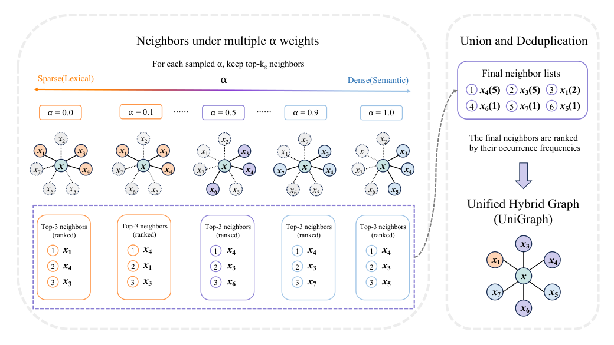

# UniGraph：支持逐查询混合权重的统一稠密稀疏图

[English](README-en.md)

> L1低成本机制组件；不是能力benchmark，未接入Evolve晋级。

## 论文信息

| 字段 | 内容 |
| --- | --- |
| 论文链接 | [UniGraph: A Unified Graph-based Index for Dynamic Hybrid Dense-Sparse Vector Retrieval](https://arxiv.org/abs/2611.20758v1)；[固定v1全文](https://arxiv.org/html/2611.20758v1) |
| 公司 / 作者机构 | 一作 Keyu Chen：Tongji University；按固定v1作者栏核对 |
| 首次公开日期 | 2026-11-16 09:06:58 UTC（arXiv v1） |
| 原作者开源代码 | 原文及其关联链接未找到/未核验公开的本论文专属作者代码。引用依赖或声称集成不等于已核验专属实现。 |
| 本地adapter / 稳定键 | `unigraph`；adapter为null，不冒充完整模型 |
| 本地复现代码目录 | `src/auto_research/foundation_models/unigraph.py` |

## 原始论文总结

### 背景与主要改动

分别检索dense和sparse再合并可能过早漏掉仅在混合距离下优秀的向量。UniGraph在多个离散alpha下取近邻，按跨alpha入选频次合并成一个有界出度图；查询时不重构图，直接按自己的alpha遍历。稀疏或稠密guide给出入口，减少到目标区域的混合距离计算。

<!-- paper-figure:start -->
### 原论文关键图



图片来自[原论文](https://arxiv.org/pdf/2611.20758v1)，版权归原作者所有；为原图或PDF裁剪，不是本地结果。[出处与SHA256](assets/provenance.json)。
<!-- paper-figure:end -->

### 核心公式

$$
D_h=\alpha(1-q_d^Tx_d)+(1-\alpha)(1-q_s^Tx_s),\quad\widehat D_h=\alpha D_d+(1-\alpha)(1-\gamma\|q_s\|\|x_s\|).
$$

Alg1先对每alpha取top-kg，按出现次数选M个邻居；Alg2维护candidate与ef-sized结果集，使用逐query混合距离。dense-first用Cauchy–Schwarz范数界决定是否需要sparse内积：gamma=1是安全下界，gamma<1只是不保证安全的更激进估计。原主实验gamma=0.3；本地诊断用gamma=1核对不改变未剪枝beam结果。guide在alpha>0.5时选dense，否则sparse，0.5是相近量纲下的原实验约定。

### 论文离线与线上效果

§V在2.68M–8.84M个向量的五数据集上，mixed alpha∈[0.3,0.7]且Recall@100≥0.95时，作者报告较最快baseline高27.6%–52.3% QPS。结果依赖大内存CPU索引、构建与查询参数；不是本地24点图的速度。未报告生产线上A/B。

## 本地复现与边界

### 数据协议与代码映射

本地exact all-pairs构图和exact guide查找是有限诊断后端，不是论文C++可扩展候选构造；没有BGE-M3编码、SINDI、百万级索引或QPS对照。安全剪枝只相对同一beam插入规则成立，不能推出全局ANN召回完备；gamma<1必须显式保留风险。完整矩阵高成本不复现。

```bash
PYTHONPATH=src python -c 'from auto_research.foundation_models.unigraph import diagnostic; print(diagnostic(42, device="cpu"))'
```

### 结果、负控与边界

L1低成本机制组件；不是能力benchmark，未接入Evolve晋级。 种子42/43/44只验证显式夹具/小张量的数值和梯度，不是三次独立模型能力试验。CPU与实际GPU证据分别保存，不能用作者指标填充本地看板。

### 高成本完整实验

268万至884万条、1024维dense加高维sparse的索引矩阵超出短预算；本地有限alpha-cover与beam search不宣称生产吞吐。 **成本过高，不复现（审查DONE）**；不阻塞已声明的审查闭环，不进入自动训练或补跑队列。

### 同主题对照

HVMap学的是异构库之间的表示转换，UniGraph学不到新的向量映射，而是保留dense/sparse原分量并改变跨权重邻域组织。SCORE2的native/mapped双空间权重与UniGraph的语义／词汇alpha含义不同，不能共享一个未经验证的权重解释。
