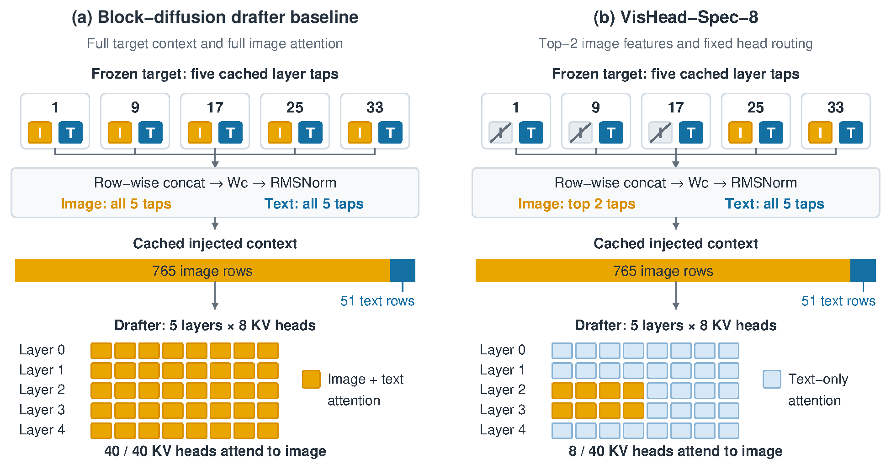

# VisHead-Spec: sparse direct visual access, shared text context

<!-- source-sha256: 1e4742c050707afde72ce396d161b5ad5e8b2a374fa26981389c0f98f33a8fe9 -->

[简体中文](README.md)

> **L1 mechanism component, not a complete model.** Full experiments are **too costly; not reproduced (review DONE)**. No capability improvement or Evolve promotion is claimed.

## Paper information

| Field | Value |
| --- | --- |
| Paper | [arXiv:2611.21839v1](https://arxiv.org/abs/2611.21839v1); [fixed text](https://arxiv.org/html/2611.21839v1) |
| Institution/company | First author Xin Guo: Meta Recommendation Systems (MRS) |
| Original publication | 2026-11-16T19:57:35Z (arXiv v1); separately observed announcement: 2026-11-18 |
| Authors' code | No released method-specific author source was found in fixed v1 and its author links. Dependency libraries are not counted as the paper code. |
| Local adapter/key | `vishead-spec`; adapter null; no Evolve integration |
| Local source | `src/auto_research/foundation_models/vishead_spec.py` |

## Original paper

### Motivation and changes

Direct visual access is concentrated in selected drafter KV heads. Layer and head choices are calibrated offline, then fixed throughout finetuning and serving. Image rows use target layers25/33; text rows use1/9/17/25/33. Other heads still see text and within-block context rather than being disabled. [Reviewed method](https://arxiv.org/html/2611.21839v1#S3): 3.1–3.3, 4.1, B.1–B.4.

### Key original figure

[](https://arxiv.org/html/2611.21839v1)

The fixed-version author figure/table is not a local result. Scientific content was not redrawn. Copyright remains with the original authors; no open-image license is inferred. [Source, crop and SHA256](assets/provenance.json).

### Equations

$$
M_{h,q,k}=M^{base}_{q,k}\land(\neg I_k\lor R_h),\qquad a=\operatorname{sg}(1-\tfrac12\|p_d-p_t\|_1),\qquad L=0.1L_{CE}+0.9L_1+L_{BCE}(c,a).
$$

Routing follows the physical KV head to its entire GQA query group. Draft-position weights are normalized exp(-d/4). Confidence predicts detached distribution-overlap acceptance, not hard argmax agreement. The supplied base visibility preserves pre-anchor context and bidirectional block access.

~~~mermaid
flowchart LR
 Q[Target context and draft Q] --> M[Fixed KV-head image visibility]
 M --> A[Grouped-query attention]
 A --> L[CE L1 and soft-acceptance BCE]
~~~

### Reported results and evidence

The reported quality/efficiency relies on the full paper configuration, which was not reproduced locally. No production randomized-traffic A/B is reported for this method. Benchmarks, single-device serving measurements, or using Meta/Google models are not production A/B evidence.

## Local implementation

### Protocol and code mapping

Executes routed GQA and the three-term drafter loss. It does not load Qwen3-VL, extract target features, search routing allocations, implement the Markov head/token verifier, or train a full drafter. Callers supply a fixed mask.


```bash
PYTHONPATH=src python -c 'from auto_research.foundation_models.vishead_spec import diagnostic; print(diagnostic(42, device="cpu"))'
PYTHONPATH=src python -m pytest tests/test_nov18_latest_foundation.py -q
```

CPU seeds42/43/44passed the mechanism checks on synthetic tensors, not capability benchmarks. CUDA acceptance requires the [real-device receipt](../../gpu-validations/vishead-spec-a100-20261118-latest.json); this text does not preclaim a GPU pass.

### Same-topic comparison and boundaries

Unbundling changes dedicated visual capacity placement; VisHead-Spec changes where a drafter directly reads images. Attention visibility is not the same intervention as gating vision-only projections. Multiple seeds do not upgrade these mechanism checks into L2/L3 capability evidence.

### High-cost full experiments

Frozen Qwen3-VL-8B, five 4096-wide drafter blocks, 67,304 target-answered sequences, three epochs/8,412 steps on MI300X; batch64 full-serving campaign on A10080GB. Full campaign high cost; no checkpoint/data download.

This is a configuration-based cost assessment, not measured local duration. The budget is one A100 or A30, or the local Mac. No multi-GPU capacity, costly probing run, large-resource download or automatic retry is assumed. Full experiments are **too costly; not reproduced (review DONE)** and do not block review closure.
