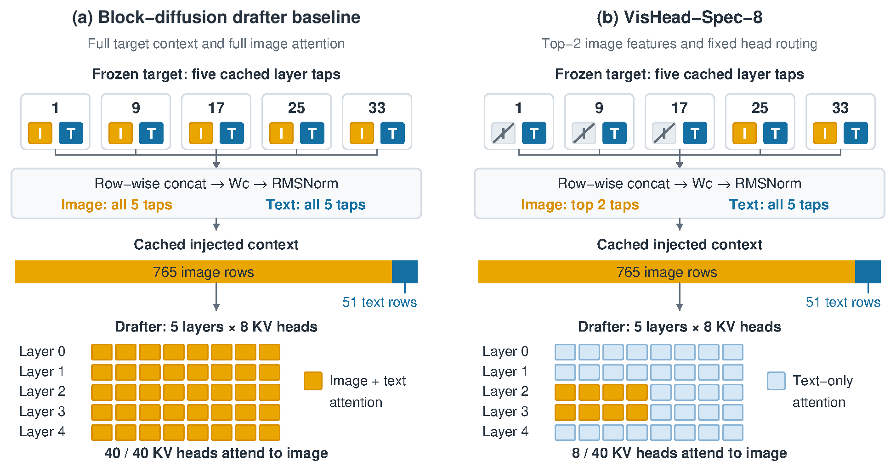

# VisHead-Spec：少数 KV heads 读取图像，全部 heads 保留文本

[English](README-en.md)

> **L1机制组件；不是完整模型**。完整实验**成本过高，不复现（审查 DONE）**；无能力提升或Evolve晋级声明。

## 论文信息

| 字段 | 内容 |
| --- | --- |
| 论文链接 | [arXiv:2611.21839v1](https://arxiv.org/abs/2611.21839v1)；[固定全文](https://arxiv.org/html/2611.21839v1) |
| 公司 / 机构 / 学校 | 一作 Xin Guo：Meta Recommendation Systems (MRS) |
| 首次公开日期 | 2026-11-16T19:57:35Z（arXiv v1）；公告日期另记为 2026-11-18 |
| 原作者开源代码 | 固定v1及原作者链接未找到可核验的已发布方法源码；未找到/未发布，不把依赖库算原作者代码。 |
| 本地 adapter / key | `vishead-spec`；`adapter: null`，未接入Evolve |
| 本地复现代码目录 | `src/auto_research/foundation_models/vishead_spec.py` |

## 原始论文总结

### 背景与主要改动

块状 drafter 的视觉注意力并非每层每头都同等重要。本文先在隔离校准集选择层，再选择少量 KV heads；仅目标层25/33的图像特征进入图像行，文本取1/9/17/25/33。非选中头仍看文本与块内位置，而不是被整个关闭。选择后固定路由并重新训练，不按测试样本动态选择。 [已核方法位置](https://arxiv.org/html/2611.21839v1#S3)：3.1–3.3, 4.1, B.1–B.4。

<!-- paper-figure:start -->
### 原论文关键图

[](https://arxiv.org/html/2611.21839v1)

原图/原表来自固定v1，未经科学内容改绘；是作者方法或结果，不是本地测量。[来源、裁切和SHA256](assets/provenance.json)。图片来自[原论文](https://arxiv.org/html/2611.21839v1)，版权归原作者所有。
<!-- paper-figure:end -->

### 核心公式

$$
M_{h,q,k}=M^{base}_{q,k}\land(\neg I_k\lor R_h),\qquad a=\operatorname{sg}(1-\tfrac12\|p_d-p_t\|_1),\qquad L=0.1L_{CE}+0.9L_1+L_{BCE}(c,a).
$$

GQA 的一个 KV head 映射到整组 query heads。loss 按草稿偏移 exp(-d/4) 归一化加权；confidence 的监督是分布重叠概率，不是 argmax 一致的硬标签。块内双向可见性和 anchor 前上下文由独立 visibility 输入保留。

~~~mermaid
flowchart LR
 Q[Target context and draft Q] --> M[Fixed KV-head image visibility]
 M --> A[Grouped-query attention]
 A --> L[CE L1 and soft-acceptance BCE]
~~~

### 论文离线与线上效果

原文以其完整训练/推理与评测配置讨论效果；本地没有复跑该矩阵，不把论文数值写成本地指标。未报告本文方法的生产随机流量线上A/B；benchmark、单卡服务计时或使用Meta/Google模型本身不是A/B证据。具体质量/速度与成本配置须一起阅读。

## 本地复现

### 数据协议与代码映射

真实执行 grouped-query 路由注意力和三项 drafter loss；没有 Qwen3-VL、上下文特征提取、离线层/头搜索、Markov head、token verifier 或训练完成的 drafter。固定路由由调用者提供，不称完整推测解码。


```bash
PYTHONPATH=src python -c 'from auto_research.foundation_models.vishead_spec import diagnostic; print(diagnostic(42, device="cpu"))'
PYTHONPATH=src python -m pytest tests/test_nov18_latest_foundation.py -q
```

CPU seeds42/43/44已通过本组件检查；仅为合成张量机制诊断，不含公开能力benchmark。CUDA验收以[真实GPU回执](../../gpu-validations/vishead-spec-a100-20261118-latest.json)为准，不能由CPU通过替代；文档本身不提前宣称GPU已通过。

### 同主题比较与边界

Unbundling改变视觉专属容量放置；VisHead-Spec改变drafter的直接图像读取位置。二者都不能用“删除视觉模块”概括，且路由attention可见性不同于vision-only投影的token门控。 本地结果只支撑上面列明的算子合同，多个seed不将L1升级成公开能力L2/L3。

### 高成本完整实验

原文目标为Qwen3-VL-8B，drafter含5个4096宽block；67,304条目标回答序列，3epochs共8,412步，在MI300X训练，并做A10080GB/batch64服务比较。完整训练与并发矩阵超出本轮短时单卡预算。

以上是配置依据的成本判断，不是本地实测耗时。资源预算为单A100或A30，或本地Mac；不假定多卡、不断扩大或试训证明成本。**成本过高，不复现（审查 DONE）**；不下载大模型/数据，不启动完整矩阵，不自动重试，不阻塞本轮审查闭环。
