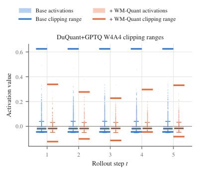

# WM-Quant: rollout-aware ranges and protected control paths

<!-- source-sha256: 106dd4904b7520a33153b663b7072e0ee409384c6f56d073c3fa1edaf38df61e -->

[简体中文](README.md)

> **L1 mechanism component, not a complete model.** Full experiments are **too costly; not reproduced (review DONE)**. No capability improvement or Evolve promotion is claimed.

## Paper information

| Field | Value |
| --- | --- |
| Paper | [arXiv:2611.21882v1](https://arxiv.org/abs/2611.21882v1); [fixed text](https://arxiv.org/html/2611.21882v1) |
| Institution/company | First author William Hammer: University of South Carolina |
| Original publication | 2026-11-16T20:51:59Z (arXiv v1); separately observed announcement: 2026-11-18 |
| Authors' code | No released method-specific author source was found in fixed v1 and its author links. Dependency libraries are not counted as the paper code. |
| Local adapter/key | `wm-quant`; adapter null; no Evolve integration |
| Local source | `src/auto_research/foundation_models/wm_quant.py` |

## Original paper

### Motivation and changes

Continuous JEPA latents repeatedly enter the predictor, so quantization errors propagate rather than resetting through discrete tokens. WM-Quant keeps the first three encoder activation blocks at8bits, control inputs in floating point, and jointly calibrates encoder and step-specific predictor ranges. [Reviewed method](https://arxiv.org/html/2611.21882v1#S3): 3.3–3.4, 4.1–4.2.

### Key original figure

[](https://arxiv.org/html/2611.21882v1)

The fixed-version author figure/table is not a local result. Scientific content was not redrawn. Copyright remains with the original authors; no open-image license is inferred. [Source, crop and SHA256](assets/provenance.json).

### Equations

Activation quantization uses the **integer zero-point** in Section3.1, not a lattice anchored at continuous lower bound:

$$
s=\frac{\beta-\alpha}{2^b-1},\quad z=\operatorname{round}(-\alpha/s),\quad q=\operatorname{clamp}(\operatorname{round}(r/s)+z,0,2^b-1),\quad\tilde r=s(q-z).
$$

When the range includes zero, zero is exactly representable. Rounding uses an STE during calibration, but the forward values still follow the paper integer lattice.

$$
L(\Theta)=\mathbb E_{\mathcal D}\sum_{t=1}^n\frac{t}{\sum_{u=1}^nu}\|\tilde z_{\tau+t}(\Theta)-\hat z_{\tau+t}\|_2^2.
$$

Calibration differentiates through the whole quantized rollout using a rounding STE and increasing horizon weights, rather than independent one-step MSE. Small control components do not share a quantization range with large state features. Rotations/smoothing and weights remain shared.

~~~mermaid
flowchart LR
 O[Observations] --> E[Mixed-precision encoder]
 E --> P[Shared predictor with step-specific ranges]
 A[Floating control] --> P
 P --> L[Increasing-horizon rollout error]
 L --> E
~~~

### Reported results and evidence

The reported quality/efficiency relies on the full paper configuration, which was not reproduced locally. No production randomized-traffic A/B is reported for this method. Benchmarks, single-device serving measurements, or using Meta/Google models are not production A/B evidence.

## Local implementation

### Protocol and code mapping

Executes four tiny encoder blocks, a shared linear recurrent predictor, floating action path, integer-zero-point STE range bank and30joint calibration updates. It does not load LeWM/DINO-WM, run visual encoding/CEM, or implement Orin integer GEMM.


```bash
PYTHONPATH=src python -c 'from auto_research.foundation_models.wm_quant import diagnostic; print(diagnostic(42, device="cpu"))'
PYTHONPATH=src python -m pytest tests/test_nov18_latest_foundation.py -q
```

CPU seeds42/43/44passed the mechanism checks on synthetic tensors, not capability benchmarks. CUDA acceptance requires the [real-device receipt](../../gpu-validations/wm-quant-a100-20261118-latest.json); this text does not preclaim a GPU pass.

Independent review found that the first fake-quant version anchored its lattice at continuous low. It was corrected to Equations1–2, with3/4/8-bit literal-equation, exact-zero, clipping and old-lattice negative controls. Old CPU records are preserved and do not validate the corrected source; attempt02records the new evidence separately.

### Same-topic comparison and boundaries

Anchor changes shared-state read/write structure; WM-Quant changes numerical precision and calibration. Control preservation is not extra memory capacity, and reduced calibration loss does not establish planning success. Multiple seeds do not upgrade these mechanism checks into L2/L3 capability evidence.

### High-cost full experiments

LeWM/DINO-WM×fivePTQmethods×W3A3/W4A4×planningtasks;300candidates×10CEMiterations×5horizon,JetsonOrinkernelmatrix; full campaign high cost.

This is a configuration-based cost assessment, not measured local duration. The budget is one A100 or A30, or the local Mac. No multi-GPU capacity, costly probing run, large-resource download or automatic retry is assumed. Full experiments are **too costly; not reproduced (review DONE)** and do not block review closure.
