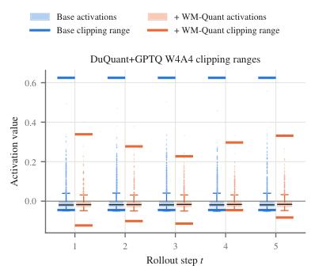

# WM-Quant：按完整rollout联合校准，并保护控制通路

[English](README-en.md)

> **L1机制组件；不是完整模型**。完整实验**成本过高，不复现（审查 DONE）**；无能力提升或Evolve晋级声明。

## 论文信息

| 字段 | 内容 |
| --- | --- |
| 论文链接 | [arXiv:2611.21882v1](https://arxiv.org/abs/2611.21882v1)；[固定全文](https://arxiv.org/html/2611.21882v1) |
| 公司 / 机构 / 学校 | 一作 William Hammer：University of South Carolina |
| 首次公开日期 | 2026-11-16T20:51:59Z（arXiv v1）；公告日期另记为 2026-11-18 |
| 原作者开源代码 | 固定v1及原作者链接未找到可核验的已发布方法源码；未找到/未发布，不把依赖库算原作者代码。 |
| 本地 adapter / key | `wm-quant`；`adapter: null`，未接入Evolve |
| 本地复现代码目录 | `src/auto_research/foundation_models/wm_quant.py` |

## 原始论文总结

### 背景与主要改动

JEPA世界模型把连续latent递归输入预测器，量化误差不会像离散token一样重置。WM-Quant保留前三个encoder blocks的8-bit激活、浮点action/proprioception控制通路，并联合优化encoder范围和每个rollout step独立的predictor范围。 [已核方法位置](https://arxiv.org/html/2611.21882v1#S3)：3.3–3.4, 4.1–4.2。

<!-- paper-figure:start -->
### 原论文关键图

[](https://arxiv.org/html/2611.21882v1)

原图/原表来自固定v1，未经科学内容改绘；是作者方法或结果，不是本地测量。[来源、裁切和SHA256](assets/provenance.json)。图片来自[原论文](https://arxiv.org/html/2611.21882v1)，版权归原作者所有。
<!-- paper-figure:end -->

### 核心公式

激活量化必须保留原文§3.1的**整数zero-point**。对范围$[\alpha,\beta]$，不是把连续的$\alpha$当作网格起点：

$$
s=\frac{\beta-\alpha}{2^b-1},\quad z=\operatorname{round}(-\alpha/s),\quad q=\operatorname{clamp}(\operatorname{round}(r/s)+z,0,2^b-1),\quad\tilde r=s(q-z).
$$

当范围包含零时，零应精确可表示。校准中的round使用straight-through梯度；前向仍须落在原式整数网格，不能用“反正只是fake quant”改变格点。

$$
L(\Theta)=\mathbb E_{\mathcal D}\sum_{t=1}^n\frac{t}{\sum_{u=1}^nu}\|\tilde z_{\tau+t}(\Theta)-\hat z_{\tau+t}\|_2^2.
$$

优化贯穿整个量化rollout，rounding使用straight-through estimator，后续步得到更高权重；不是分别让单步MSE最小。控制分量不参与和大幅度状态共用的量化范围。旋转/平滑与权重仍共享，只有激活范围按步分开。

~~~mermaid
flowchart LR
 O[Observations] --> E[Mixed-precision encoder]
 E --> P[Shared predictor with step-specific ranges]
 A[Floating control] --> P
 P --> L[Increasing-horizon rollout error]
 L --> E
~~~

### 论文离线与线上效果

原文以其完整训练/推理与评测配置讨论效果；本地没有复跑该矩阵，不把论文数值写成本地指标。未报告本文方法的生产随机流量线上A/B；benchmark、单卡服务计时或使用Meta/Google模型本身不是A/B证据。具体质量/速度与成本配置须一起阅读。

## 本地复现

### 数据协议与代码映射

执行四个小型encoder blocks、共享线性递归预测器、浮点action通路、整数zero-point的STE范围bank和30步joint calibration；不加载LeWM/DINO-WM，不运行图像编码或CEM，不实现Orin整数GEMM。


```bash
PYTHONPATH=src python -c 'from auto_research.foundation_models.wm_quant import diagnostic; print(diagnostic(42, device="cpu"))'
PYTHONPATH=src python -m pytest tests/test_nov18_latest_foundation.py -q
```

CPU seeds42/43/44已通过本组件检查；仅为合成张量机制诊断，不含公开能力benchmark。CUDA验收以[真实GPU回执](../../gpu-validations/wm-quant-a100-20261118-latest.json)为准，不能由CPU通过替代；文档本身不提前宣称GPU已通过。

独立复核发现首版fake quant把网格锚在连续low，已修为原文Eq1–2，并增加3/4/8-bit逐元素原式、零精确表示、clip边界及旧网格负控。旧失败实现的CPU记录保留，不用旧结果证明新源码；修正后的证据单列attempt02。

### 同主题比较与边界

Anchor压缩共享状态的读写结构，WM-Quant改变数值精度与校准目标；保留控制通路不是增加记忆容量，机制loss下降也不能推导规划成功率。 本地结果只支撑上面列明的算子合同，多个seed不将L1升级成公开能力L2/L3。

### 高成本完整实验

原文对LeWM/DINO-WM、5类PTQ、W3A3/W4A4和多规划任务做矩阵；一个规划配置含300候选×10次CEM×5步rollout，还评测Orin整数内核。这里不重跑完整规划成功率和设备矩阵。

以上是配置依据的成本判断，不是本地实测耗时。资源预算为单A100或A30，或本地Mac；不假定多卡、不断扩大或试训证明成本。**成本过高，不复现（审查 DONE）**；不下载大模型/数据，不启动完整矩阵，不自动重试，不阻塞本轮审查闭环。
