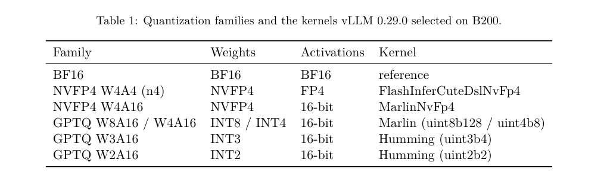

# Beyond Bitwidth: deployment gates beyond nominal precision

<!-- source-sha256: e4df76b4fddea7a84a9445f4c7be51963c453fabd12d351f0cd4291b11caeebb -->

[简体中文](README.md)

> **Review only, not implemented.** Full experiments are **too costly; not reproduced (review DONE)**. No capability improvement or Evolve promotion is claimed.

## Paper information

| Field | Value |
| --- | --- |
| Paper | [arXiv:2611.21974v1](https://arxiv.org/abs/2611.21974v1); [fixed text](https://arxiv.org/html/2611.21974v1) |
| Institution/company | First author Hyojung Han: ThakiCloud |
| Original publication | 2026-11-16T22:58:32Z (arXiv v1); separately observed announcement: 2026-11-18 |
| Authors' code | No released method-specific author source was found in fixed v1 and its author links. Dependency libraries are not counted as the paper code. |
| Local adapter/key | `beyond-bitwidth`; adapter null; no Evolve integration |
| Local source | None; documentation, original figure and learning material only |

## Original paper

### Motivation and changes

A low-bit label establishes neither native execution nor multilingual quality. Separate diagnostic, selection and final sets are frozen. Every fused module is checked for stored weight type, activation policy, kernel, fallback and memory before service-quality gating. [Reviewed method](https://arxiv.org/html/2611.21974v1#S3): 3.5–3.6, 4.1, abstract.

### Key original figure

The fixed-version author figure/table is not a local result. Scientific content was not redrawn. Copyright remains with the original authors; no open-image license is inferred. [Source, crop and SHA256](assets/provenance.json).

### Equations

$$
\min\operatorname{TPOT}(c)\quad\mathrm{s.t.}\quad Memory(c)\le B,\quad Retention_k(c)\ge\tau_k\ \forall k.
$$

Single-module BF16 restoration supplies a ranking, not additive gains; deployed protection uses INT8. The final comparison changes activation precision and INT8 allocation jointly, so allocation alone is not identified. Final checkpoints were not retained and bitwise rebuild was unverified.

~~~mermaid
flowchart LR
 F[Format candidate] --> E[Native kernel and stored-type evidence]
 E --> S[Diagnostic and selection gates]
 S --> H[Untouched final quality memory latency gates]
~~~

### Reported results and evidence

The reported quality/efficiency relies on the full paper configuration, which was not reproduced locally. No production randomized-traffic A/B is reported for this method. Benchmarks, single-device serving measurements, or using Meta/Google models are not production A/B evidence.

## Local implementation

### Protocol and code mapping

Review only, without low-bit kernels or model evaluation. A100/A30 byte arithmetic cannot verify B200-native NVFP4 execution, and a generic budget optimizer is not presented as this deployment study.

There is no local run command, metrics artifact or GPU receipt. Review DONE is not implementation completion, and no automatic reproduction/retry queue is created.

### Same-topic comparison and boundaries

WM-Quant calibrates compounding latent rollout error. This study targets multilingual LLM deployment constraints and native-kernel evidence. Objectives, hardware contracts and quality evaluations differ. Multiple seeds do not upgrade these mechanism checks into L2/L3 capability evidence.

### High-cost full experiments

Qwen3-8B on B200;reported4.98+2.39+1.35GPUhoursdiagnostic/selection/final,144fusedmodulechecks,FINAL81contains5168items; checkpointnotretainedandbitwiserebuildunverified; availableA100/A30cannotverifyBlackwellpath.

This is a configuration-based cost assessment, not measured local duration. The budget is one A100 or A30, or the local Mac. No multi-GPU capacity, costly probing run, large-resource download or automatic retry is assumed. Full experiments are **too costly; not reproduced (review DONE)** and do not block review closure.
