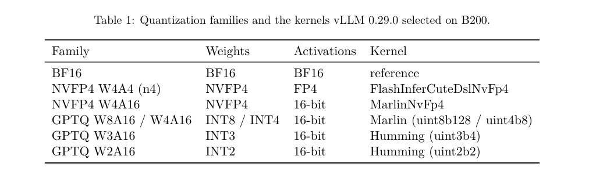

# Beyond Bitwidth：量化方案必须同时过质量与真实执行门槛

[English](README-en.md)

> **资料收录，未实现**。完整实验**成本过高，不复现（审查 DONE）**；无能力提升或Evolve晋级声明。

## 论文信息

| 字段 | 内容 |
| --- | --- |
| 论文链接 | [arXiv:2611.21974v1](https://arxiv.org/abs/2611.21974v1)；[固定全文](https://arxiv.org/html/2611.21974v1) |
| 公司 / 机构 / 学校 | 一作 Hyojung Han：ThakiCloud |
| 首次公开日期 | 2026-11-16T22:58:32Z（arXiv v1）；公告日期另记为 2026-11-18 |
| 原作者开源代码 | 固定v1及原作者链接未找到可核验的已发布方法源码；未找到/未发布，不把依赖库算原作者代码。 |
| 本地 adapter / key | `beyond-bitwidth`；`adapter: null`，未接入Evolve |
| 本地复现代码目录 | 无；仅本文档、原图与学习资料，未实现 |

## 原始论文总结

### 背景与主要改动

低比特名称不保证GPU真的按该格式执行，也不保证多语种质量。本文用固定诊断/selection/final切分，逐fused-module核对weight类型、activation policy、kernel、fallback和显存，再按服务质量约束配置保护。 [已核方法位置](https://arxiv.org/html/2611.21974v1#S3)：3.5–3.6, 4.1, abstract。

<!-- paper-figure:start -->
### 原论文关键图

原图/原表来自固定v1，未经科学内容改绘；是作者方法或结果，不是本地测量。[来源、裁切和SHA256](assets/provenance.json)。图片来自[原论文](https://arxiv.org/html/2611.21974v1)，版权归原作者所有。
<!-- paper-figure:end -->

### 核心公式

$$
\min\operatorname{TPOT}(c)\quad\mathrm{s.t.}\quad Memory(c)\le B,\quad Retention_k(c)\ge\tau_k\ \forall k.
$$

BF16单模块恢复只用于敏感性排序，不可假定收益可加；实际保护格式是INT8。最终方案同时改变activation精度和INT8分配，不能把全部收益归因于allocation。作者未保留final checkpoint，位级rebuild未验证。

~~~mermaid
flowchart LR
 F[Format candidate] --> E[Native kernel and stored-type evidence]
 E --> S[Diagnostic and selection gates]
 S --> H[Untouched final quality memory latency gates]
~~~

### 论文离线与线上效果

原文以其完整训练/推理与评测配置讨论效果；本地没有复跑该矩阵，不把论文数值写成本地指标。未报告本文方法的生产随机流量线上A/B；benchmark、单卡服务计时或使用Meta/Google模型本身不是A/B证据。具体质量/速度与成本配置须一起阅读。

## 本地复现

### 数据协议与代码映射

仅资料收录，无低比特kernel或模型评测。B200原生NVFP4执行不能由A100/A30上的字节算术替代；不实现通用budget knapsack就声称复现该部署方法。

本页没有本地运行命令、指标文件或GPU回执。审查DONE不等于完成实现；不进入自动复现或重试队列。

### 同主题比较与边界

WM-Quant针对递归latent误差做rollout校准，本文面向多语LLM部署约束和原生kernel证据。两者的校准目标、硬件合同、质量评测不相同。 本地结果只支撑上面列明的算子合同，多个seed不将L1升级成公开能力L2/L3。

### 高成本完整实验

原文Qwen3-8B使用B200；诊断、selection、final分别实测4.98/2.39/1.35 GPU小时，核144个fused modules，FINAL-81有5,168项。我们只有A100/A30，且作者未保留final checkpoint，无法验证Blackwell原生执行或位级重建。

以上是配置依据的成本判断，不是本地实测耗时。资源预算为单A100或A30，或本地Mac；不假定多卡、不断扩大或试训证明成本。**成本过高，不复现（审查 DONE）**；不下载大模型/数据，不启动完整矩阵，不自动重试，不阻塞本轮审查闭环。
