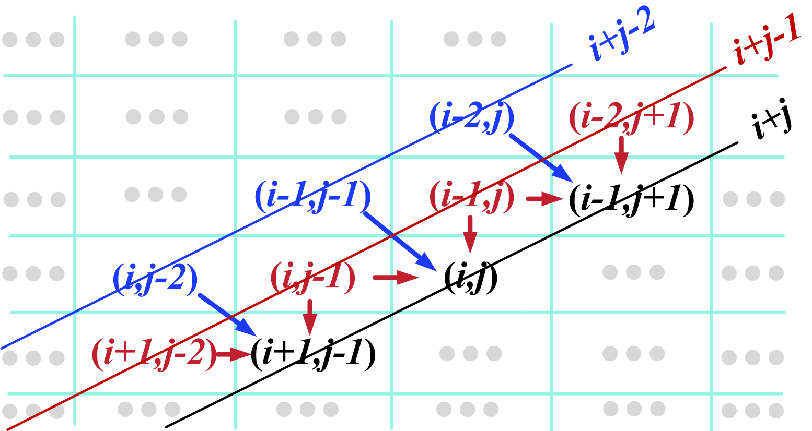

# FM-Mamba: stability-aware native2D state recursion

<!-- source-sha256: 47a758518f743965583000652d32148858f6f69728c230c13767f4b21917faf3 -->

[简体中文](README.md)

> **L1 mechanism component, not a complete model.** Full experiments are **too costly; not reproduced (review DONE)**. No capability improvement or Evolve promotion is claimed.

## Paper information

| Field | Value |
| --- | --- |
| Paper | [arXiv:2611.22061v1](https://arxiv.org/abs/2611.22061v1); [fixed text](https://arxiv.org/html/2611.22061v1) |
| Institution/company | First author Shengyuan Hu: Beijing Institute of Technology |
| Original publication | 2026-11-17T01:40:53Z (arXiv v1); separately observed announcement: 2026-11-18 |
| Authors' code | [Author repository](https://github.com/BitSsm/FM-Mamba-Runtime), verified HEAD `74cdeb75e9b691f3a71ef0a77764bac65f6edb19`. No upstream source was copied; its license was not separately verified. |
| Local adapter/key | `fm-mamba`; adapter null; no Evolve integration |
| Local source | `src/auto_research/foundation_models/fm_mamba.py` |

## Original paper

### Motivation and changes

The native2D FM recurrence reads upper, left and diagonal predecessors instead of flattening the grid into a chain. Two input-dependent steps control the axes separately, with a0/(a1a2) determining whether bounded steps are necessary. [Reviewed method](https://arxiv.org/html/2611.22061v1#S3): 3.1–3.3, 4.1.

### Key original figure

[](https://arxiv.org/html/2611.22061v1)

The fixed-version author figure/table is not a local result. Scientific content was not redrawn. Copyright remains with the original authors; no open-image license is inferred. [Source, crop and SHA256](assets/provenance.json).

### Equations

$$
h_{ij}=\tilde A_1h_{i-1,j}+\tilde A_2h_{i,j-1}+\tilde A_0h_{i-1,j-1}+u_{ij},\qquad \Delta_1^{max}=\min_{r_k<-2}\frac{-\log(1+2/r_k)}{|a_{2,k}|}.
$$

Axis steps enter the opposite rates in ZOH exponents. Only input injection uses the first-order approximation; state coefficients retain exact exponentials/integrals. Ratios(-2,0) need no bound; ratios below-2 use the tightest component bound with10% margin. Frozen-position stability is not a general switched-field proof.

~~~mermaid
flowchart LR
 D[Two axis steps] --> B[Ratio-dependent strict projection]
 B --> Z[Exact ZOH state coefficients]
 Z --> W[Three-predecessor diagonal wavefront]
~~~

### Reported results and evidence

The reported quality/efficiency relies on the full paper configuration, which was not reproduced locally. No production randomized-traffic A/B is reported for this method. Benchmarks, single-device serving measurements, or using Meta/Google models are not production A/B evidence.

## Local implementation

### Protocol and code mapping

Executes exact ZOH state coefficients, strict step projection, and three-predecessor serial/wavefront reference scans with gradients. Callers provide the input injection. No full vision network, PSD dispatch, CUDA graphs or fused scan kernel is included.


```bash
PYTHONPATH=src python -c 'from auto_research.foundation_models.fm_mamba import diagnostic; print(diagnostic(42, device="cpu"))'
PYTHONPATH=src python -m pytest tests/test_nov18_latest_foundation.py -q
```

CPU seeds42/43/44passed the mechanism checks on synthetic tensors, not capability benchmarks. CUDA acceptance requires the [real-device receipt](../../gpu-validations/fm-mamba-a100-20261118-latest.json); this text does not preclaim a GPU pass.

### Same-topic comparison and boundaries

Spool composes1D fixed-input affine summaries. FM-Mamba has intersecting2D predecessors and cannot simply reuse the same prefix monoid. Wavefront parallelism and a1D scan have different dependencies. Multiple seeds do not upgrade these mechanism checks into L2/L3 capability evidence.

### High-cost full experiments

21.8M–24.6M full architectures and40epochs,reported2.2–7.7hours each pluscondition/depth/PSDmatrix; full campaign high cost.

This is a configuration-based cost assessment, not measured local duration. The budget is one A100 or A30, or the local Mac. No multi-GPU capacity, costly probing run, large-resource download or automatic retry is assumed. Full experiments are **too costly; not reproduced (review DONE)** and do not block review closure.
