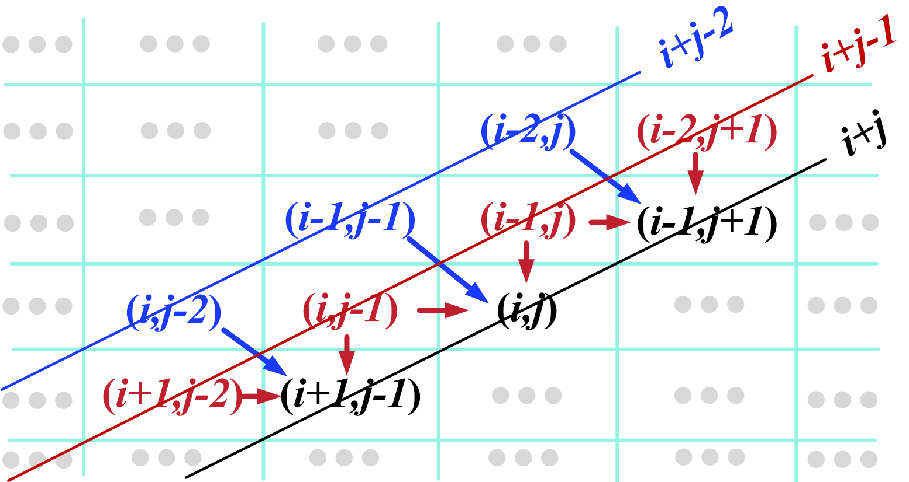

# FM-Mamba：稳定约束的原生二维状态空间递推

[English](README-en.md)

> **L1机制组件；不是完整模型**。完整实验**成本过高，不复现（审查 DONE）**；无能力提升或Evolve晋级声明。

## 论文信息

| 字段 | 内容 |
| --- | --- |
| 论文链接 | [arXiv:2611.22061v1](https://arxiv.org/abs/2611.22061v1)；[固定全文](https://arxiv.org/html/2611.22061v1) |
| 公司 / 机构 / 学校 | 一作 Shengyuan Hu：Beijing Institute of Technology |
| 首次公开日期 | 2026-11-17T01:40:53Z（arXiv v1）；公告日期另记为 2026-11-18 |
| 原作者开源代码 | [作者仓库](https://github.com/BitSsm/FM-Mamba-Runtime)；核验HEAD `74cdeb75e9b691f3a71ef0a77764bac65f6edb19`。未复制上游源码；许可证未另行核验。 |
| 本地 adapter / key | `fm-mamba`；`adapter: null`，未接入Evolve |
| 本地复现代码目录 | `src/auto_research/foundation_models/fm_mamba.py` |

## 原始论文总结

### 背景与主要改动

原生2D FM状态同时接收上、左与左上三个前驱，不通过展平扫描把二维关系退化为一条链。两个输入相关步长分别控制两个轴；a0/(a1a2)决定是否需要给步长施加上界。 [已核方法位置](https://arxiv.org/html/2611.22061v1#S3)：3.1–3.3, 4.1。

<!-- paper-figure:start -->
### 原论文关键图

[](https://arxiv.org/html/2611.22061v1)

原图/原表来自固定v1，未经科学内容改绘；是作者方法或结果，不是本地测量。[来源、裁切和SHA256](assets/provenance.json)。图片来自[原论文](https://arxiv.org/html/2611.22061v1)，版权归原作者所有。
<!-- paper-figure:end -->

### 核心公式

$$
h_{ij}=\tilde A_1h_{i-1,j}+\tilde A_2h_{i,j-1}+\tilde A_0h_{i-1,j-1}+u_{ij},\qquad \Delta_1^{max}=\min_{r_k<-2}\frac{-\log(1+2/r_k)}{|a_{2,k}|}.
$$

ZOH中两个轴步长交叉进入指数。只对输入注入项采用一阶积分近似，状态系数保留精确指数/积分。r在(-2,0)时不需要步长界，r<-2时取所有state分量最紧界并留10%余量。局部冻结系数稳定不是任意时变场全局稳定证明。

~~~mermaid
flowchart LR
 D[Two axis steps] --> B[Ratio-dependent strict projection]
 B --> Z[Exact ZOH state coefficients]
 Z --> W[Three-predecessor diagonal wavefront]
~~~

### 论文离线与线上效果

原文以其完整训练/推理与评测配置讨论效果；本地没有复跑该矩阵，不把论文数值写成本地指标。未报告本文方法的生产随机流量线上A/B；benchmark、单卡服务计时或使用Meta/Google模型本身不是A/B证据。具体质量/速度与成本配置须一起阅读。

## 本地复现

### 数据协议与代码映射

执行精确ZOH状态系数、严格步长投影、三个前驱的逐行/反对角参考递推及梯度；input projection/injection由调用方提供。没有完整视觉网络、PSD dispatch、CUDA graphs或融合kernel。


```bash
PYTHONPATH=src python -c 'from auto_research.foundation_models.fm_mamba import diagnostic; print(diagnostic(42, device="cpu"))'
PYTHONPATH=src python -m pytest tests/test_nov18_latest_foundation.py -q
```

CPU seeds42/43/44已通过本组件检查；仅为合成张量机制诊断，不含公开能力benchmark。CUDA验收以[真实GPU回执](../../gpu-validations/fm-mamba-a100-20261118-latest.json)为准，不能由CPU通过替代；文档本身不提前宣称GPU已通过。

### 同主题比较与边界

Spool的一维固定输入仿射摘要可结合；FM-Mamba二维网格有多个相交前驱，不能直接冒充同一monoid prefix scan。反对角并行与一维scan是不同依赖结构。 本地结果只支撑上面列明的算子合同，多个seed不将L1升级成公开能力L2/L3。

### 高成本完整实验

原文完整视觉网络约21.8M—24.6M参数、40epochs，每个配置报告约2.2—7.7小时，另有结构深度、稳定条件和PSD消融。完整多臂训练属于高成本。

以上是配置依据的成本判断，不是本地实测耗时。资源预算为单A100或A30，或本地Mac；不假定多卡、不断扩大或试训证明成本。**成本过高，不复现（审查 DONE）**；不下载大模型/数据，不启动完整矩阵，不自动重试，不阻塞本轮审查闭环。
