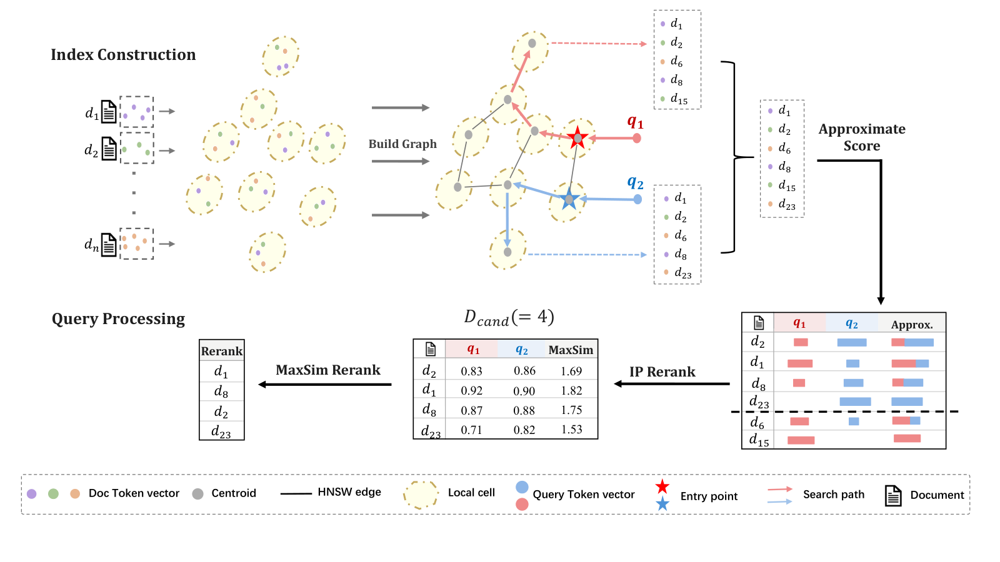

<!-- source-sha256: d1079071528e6e9031c91e00494bb762739e03efc292a27e23460b0c87a62b7c -->
# SIMQ: A Single Graph-based Index for Multi-Vector Query

[简体中文](README.md)

> L1 bounded mechanism component, not a capability benchmark or Evolve promotion.

## Paper information

| Field | Content |
| --- | --- |
| Paper | [SIMQ: A Single Graph-based Index for Multi-Vector Query](https://arxiv.org/abs/2611.22079v1); [fixed v1](https://arxiv.org/html/2611.22079v1) |
| Institution | First author Yifan Lu: Tongji University; fixed-v1 byline checked |
| First publication | 2026-11-17 02:01:39 UTC, arXiv v1 |
| Original source code | No publicly verifiable paper-specific author implementation found in the fixed paper and linked sources. Cited dependencies or integration claims are not verified paper-specific code. |
| Local adapter / key | `simq`; adapter is null, not a complete model |
| Local implementation | `src/auto_research/foundation_models/simq.py` |

## Paper summary

### Motivation and changes

ColBERT-style MaxSim matches every query token to document tokens. SIMQ samples initial aggregation points, assigns residual tokens through a temporary graph, recursively splits oversized clusters, normalizes their means and builds one centroid graph. Queries navigate to a few centroids, collect documents through membership maps and access original tokens only for exact candidate reranking, avoiding a full query-by-centroid matrix.

<!-- paper-figure:start -->
### Original figure



Image from the [original paper](https://arxiv.org/pdf/2611.22079v1); copyright belongs to the original authors. Original asset/PDF crop, not local results. [Provenance and SHA256](assets/provenance.json).
<!-- paper-figure:end -->

### Core formulas

$$
\mathcal M(d,Q)=\sum_i\max_{v\in V(d)}\langle q_i,v\rangle,\quad cnt(d)=\sum_i\mathbf1[d\in\mathcal U_i],\quad\tau=\max\{t:|\{d:cnt(d)\ge t\}|\ge N_{min}\}.
$$

SectionIII/Algorithms1–2 retain sampling, graph-guided assignment, deferred splitting, normalized centroids, token-wise candidates and exact MaxSim reranking. SIMQ+ in SectionV/Algorithm3 counts distinct document membership in each raw token pool without TopDocs truncation. All boundary-count ties are retained, so the pool may exceedNmin. The local Index uses exact finite kNN graph construction and bounded Lloyd splitting instead of scalable HNSW/VSAG backends; this is an explicit small-data deviation, not an industrial build/QPS reproduction.

### Author results

SectionVI compares recall–QPS and construction cost against PLAID, MUVERA, IGP and GEM across five public retrieval datasets. There is no parameter- and recall-independent universal speedup. Alternative graph backends produce different quality/throughput trade-offs. No production A/B is reported. Twelve random local documents test assignment, counting and reranking invariants only.

## Local implementation and boundaries

### Data protocol and code mapping

No ColBERT encoder, million-token index, residual compression, full HNSW or fair throughput experiment is supplied. Repeated seeds do not turn random vectors into semantic evaluation. SIMQ+ preserves the complete boundary tie group, so the rerank argument is not its hard candidate cap. The full five-dataset campaign is not reproduced due to cost(reviewDONE).

```bash
PYTHONPATH=src python -c 'from auto_research.foundation_models.simq import diagnostic; print(diagnostic(42, device="cpu"))'
```

### Results, controls and limits

L1 bounded mechanism component, not a capability benchmark or Evolve promotion. Seeds42/43/44 check explicit fixtures/small-tensor arithmetic and gradients, not three independent model-capability trials. CPU and actual GPU evidence remain separate. Author scores must not populate local dashboards.

### High-cost full experiments

Five large-index CPU throughput/build campaigns; full PLAID baseline requires separateGPU clustering. The small exact construction backend is an explicit diagnostic deviation, not scalable HNSW performance **Not reproduced due to high cost; review DONE.** No automatic training/retry queue and no blocking of declared review closure.

### Same-topic comparison

HVMap handles incompatible encoder spaces through hub mappings and native/mapped SCORE2 reranking. SIMQ assumes one normalized token space and changes graph organization and late-interaction computation. SIMQ hit counts do not validate mapping quality, and HVMap tensor losses do not establish graph efficiency.
