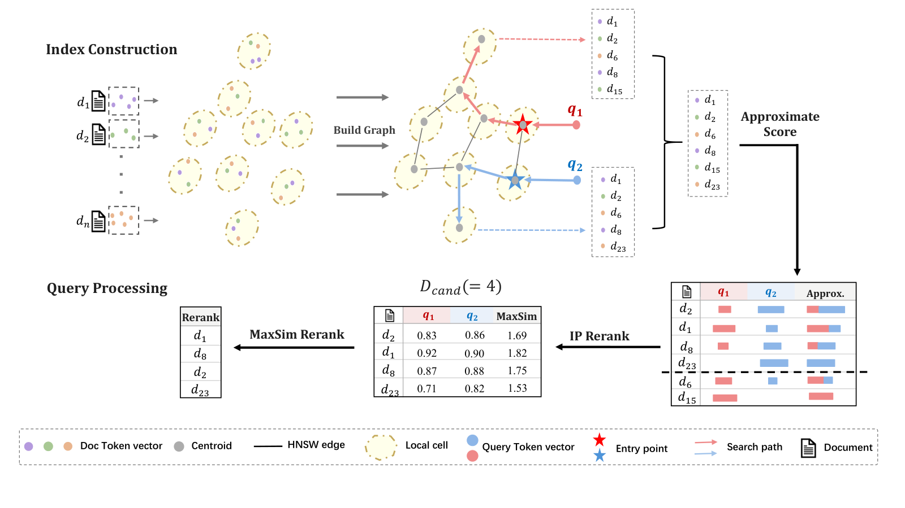

# SIMQ：单质心图上的多向量检索与计数候选选择

[English](README-en.md)

> L1低成本机制组件；不是能力benchmark，未接入Evolve晋级。

## 论文信息

| 字段 | 内容 |
| --- | --- |
| 论文链接 | [SIMQ: A Single Graph-based Index for Multi-Vector Query](https://arxiv.org/abs/2611.22079v1)；[固定v1全文](https://arxiv.org/html/2611.22079v1) |
| 公司 / 作者机构 | 一作 Yifan Lu：Tongji University；按固定v1作者栏核对 |
| 首次公开日期 | 2026-11-17 02:01:39 UTC（arXiv v1） |
| 原作者开源代码 | 原文及其关联链接未找到/未核验公开的本论文专属作者代码。引用依赖或声称集成不等于已核验专属实现。 |
| 本地adapter / 稳定键 | `simq`；adapter为null，不冒充完整模型 |
| 本地复现代码目录 | `src/auto_research/foundation_models/simq.py` |

## 原始论文总结

### 背景与主要改动

ColBERT式MaxSim需要逐query token匹配文档token。SIMQ先均匀抽样token作初始聚合点，通过临时图分配剩余token，对过大cluster递归二分，归一化均值后建立一个质心图。查询只导航到少量质心，经质心到文档映射生成候选，最后才访问候选原始token精确重排，避免全query×centroid矩阵。

<!-- paper-figure:start -->
### 原论文关键图



图片来自[原论文](https://arxiv.org/pdf/2611.22079v1)，版权归原作者所有；为原图或PDF裁剪，不是本地结果。[出处与SHA256](assets/provenance.json)。
<!-- paper-figure:end -->

### 核心公式

$$
\mathcal M(d,Q)=\sum_i\max_{v\in V(d)}\langle q_i,v\rangle,\quad cnt(d)=\sum_i\mathbf1[d\in\mathcal U_i],\quad\tau=\max\{t:|\{d:cnt(d)\ge t\}|\ge N_{min}\}.
$$

§III/Alg1–2保留抽样、图引导分配、deferred二分、质心归一化、每token候选和精确MaxSim重排。§V/Alg3的SIMQ+在每token原始文档pool中按文档去重计数，不做TopDocs截断；边界count并列必须全部保留，候选数可以超过Nmin。当前Index用小型exact kNN邻接构图和有限Lloyd二分代替可扩展HNSW/VSAG后端，是明确的小数据后端差异，不复现工业build/QPS。

### 论文离线与线上效果

§VI在五个公开检索数据集上比较SIMQ/SIMQ+与PLAID、MUVERA、IGP和GEM的Recall–QPS／构建成本，不存在一个脱离recall和参数的统一倍数。论文说明图后端可替换且不同后端的质量／吞吐折衷不同。未报告生产线上A/B；本地随机12文档只检验分配、计数和重排不变量。

## 本地复现与边界

### 数据协议与代码映射

没有ColBERT编码、百万级token索引、残差压缩、完整HNSW或公平吞吐实验。重复seed不使随机向量变成语义能力评测；SIMQ+保留完整边界并列意味着rerank参数不是它的硬候选上限。完整五数据集矩阵成本过高，不复现（审查DONE）。

```bash
PYTHONPATH=src python -c 'from auto_research.foundation_models.simq import diagnostic; print(diagnostic(42, device="cpu"))'
```

### 结果、负控与边界

L1低成本机制组件；不是能力benchmark，未接入Evolve晋级。 种子42/43/44只验证显式夹具/小张量的数值和梯度，不是三次独立模型能力试验。CPU与实际GPU证据分别保存，不能用作者指标填充本地看板。

### 高成本完整实验

五个百万级多向量索引的完整Recall/QPS/构建时间矩阵成本高；PLAID基线另需GPU聚类。本地精确小图构建不等于可扩展HNSW。 **成本过高，不复现（审查DONE）**；不阻塞已声明的审查闭环，不进入自动训练或补跑队列。

### 同主题对照

HVMap解决不同编码器向量空间不能直接比较的问题，通过hub映射和双空间SCORE2联合重排；SIMQ假定同一规范化token空间，改变候选图组织和晚交互计算。前者的映射质量不由SIMQ的计数验证，后者的图效率也不由HVMap小张量loss证明。
