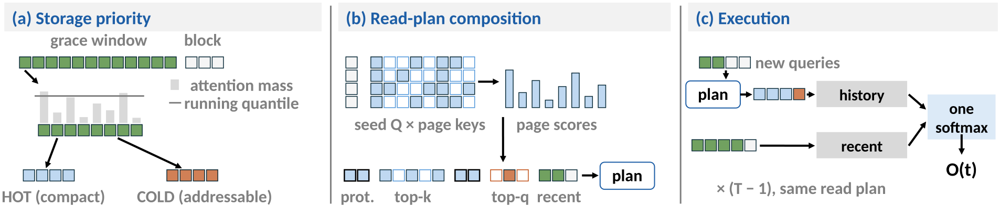

# RISA: recoverable storage and reusable sparse addresses

<!-- source-sha256: 41f070c246962e44f9ecd1b98c225126181fa84d444467ac666cb4ccb25334f4 -->

[简体中文](README.md)

> **L1 mechanism component, not a complete model.** Full experiments are **too costly; not reproduced (review DONE)**. No capability improvement or Evolve promotion is claimed.

## Paper information

| Field | Value |
| --- | --- |
| Paper | [arXiv:2611.22191v1](https://arxiv.org/abs/2611.22191v1); [fixed text](https://arxiv.org/html/2611.22191v1) |
| Institution/company | First author Xinrui Zhong: Rice University |
| Original publication | 2026-11-17T04:27:48Z (arXiv v1); separately observed announcement: 2026-11-18 |
| Authors' code | No released method-specific author source was found in fixed v1 and its author links. Dependency libraries are not counted as the paper code. |
| Local adapter/key | `risa`; adapter null; no Evolve integration |
| Local source | `src/auto_research/foundation_models/risa.py` |

## Original paper

### Motivation and changes

RISA separates persistent HOT/COLD storage priority from a temporary denoising-block read plan. Unread pages remain stored and can be recovered later. Seed queries score page extrema while protecting initial/recent HOT pages and mandatory recent/current rows. [Reviewed method](https://arxiv.org/html/2611.22191v1#S3): 4.1–4.3, 5.

### Key original figure

[](https://arxiv.org/html/2611.22191v1)

The fixed-version author figure/table is not a local result. Scientific content was not redrawn. Copyright remains with the original authors; no open-image license is inferred. [Source, crop and SHA256](assets/provenance.json).

### Equations

$$
u_p=\sum_q\max(q^Tk_p^{min},q^Tk_p^{max}),\qquad S=R\cup\operatorname{rows}(H^{prot}\cup Top_k(H^{eligible})\cup Top_q(C)).
$$

The maximum is taken after two complete dot products, not the coordinate-wise QUEST bound. Later steps reuse addresses, not attention outputs, and recompute one softmax with current queries/KV. Exact storage does not imply dense-equivalent decoding.

~~~mermaid
flowchart LR
 S[Exact HOT and COLD storage] --> P[Seed page-extrema scores]
 P --> B[Protected bounded address plan]
 B --> A[Fresh queries with one joint softmax]
~~~

### Reported results and evidence

The reported quality/efficiency relies on the full paper configuration, which was not reproduced locally. No production randomized-traffic A/B is reported for this method. Benchmarks, single-device serving measurements, or using Meta/Google models are not production A/B evidence.

## Local implementation

### Protocol and code mapping

Executes mass-only grace priorities, HOT/COLD/mandatory address selection and gathered attention on caller-owned exact storage. It omits native block-diffusion decoding, learned admission correction, seed commitment/finalization and CUDA-graph serving.


```bash
PYTHONPATH=src python -c 'from auto_research.foundation_models.risa import diagnostic; print(diagnostic(42, device="cpu"))'
PYTHONPATH=src python -m pytest tests/test_nov18_latest_foundation.py -q
```

CPU seeds42/43/44passed the mechanism checks on synthetic tensors, not capability benchmarks. CUDA acceptance requires the [real-device receipt](../../gpu-validations/risa-a100-20261118-latest.json); this text does not preclaim a GPU pass.

### Same-topic comparison and boundaries

DropKV evicts KV to reduce storage. RISA limits recurring reads while retaining COLD for recovery. Read and storage budgets cannot be exchanged as memory/latency conclusions. Multiple seeds do not upgrade these mechanism checks into L2/L3 capability evidence.

### High-cost full experiments

DreamReasoner8B/SDAR8B/LLaDA2.2-mini,BF16H200,16K–128Kcontexts,512output-tokentrajectories andmultiplebenchmarks; full campaign high cost.

This is a configuration-based cost assessment, not measured local duration. The budget is one A100 or A30, or the local Mac. No multi-GPU capacity, costly probing run, large-resource download or automatic retry is assumed. Full experiments are **too costly; not reproduced (review DONE)** and do not block review closure.
