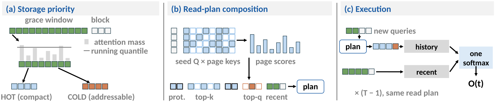

# RISA：保留可恢复KV存储，只缓存稀疏读取地址

[English](README-en.md)

> **L1机制组件；不是完整模型**。完整实验**成本过高，不复现（审查 DONE）**；无能力提升或Evolve晋级声明。

## 论文信息

| 字段 | 内容 |
| --- | --- |
| 论文链接 | [arXiv:2611.22191v1](https://arxiv.org/abs/2611.22191v1)；[固定全文](https://arxiv.org/html/2611.22191v1) |
| 公司 / 机构 / 学校 | 一作 Xinrui Zhong：Rice University |
| 首次公开日期 | 2026-11-17T04:27:48Z（arXiv v1）；公告日期另记为 2026-11-18 |
| 原作者开源代码 | 固定v1及原作者链接未找到可核验的已发布方法源码；未找到/未发布，不把依赖库算原作者代码。 |
| 本地 adapter / key | `risa`；`adapter: null`，未接入Evolve |
| 本地复现代码目录 | `src/auto_research/foundation_models/risa.py` |

## 原始论文总结

### 背景与主要改动

RISA区分长期HOT/COLD存储优先级和当前denoising block的短期read plan。未读取页面不被删除，后续query可以恢复COLD。seed根据page min/max key摘要评分，保护初始/近期HOT并加入mandatory近期/current行。 [已核方法位置](https://arxiv.org/html/2611.22191v1#S3)：4.1–4.3, 5。

<!-- paper-figure:start -->
### 原论文关键图

[](https://arxiv.org/html/2611.22191v1)

原图/原表来自固定v1，未经科学内容改绘；是作者方法或结果，不是本地测量。[来源、裁切和SHA256](assets/provenance.json)。图片来自[原论文](https://arxiv.org/html/2611.22191v1)，版权归原作者所有。
<!-- paper-figure:end -->

### 核心公式

$$
u_p=\sum_q\max(q^Tk_p^{min},q^Tk_p^{max}),\qquad S=R\cup\operatorname{rows}(H^{prot}\cup Top_k(H^{eligible})\cup Top_q(C)).
$$

max在两个完整dot之后进行，不是QUEST的逐坐标上界。后续步只重用地址，用新query/current KV重新计算同一个softmax；不能把history和current分别归一化后平均。精确存储不等于dense-equivalent解码。

~~~mermaid
flowchart LR
 S[Exact HOT and COLD storage] --> P[Seed page-extrema scores]
 P --> B[Protected bounded address plan]
 B --> A[Fresh queries with one joint softmax]
~~~

### 论文离线与线上效果

原文以其完整训练/推理与评测配置讨论效果；本地没有复跑该矩阵，不把论文数值写成本地指标。未报告本文方法的生产随机流量线上A/B；benchmark、单卡服务计时或使用Meta/Google模型本身不是A/B证据。具体质量/速度与成本配置须一起阅读。

## 本地复现

### 数据协议与代码映射

执行mass-only grace优先级、HOT/COLD/mandatory地址选择与实际gather attention；输入store由调用者持有。没有native块扩散解码、learned admission correction、seed提交/finalization或CUDA graph engine。


```bash
PYTHONPATH=src python -c 'from auto_research.foundation_models.risa import diagnostic; print(diagnostic(42, device="cpu"))'
PYTHONPATH=src python -m pytest tests/test_nov18_latest_foundation.py -q
```

CPU seeds42/43/44已通过本组件检查；仅为合成张量机制诊断，不含公开能力benchmark。CUDA验收以[真实GPU回执](../../gpu-validations/risa-a100-20261118-latest.json)为准，不能由CPU通过替代；文档本身不提前宣称GPU已通过。

### 同主题比较与边界

DropKV实际驱逐KV以缩减存储；RISA主要限制每步读取但保留COLD以便恢复。读得少与存得少是不同预算，不能互换显存/延迟结论。 本地结果只支撑上面列明的算子合同，多个seed不将L1升级成公开能力L2/L3。

### 高成本完整实验

原文在H200上以BF16测试DreamReasoner/SDAR 8B与LLaDA2.2-mini，长度16K—128K、512输出token轨迹及多能力benchmark。完整解码/预算/上下文矩阵高成本。

以上是配置依据的成本判断，不是本地实测耗时。资源预算为单A100或A30，或本地Mac；不假定多卡、不断扩大或试训证明成本。**成本过高，不复现（审查 DONE）**；不下载大模型/数据，不启动完整矩阵，不自动重试，不阻塞本轮审查闭环。
