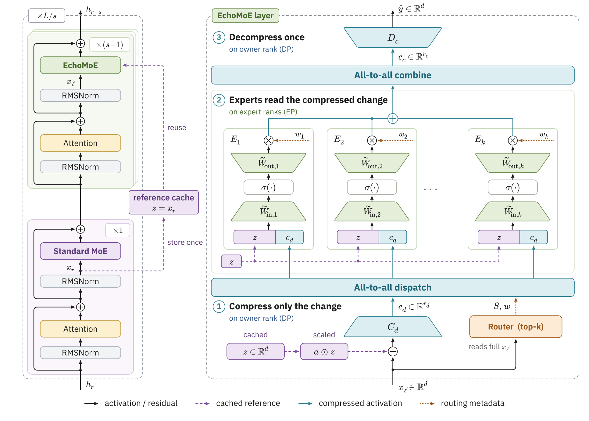

# EchoMoE: compressed changes around cached reference states

<!-- source-sha256: a939116286b19789b759c661c55b55fd02d367f882fe538d9d11251e867f42b9 -->

[简体中文](README.md)

> **L1 mechanism component, not a complete model.** Full experiments are **too costly; not reproduced (review DONE)**. No capability improvement or Evolve promotion is claimed.

## Paper information

| Field | Value |
| --- | --- |
| Paper | [arXiv:2611.22215v1](https://arxiv.org/abs/2611.22215v1); [fixed text](https://arxiv.org/html/2611.22215v1) |
| Institution/company | First author Fengyuan Liu: Mila / McGill University |
| Original publication | 2026-11-17T04:52:41Z (arXiv v1); separately observed announcement: 2026-11-18 |
| Authors' code | [Author repository](https://github.com/McGill-NLP/EchoMoE), verified HEAD `c211186cdd7ccd9315f5f061c7cc56f6dc725f53`. No upstream source was copied; its license was not separately verified. |
| Local adapter/key | `echomoe`; adapter null; no Evolve integration |
| Local source | `src/auto_research/foundation_models/echomoe.py` |

## Original paper

### Motivation and changes

A group first broadcasts reference z. Later layers send a compressed code for x-a⊙z, while routing still reads full x. Folding absorbs reference reconstruction and dispatch decoding into gate/up weights and combine compression into down weights. [Reviewed method](https://arxiv.org/html/2611.22215v1#S3): 4.1–4.4, 5.1, G.1.

### Key original figure

[](https://arxiv.org/html/2611.22215v1)

The fixed-version author figure/table is not a local result. Scientific content was not redrawn. Copyright remains with the original authors; no open-image license is inferred. [Source, crop and SHA256](assets/provenance.json).

### Equations

$$
c_d=C_d(x-a\odot z),\quad \hat x=Gz+D_dc_d,\qquad \widetilde W_{in}=[W_g;W_u][G,D_d],\quad \widetilde W_{out}=C_cW_{down},\quad y=D_c\sum_iw_i\widetilde W_{out,i}\operatorname{SwiGLU}(\widetilde W_{in,i}[z;c_d]).
$$

Folding is algebraically equivalent to the compressed model, not lossless recovery of the original backbone. The paper also uses projection-weighted initialization followed by KL distillation and next-token adaptation. Analytic bytes are not measured RDMA traffic.

~~~mermaid
flowchart LR
 X[Full x and cached reference z] --> C[Compressed difference]
 C --> F[Folded expert SwiGLU]
 F --> R[Compressed weighted combine]
 R --> D[One owner-side decoder]
~~~

### Reported results and evidence

The reported quality/efficiency relies on the full paper configuration, which was not reproduced locally. No production randomized-traffic A/B is reported for this method. Benchmarks, single-device serving measurements, or using Meta/Google models are not production A/B evidence.

## Local implementation

### Protocol and code mapping

Executes nonreference dispatch/combine compression, expert SwiGLU, routed aggregation, folded/unfolded output and gradient parity, and analytic traffic. It omits collectives, asynchronous broadcast and full-model adaptation.


```bash
PYTHONPATH=src python -c 'from auto_research.foundation_models.echomoe import diagnostic; print(diagnostic(42, device="cpu"))'
PYTHONPATH=src python -m pytest tests/test_nov18_latest_foundation.py -q
```

CPU seeds42/43/44passed the mechanism checks on synthetic tensors, not capability benchmarks. CUDA acceptance requires the [real-device receipt](../../gpu-validations/echomoe-a100-20261118-latest.json); this text does not preclaim a GPU pass.

### Same-topic comparison and boundaries

MoEZip protects routing-sensitive KV entries. EchoMoE compresses expert-parallel activation communication. Their different storage/traffic targets make compression ratios incomparable as throughput evidence. Multiple seeds do not upgrade these mechanism checks into L2/L3 capability evidence.

### High-cost full experiments

Qwen3-30B-A3B and four16B–30B models,4.32Badaptationtokens,4DGXH100nodes/32GPUs; full experiments high cost.

This is a configuration-based cost assessment, not measured local duration. The budget is one A100 or A30, or the local Mac. No multi-GPU capacity, costly probing run, large-resource download or automatic retry is assumed. Full experiments are **too costly; not reproduced (review DONE)** and do not block review closure.
